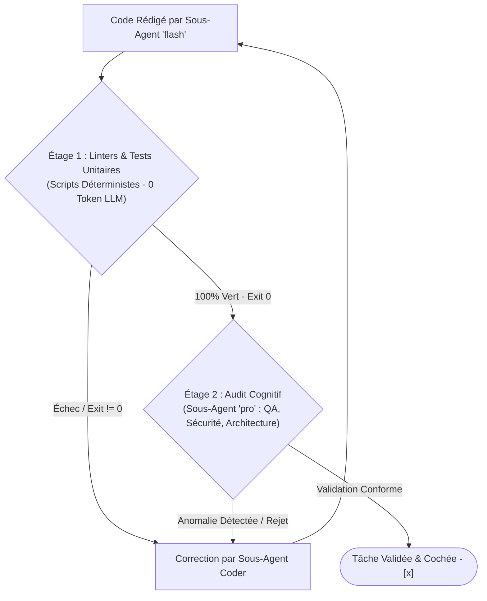

# CONSTITUTION TECHNIQUE & RÈGLES D'INGÉNIERIE (`PROJECT.md`)

> **Loi technique suprême :** Ce document fixe l'architecture d'ingénierie, le profil opérationnel, la gouvernance des modèles IA Antigravity, la politique de tests non négociable et l'entonnoir de validation.

---

## 1. PROFIL DU PROJET (`PROJECT_PROFILE`)

Chaque projet adopte un profil contextuel qui conditionne les contraintes produit et architecturales :

* **PROFIL ACTIF :** `PROJECT_PROFILE: [global_saas | emerging_market_3g | mobile_consumer | cli_devtools | api_platform]`

### Spécificités par Profil :
* **`global_saas` :** Multi-tenant, conformité SOC2/RGPD, billing Stripe/LemonSqueezy, SSO SAML, observabilité OpenTelemetry.
* **`emerging_market_3g` :** Offline-first strict, payload session < 1.5 Mo, passerelles Mobile Money (USSD asynchrone), SMS OTP, adresses sans codes postaux.
* **`mobile_consumer` :** Touch 44x44px minimum, gestures 60 fps, batterie/CPU préservés, deep links WhatsApp/stores.
* **`cli_devtools` :** Démarrage instantané (< 100ms), zéro dépendance runtime lourde, flags POSIX conformes, stdout structuré JSON optionnel.
* **`api_platform` :** OpenAPI 3.1 contract-first, rate limiting granulaire, idempotence distribuée Redis, latence p99 < 50ms.

---

## 2. STACK TECHNIQUE OFFICIELLE DU PROJET

* **Écosystème & Framework :** `[Ex: Laravel 11 / Next.js 15 (App Router) / React 19 (Vite) / Expo SDK 52 / Go 1.23 / Fastify]`
* **Langage & Typage :** TypeScript (`"strict": true`, interdiction de `any`) / PHP 8.3 (`declare(strict_types=1);`) / Python 3.12 (`ruff` + `mypy`) / Go.
* **Base de Données Primaire :** `[Ex: PostgreSQL 16 (JSONB, GIN) / MySQL 8.0 / SQLite / LibSQL]`
* **Cache & Files d'Attente :** `[Ex: Redis 7.2 pour verrous d'idempotence, jobs asynchrones et sessions]`
* **Gestionnaire de Paquets :** `[pnpm / bun / npm / composer / uv / go mod]`
* **Spécification des Contrats d'API :** OpenAPI 3.1 (`openapi.yaml`) et collections Bruno (`.bru`) dans `bruno/`.
* **Ports Standards d'Exécution Locale :**
  - Frontend Web : `http://localhost:5173` (Vite) ou `http://localhost:3000` (Next.js)
  - Backend / API : `http://localhost:8000` (Laravel) ou `http://localhost:3000` (Nest/Fastify) ou `http://localhost:3333` (Adonis)
  - Mobile Metro (Expo / React Native) : `http://localhost:8081`

---

## 3. ROUTAGE COGNITIF STRICT DES MODÈLES (`invoke_subagent`)

Pour maximiser l'acuité intellectuelle tout en préservant le quota de tokens et la vélocité :

| Rôle de l'Agent / Sous-Agent | Paramètre `Model` | Modèle Cible | Justification & Périmètre |
| :--- | :--- | :--- | :--- |
| **Session Principale (Orchestrateur)** | `inherit` (ou `pro`) | `gemini-3.1-pro-high` | Stratégie, planification, coordination globale. |
| **Architecte & Pre-Mortem (`san-architect`)** | `pro` | `gemini-3.1-pro-high` | Modélisation de domaine, analyse de risques, ADR. |
| **Auditeur Sceptique & QA (`san-qa-auditor`)** | `pro` | `gemini-3.1-pro-high` | Présomption d'insuffisance, OWASP, critique pixels PNG. |
| **Sous-Agents de Code (`san-coder-*`)** | `flash` | `gemini-3.8-flash-high` | Écriture atomique cadrée, respect du contrat, tests. |
| **Artisan Designer (`san-designer-worker`)** | `flash` | `gemini-3.8-flash-high` | Layouts HTML/Tailwind, tokens, exports PNG. |
| **Exploration & Recherche (`san-researcher`)** | `flash` | `gemini-3.8-flash-high` | Cartographie rapide, matrice 2 approches, veille RFC. |
| **DevOps & Légal (`san-ops-*`, `san-growth-*`)** | `flash` | `gemini-3.8-flash-high` | Scripts CI/CD, Docker, conformité stores. |

---

## 4. INVARIANTS D'ORCHESTRATION & DISCIPLINE HARNESS

* **Zéro Solo-Coding en Ligne :** L'orchestrateur délègue impérativement toute feature ou refonte via `invoke_subagent`.
* **Fast-Track d'Hygiène Autorisé :** L'orchestrateur peut intervenir directement uniquement pour :
  1. Cocher les cases `- [x]` dans `/roadmaps/*.md` après vérification physique et exécution réelle des tests (`exit 0`).
  2. Déplacer une roadmap 100% achevée vers `/roadmaps/archives/`.
  3. Mettre à jour `CHANGELOG.md` (*Keep a Changelog*).
  4. Enrichir les règles `.agents/rules/*.md`.

---

## 5. POLITIQUE DE TESTS OBLIGATOIRE (ZÉRO TESTING THEATER)

Aucune fonctionnalité n'est acceptée sans suite automatisée au vert :

### A. Tests Unitaires & Métier (Domain Core)
* Logique métier pure testée sans mock du domaine ; isolation avec mocks des passerelles externes.
* Couverture stricte des calculs sensibles, autorisations (RBAC/Policies) et invariants de transition d'état.

### B. Tests d'Intégration d'API (OpenAPI & Bruno)
* Validation des routes avec scénarios nominaux (`200 OK`, `201 Created`) et erreurs aux limites (`400`, `401`, `403`, `422`).
* Transactions de base de données obligatoires sur toute opération d'écriture multi-tables.

### C. Validation de Composants UI (Les 5 États Invariants)
1. **État Idéal :** Rendu complet et équilibré.
2. **État Vide :** Message bienveillant et action d'amorce claire.
3. **État de Chargement (*Stale-While-Revalidate*) :** Squelette non bloquant, conservation des données antérieures lors d'un filtre.
4. **État d'Erreur :** Message actionnable avec bouton « Réessayer » (y compris quand données partielles présentes).
5. **État Hors-Ligne :** Données en cache local avec indicateur discret de synchronisation.

---

## 6. ENTONNOIR DE VÉRIFICATION EN 2 ÉTAGES (FAIL-CLOSED)

