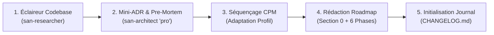

# `san_planner` — Expert en Planification de Projet, Architecture de Roadmaps et Ordonnancement

Ce runbook impératif régit la planification cartésienne et l'ordonnancement séquentiel des développements dans le framework **Antigravity (`san_*`)**. Il applique la méthode du chemin critique (CPM), verrouille les choix d'ingénierie par un mini-ADR/Pre-Mortem et impose la règle de la **Preuve par le Code**.

---

## Protocole d'Exécution Séquentiel (Runbook)

### Étape 1 : Cartographie Factuelle via `san-researcher`
1. Si le besoin amont est flou ou non chiffré, router d'abord vers [san_brainstorming](../san_brainstorming/SKILL.md).
2. Spawner l'éclaireur **`san-researcher`** (`Model: 'flash'`, sandbox) pour auditer l'état réel de la codebase :
   - Schémas BDD existants, migrations et indexations.
   - Points d'entrée API, routes et contrôleurs actuels.
   - Commandes et état passant des suites de tests.

### Étape 2 : Mini-ADR & Red-Team Pre-Mortem via `san-architect`
1. Spawner l'architecte principal **`san-architect`** (`Model: 'pro'`, lecture seule) pour arbitrer la stratégie :
   - **Comparatif de 2 Architectures Viables :** Confronter deux options réalistes avec leurs compromis lucides (interdiction de l'option C épouvantail).
   - **Pre-Mortem Systémique :** Identifier par avance les 3 principaux risques d'échec (points de rupture, conditions de course, timeouts réseau) et définir leurs mitigations.
2. Ce livrable constitue la **Section 0 obligatoire** de la feuille de route.

### Étape 3 : Séquençage CPM & Calibration par Profil (`PROJECT_PROFILE`)
1. Structurer l'effort selon le [Guide des 6 Phases CPM](references/cpm_phases_guide.md) :
   - *Phase 1 :* Contrats d'API & Fondations (Migrations, Zod, Bruno, DTOs).
   - *Phase 2 :* Logique Métier & Backend Core (Services, tests unitaires).
   - *Phase 3 :* Interface Client (Chorégraphie des 5 états, `BRAND.md`, 60 fps).
   - *Phase 4 :* Résilience Réseau Dégradé (`Idempotency-Key`, Outbox locale).
   - *Phase 5 :* Entonnoir Qualité E2E (Quality Gates scriptés, OWASP, p95 $< 100\text{ms}$).
   - *Phase 6 :* Clôture Industrielle (Test manuel 3 min, `CHANGELOG.md`, archivage).
2. **Adaptation contextuelle :**
   - *`cli_devtools` :* Tranches verticales complètes *Tracer Bullet* (commande par commande) autorisées.
   - *`emerging_market` :* Verrou 3G, Mobile Money asynchrone et bundle $< 300\text{ Ko}$ renforcés en Phase 4.

### Étape 4 : Rédaction Normative de la Roadmap
1. Créer `/roadmaps/[PHASE]_[PROBLEMATIQUE]_[JJMMAAAA].md` depuis [ROADMAP_TEMPLATE.md](templates/ROADMAP_TEMPLATE.md).
2. Intégrer les commandes de validation officielles issues de la [Matrice des Tests par Stack](references/test_stack_matrix.md).
3. **Règle Absolue de Preuve par le Code :** Aucune case ne peut être cochée (`- [x]`) sans fichier physique existant sur le disque ET test automatisé vert.

### Étape 5 : Traçabilité Documentaire & Handoff vers `san_executer`
1. Initialiser ou enrichir `CHANGELOG.md` sous la section `[Unreleased]` via [CHANGELOG_TEMPLATE.md](templates/CHANGELOG_TEMPLATE.md).
2. Transmettre la roadmap active à [san_executer](../san_executer/SKILL.md) pour ordonnancer les sous-agents d'implémentation.
3. En fin de chantier, exécuter [archive_roadmap.sh](scripts/archive_roadmap.sh) pour certifier 100 % de coches prouvées.

---

## Invariants Non Négociables
1. **Section 0 Indispensable :** Aucune roadmap n'est validée sans son mini-ADR (2 architectures) et son Pre-Mortem (3 risques).
2. **Souveraineté des Tests :** Une tâche sans commande de test validante ne peut jamais être déclarée achevée.
3. **Archivage Tout-ou-Rien :** Le moindre `- [ ]` orphelin stoppe net le script d'archivage avec exit code 1.
