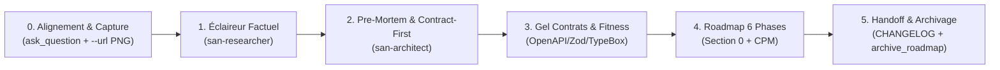

# `san_planner` — Planification Contract-First, Fitness Functions & Dual-Harness

Ce runbook régit la planification cartésienne et l'ordonnancement des développements dans **SAN AI Harness (`san_*` v3.0)**. Il impose l'alignement socratique amont, la méthode du chemin critique (CPM), le **Contract-First**, les **Architectural Fitness Functions**, l'orchestration **Dual-Harness** (`.agents/models.json` via `san-harness models`) et la **Preuve par le Code**.

---

## Protocole d'Exécution Séquentiel (Runbook)



### Étape 0 : Verrou d'Alignement Socratique & Inspection Visuelle (OBLIGATOIRE)
1. **Avant de planifier ou déléguer**, lever toute ambiguïté critique (cibles UI, périmètre MVP, contraintes) via **`ask_question`** (Antigravity) ou **`question`** (OpenCode V2.3) — jamais de supposition silencieuse.
2. Si l'utilisateur cite une URL ou un site de référence, **capturer les pixels réels** avant toute spécification UI :
   ```bash
   node .agents/skills/san_designer/scripts/export_png.mjs --url=<https://...> --viewports=desktop,mobile
   ```
   Puis lire les PNG avec `read_file` / `view_file` et poser les questions de cadrage restantes.

### Étape 1 : Reconnaissance Factuelle (`san-researcher` ou inspection directe)
1. Si le besoin amont reste flou ou non chiffré, router d'abord vers [san_brainstorming](../san_brainstorming/SKILL.md).
2. Pour un chantier simple/mono-couche, explorer directement les fichiers pertinents (`rg`, `read_file`) ; pour une codebase complexe/multi-couches, spawner **`san-researcher`** via `swarm` (`agy.executor`) ou `san_swarm` / `subagent` (`opencode.executor` dans `.agents/models.json`) pour auditer schémas BDD, APIs et suites de tests existantes.

### Étape 2 : Pre-Mortem, Contract-First & Fitness Functions via `san-architect`
Pour tout chantier structurant ou multi-couches, spawner **`san-architect`** en lecture seule (`swarm` | `san_swarm` selon `.agents/models.json`) pour livrer la **Section 0 obligatoire** :
- **Mini-ADR (2 Architectures Viables) :** Comparer deux options réalistes avec compromis lucides (zéro option épouvantail).
- **Pre-Mortem Systémique :** Anticiper les 3 causes exactes de rupture à 6 mois et leurs mitigations.
- **Architecture Contract-First :** Spécifier les contrats partagés à **générer et geler** (OpenAPI 3.1 + schémas **Zod** / **TypeBox** + DTOs + Bruno `.bru`) **avant** tout codage parallèle Front/Back.
- **Architectural Fitness Functions :** Définir les tests automatisés d'étanchéité inter-modules, d'absence de cycles de dépendances et de budgets techniques (`< 220` lignes UI, latence p95 `< 100ms`).

### Étape 3 : Séquençage CPM & Calibration par Profil (`PROJECT_PROFILE`)
1. Structurer l'effort selon le [Guide des 6 Phases CPM](references/cpm_phases_guide.md) :
   - *Phase 1 :* **Contract-First & Fondations** — Génération et gel OpenAPI 3.1 / Zod / TypeBox, Bruno, migrations, setup des Fitness Functions. *(Verrou : 100% gelé avant tout codage parallèle Front/Back.)*
   - *Phase 2 :* Logique Métier & Backend Core (Services, transactions ACID, tests réels).
   - *Phase 3 :* Interface Client (Standard UI 5 états non-destructifs, Motion System `cubic-bezier` + `prefers-reduced-motion`, Studio Duel UI, cibles `>= 44x44px`, `tabular-nums`).
   - *Phase 4 :* Résilience Réseau Dégradé (`Idempotency-Key`, Outbox locale).
   - *Phase 5 :* Entonnoir Qualité E2E (Quality Gates, Fitness Functions, OWASP, audit géométrique DOM, `exit 0`).
   - *Phase 6 :* Clôture Industrielle (Test manuel 3 min, `CHANGELOG.md`, archivage).
2. **Adaptation contextuelle :**
   - *`cli_devtools` :* Tranches verticales complètes *Tracer Bullet* par contrat gelé autorisées.
   - *`emerging_market_3g` :* Verrou 3G, Mobile Money asynchrone et bundle $< 300\text{ Ko}$ renforcés en Phase 4.

### Étape 4 : Rédaction Normative de la Roadmap
1. Créer `/roadmaps/[PHASE]_[PROBLEMATIQUE]_[JJMMAAAA].md` depuis [ROADMAP_TEMPLATE.md](templates/ROADMAP_TEMPLATE.md).
2. Intégrer les commandes de validation issues de la [Matrice des Tests par Stack](references/test_stack_matrix.md).
3. **Preuve par le Code :** Zéro coche `- [x]` sans fichier physique et test/fitness gate retournant `exit 0`.

### Étape 5 : Traçabilité Documentaire & Handoff vers `san_executer`
1. Enrichir `CHANGELOG.md` sous `[Unreleased]` via [CHANGELOG_TEMPLATE.md](templates/CHANGELOG_TEMPLATE.md).
2. Transmettre la roadmap active à [san_executer](../san_executer/SKILL.md) pour exécution (`Plan → Execute` simple ou `swarm` / `san_swarm`).
3. En fin de chantier, exécuter [archive_roadmap.sh](scripts/archive_roadmap.sh) pour certifier 100 % de coches prouvées.

---

## Invariants Non Négociables
1. **Section 0 & Contrats Gelés :** Aucune roadmap multi-couches validée sans Mini-ADR, Pre-Mortem, contrats OpenAPI/Zod/TypeBox gelés et Fitness Functions définies.
2. **Zero Parallel Drift :** Interdiction de coder Front et Back en parallèle avant le gel des contrats de Phase 1.
3. **Souveraineté des Tests & Fitness :** Une tâche sans test ni fitness function au vert (`exit 0`) ne peut jamais être cochée `- [x]`.
4. **Archivage Tout-ou-Rien :** Le moindre `- [ ]` orphelin stoppe [archive_roadmap.sh](scripts/archive_roadmap.sh) avec `exit 1`.
