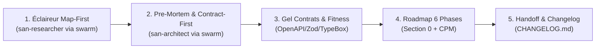

# `san_planner` — Planification Contract-First, Fitness Functions & Ordonnancement `Swarm`

Ce runbook impératif régit la planification cartésienne et l'ordonnancement des développements dans le framework **Antigravity (`san_*` v2.1)**. Il impose la méthode du chemin critique (CPM), le **Contract-First**, les **Architectural Fitness Functions** et la **Preuve par le Code**.

---

## Protocole d'Exécution Séquentiel (Runbook)

### Étape 1 : Cartographie Factuelle Map-First via `san-researcher`
1. Si le besoin amont est flou ou non chiffré, router d'abord vers [san_brainstorming](../san_brainstorming/SKILL.md).
2. Spawner **`san-researcher`** via `swarm(action: "add", model: "gemini-4-hydrogen-xhigh", ...)` (jamais `invoke_subagent(Model: "inherit")` sur `Argon`/`Carbon`) en lisant d'abord `.agents/cache/REPO_MAP.md` pour auditer la codebase réelle :
   - Schémas BDD existants, migrations, indexations et modules/frontières.
   - Points d'entrée API, contrats existants et état passant des suites de tests.

### Étape 2 : Pre-Mortem, Contract-First & Fitness Functions via `san-architect`
1. Spawner **`san-architect`** via `swarm(action: "add", model: "gemini-4-hydrogen-xhigh", ...)` (lecture seule) pour livrer la **Section 0 obligatoire** :
   - **Mini-ADR (2 Architectures Viables) :** Comparer deux options réalistes avec compromis lucides (zéro option épouvantail).
   - **Pre-Mortem Systémique :** Anticiper les 3 causes exactes de rupture à 6 mois et leurs mitigations.
   - **Architecture Contract-First :** Spécifier les contrats partagés à **générer et geler** (OpenAPI 3.1 + schémas **Zod** / **TypeBox** + DTOs + Bruno `.bru`) **avant** tout codage parallèle Front/Back.
   - **Architectural Fitness Functions :** Définir les tests automatisés d'étanchéité inter-modules, d'absence de cycles de dépendances et de budgets techniques (`< 220` lignes UI, latence p95 `< 100ms`, bundle budget) exécutés au Quality Gate.

### Étape 3 : Séquençage CPM & Calibration par Profil (`PROJECT_PROFILE`)
1. Structurer l'effort selon le [Guide des 6 Phases CPM](references/cpm_phases_guide.md) :
   - *Phase 1 :* **Contract-First & Fondations** — Génération et gel OpenAPI 3.1 / Zod / TypeBox, Bruno, migrations, setup des Fitness Functions. *(Verrou : 100% gelé avant tout codage parallèle Front/Back.)*
   - *Phase 2 :* Logique Métier & Backend Core (Services, transactions ACID, tests réels).
   - *Phase 3 :* Interface Client (Standard UI 5 états non-destructifs, Motion System `cubic-bezier` + `prefers-reduced-motion`, Studio Duel UI, cibles `>= 44x44px`, `tabular-nums`).
   - *Phase 4 :* Résilience Réseau Dégradé (`Idempotency-Key`, Outbox locale).
   - *Phase 5 :* Entonnoir Qualité E2E (Quality Gates, Fitness Functions, OWASP, audit géométrique DOM, `.agents/cache/last-gate-status.json`).
   - *Phase 6 :* Clôture Industrielle (Test manuel 3 min, `CHANGELOG.md`, archivage).
2. **Adaptation contextuelle :**
   - *`cli_devtools` :* Tranches verticales complètes *Tracer Bullet* par contrat gelé autorisées.
   - *`emerging_market_3g` :* Verrou 3G, Mobile Money asynchrone et bundle $< 300\text{ Ko}$ renforcés en Phase 4.

### Étape 4 : Rédaction Normative de la Roadmap
1. Créer `/roadmaps/[PHASE]_[PROBLEMATIQUE]_[JJMMAAAA].md` depuis [ROADMAP_TEMPLATE.md](templates/ROADMAP_TEMPLATE.md).
2. Intégrer les commandes de validation issues de la [Matrice des Tests par Stack](references/test_stack_matrix.md).
3. **Preuve par le Code :** Zéro coche `- [x]` sans fichier physique et test/fitness gate retournant `exit 0`.

### Étape 5 : Traçabilité Documentaire & Handoff vers `san_executer`
1. Enrichir `CHANGELOG.md` sous `[Unreleased]` via [CHANGELOG_TEMPLATE.md](templates/CHANGELOG_TEMPLATE.md).
2. Transmettre la roadmap active à [san_executer](../san_executer/SKILL.md) pour exécution parallèle (`swarm` / `run_workflow`).
3. En fin de chantier, exécuter [archive_roadmap.sh](scripts/archive_roadmap.sh) pour certifier 100 % de coches prouvées.

---

## Invariants Non Négociables
1. **Section 0 & Contrats Gelés :** Aucune roadmap validée sans Mini-ADR, Pre-Mortem, contrats OpenAPI/Zod/TypeBox gelés et Fitness Functions définies.
2. **Zero Parallel Drift :** Interdiction de coder Front et Back en parallèle avant le gel des contrats de Phase 1.
3. **Souveraineté des Tests & Fitness :** Une tâche sans test ni fitness function au vert (`exit 0`) ne peut jamais être cochée `- [x]`.
4. **Archivage Tout-ou-Rien :** Le moindre `- [ ]` orphelin stoppe [archive_roadmap.sh](scripts/archive_roadmap.sh) avec `exit 1`.
