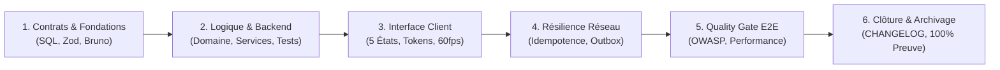

# Guide du Chemin Critique (CPM) & Adaptation par Profil de Projet

Ce guide décrit la méthodologie séquentielle d'ingénierie appliquée par `san_planner` pour ordonnancer les roadmaps techniques sans régression ni dette technique masquée.

---

## 1. Philosophie du Chemin Critique & Étanchéité Stricte

Le découpage séquentiel garantit que les contrats d'interface et la modélisation des données précèdent toujours l'interface client. La règle d'or est l'**étanchéité absolue** : la Phase $N+1$ est verrouillée tant que la Phase $N$ n'a pas validé 100 % de ses livrables avec tests au vert.

---

## 2. Les 6 Phases Séquentielles Détaillées

### PHASE 1 : Fondations, Modélisation & Contrats d'API (Contract-First)
- Migrations de base de données avec index optimisés et contraintes d'intégrité.
- Spécifications des contrats d'endpoints (`.agents/rules/technicals/endpoints/*.md`).
- Collections de tests Bruno (`.bru`) et schémas Zod ou DTOs TypeScript stricts exportés.
- *Critère de sortie :* Types compilés sans erreur (`tsc --noEmit`), schémas verrouillés.

### PHASE 2 : Domaine Métier & Backend Core
- Logique métier isolée dans des Services / Actions purs en conformité SOLID.
- Validation stricte des requêtes, authentification, middlewares de rate limiting.
- Files d'attente asynchrones (Redis) et sécurisation des webhooks (HMAC, anti-replay).
- *Critère de sortie :* 100 % des tests unitaires et intégration au vert + validation Bruno CLI (`bru run`).

### PHASE 3 : Interface Client & 5 États Obligatoires
- Composants typés consommant les types de la Phase 1 (zéro type `any`).
- Implémentation non-destructive des 5 états UI :
  1. **Idéal :** Rendu fluide et complet des données réelles.
  2. **Vide :** Micro-copie empathique guidant immédiatement vers l'action première.
  3. **Chargement :** Skeletons animés à 60 fps respectant la géométrie exacte des composants finaux.
  4. **Erreur :** Message explicite orienté solution avec bouton de réessai (`Retry`).
  5. **Succès / Hors-ligne :** Feedback visuel instantané non bloquant.
- Respect strict des tokens de `BRAND.md` (zéro valeur magique CSS).

### PHASE 4 : Résilience E2E & Réseau Dégradé
- En-tête obligatoire `Idempotency-Key` avec verrou Redis pour toute mutation sensible.
- File d'attente hors-ligne (*Offline Outbox* avec SQLite/MMKV/IndexedDB) et rejeu automatique ordonné.
- Retries exponentiels avec jitter et dégradation gracieuse en cas de rupture réseau.

### PHASE 5 : Entonnoir d'Assurance Qualité & Sécurité
- Étage 1 : Exécution des Quality Gates scriptés (`qa_security_gate.sh`, `backend_quality_gate.sh`, `front_quality_gate.sh`).
- Étage 2 : Audit OWASP (prévention failles BOLA/IDOR, XSS, CSRF) et métriques de latence p95 $< 100\text{ms}$.

### PHASE 6 : Fast-Track Documentaire & Clôture
- Scénario de test manuel chronométré en moins de 3 minutes.
- Mise à jour de `CHANGELOG.md` selon Keep a Changelog.
- Archivage déterministe via `scripts/archive_roadmap.sh` sous condition stricte de 100 % de cases cochées sur preuve.

---

## 3. Adaptation par Profil de Projet (`PROJECT_PROFILE`)

- **`emerging_market` :** Accent renforcé en Phase 4 (Résilience 3G/EDGE, bundles ultra-légers $< 300\text{ Ko}$, réconciliation Mobile Money asynchrone).
- **`global_saas` :** Accent sur les abonnements, la conformité multi-tenant, les webhooks Stripe et les Core Web Vitals.
- **`mobile_consumer` :** Accent sur la réactivité gestuelle 60 fps, les notifications push et la gestion fine du cycle de vie de l'application en tâche de fond.
- **`cli_devtools` :** Tranches verticales *Tracer Bullet* autorisées (découpage par sous-commandes complètes de bout en bout), zéro contrainte 3G, focus sur la vitesse d'exécution locale et les codes de sortie POSIX.
- **`api_platform` :** Accent maximal sur les contrats OpenAPI/Zod, la latence p95, les verrous d'idempotence et les collections Bruno.
