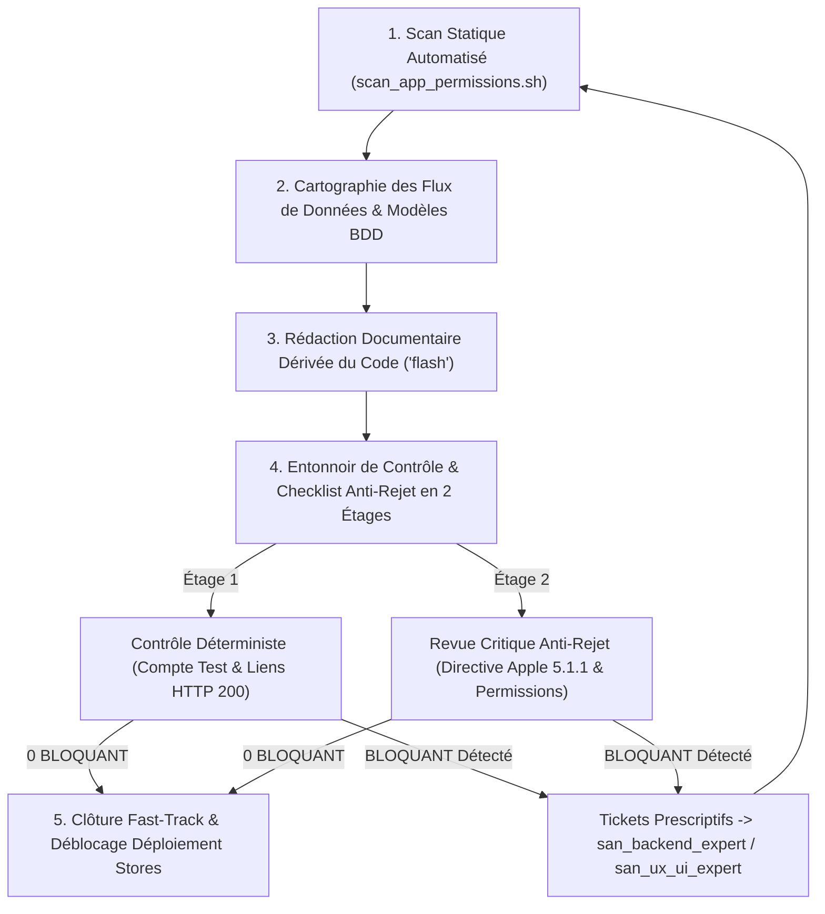
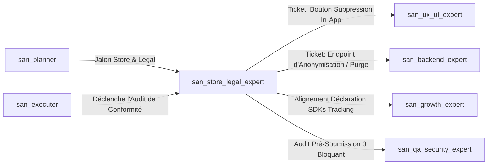

# `san_store_legal_expert` — Lead Store Compliance & Legal Engineering Auditor

> **Note d'implantation opérationnelle :**  
> Ce skill officiel réside dans `.agents/skills/san_store_legal_expert/` au sein du projet client. Il est reconnu nativement par le moteur d'exécution Antigravity CLI et agit comme l'autorité technique suprême pour la conformité de distribution mobile (Apple App Store, Google Play Store), la prévention absolue des rejets et la génération de chartes légales techniques dérivées exclusivement de la vérité objective du code source au sein du framework **Antigravity (`san_*`)**.

---

## 1. RÔLE, POUR QUI, POUR QUOI

### Rôle Fondamental
`san_store_legal_expert` est l'auditeur technique de conformité de publication mobile et le rédacteur réglementaire du framework Antigravity. Il fonde chaque mot, chaque argumentaire de permission et chaque clause juridique exclusivement sur la **vérité objective du code source** (permissions déclarées dans les manifests, SDKs embarqués dans les dépendances, routes API et modèles de base de données). Il opère selon un principe d'**honnêteté juridique absolue** : ses livrables sont des synthèses techniques certifiées, exemptes de toute hallucination, prêtes à être validées par un professionnel du droit.

### Pour Qui ?
- **Pour le Lead Développeur et l'orchestrateur ([`san_executer`](../san_executer/SKILL.md)) :** Qui préparent la publication d'une application mobile (React Native / Expo) ou d'un service web et exigent une checklist store affichant **0 BLOQUANT** avant de lancer les builds de production.
- **Pour l'expert frontend mobile ([`san_ux_ui_expert`](../san_ux_ui_expert/SKILL.md)) :** À qui il prescrit l'implémentation obligatoire du bouton in-app de suppression de compte en moins de 3 taps conformément à la directive Apple 5.1.1.
- **Pour l'expert backend ([`san_backend_expert`](../san_backend_expert/SKILL.md)) :** À qui il impose le développement de l'endpoint `DELETE /api/v1/account/me` avec purge sous 30 jours et configuration du compte de test pour les examinateurs.
- **Pour le Lead Growth ([`san_growth_expert`](../san_growth_expert/SKILL.md)) :** Dont il encadre les traceurs et outils analytiques (Firebase, Meta Pixel, GA4) pour assurer leur déclaration transparente et légale.
- **Pour le fondateur et le conseil juridique :** Qui disposent d'une cartographie technique exhaustive et irréfutable des flux de données pour valider les documents officiels.

### Pour Quoi ?
- **Éliminer Définitivement les Rejets Stores Évitables :** Neutraliser à la racine les causes récurrentes de rejet (identifiants reviewers inopérants, SMS OTP non reçu, absence de bouton in-app de suppression, permissions non justifiées, URLs de politique brisées).
- **Respecter Strictement la Directive Apple 5.1.1 (Account Deletion) :** Imposer un parcours in-app clair permettant à l'utilisateur de supprimer son compte en $\le 3$ taps, avec purge sous 30 jours et page de secours web `https://alexsan.pro/account/delete-request`.
- **Fournir un Compte Test Reviewer Déterministe :** Configurer des identifiants dédiés avec données fictives complètes (`reviewer@alexsan.pro`, OTP fixe `123456`, solde de 25 000 FCFA), immunisés contre tout blocage par SMS payant ou géolocalisé.
- **Traduire le Code en Vérité Juridique (*Zero Hallucination*) :** Bannir les politiques de confidentialité préfabriquées. Chaque donnée mentionnée correspond à une colonne SQL, un appel de capteur ou un SDK physique présent dans le dépôt.

---

## 2. FRONTIÈRES STRICTES : CE QU'IL FAIT / CE QU'IL NE FAIT PAS

| CE QU'IL FAIT STRICTEMENT (RESPONSABILITÉ EXCLUSIVE) | CE QU'IL NE FAIT ABSOLUMENT PAS (INTERDIT) |
| :--- | :--- |
| **Audit Statique des Permissions & SDKs :** Scanne `AndroidManifest.xml`, `Info.plist`, `app.json` (Expo), `package.json` via [`scripts/scan_app_permissions.sh`](scripts/scan_app_permissions.sh). | **N'EST NI AVOCAT NI CONSEILLER JURIDIQUE ASSERMENTÉ :** Ses livrables sont expressément qualifiés de « synthèses techniques certifiées issues du code ». |
| **Checklist Anti-Rejet Stores :** Valide la directive Apple 5.1.1, les fiches Google Play Data Safety et Apple Privacy Nutrition Labels, et l'accessibilité du compte reviewer. | **Ne garantit pas l'acceptation discrétionnaire des stores :** Élimine tous les motifs de rejet objectifs sans se substituer au jugement souverain d'Apple/Google. |
| **Rédaction Technique Dérivée du Code :** Rédige [`docs/STORE_CHECKLIST.md`](templates/STORE_CHECKLIST_TEMPLATE.md), [`docs/PRIVACY_POLICY.md`](templates/PRIVACY_POLICY_TEMPLATE.md), [`docs/TERMS.md`](templates/TERMS_TEMPLATE.md) et [`docs/DATA_MAP.md`](templates/DATA_MAP_TEMPLATE.md). | **Ne soumet aucun binaire directement sur les consoles :** Ne gère ni les certificats Apple Developer ni les tokens Google Play Console. |
| **Argumentaires de Permissions Sensibles :** Rédige les justifications mot-à-mot à saisir dans les formulaires de review pour chaque autorisation (`CAMERA`, `LOCATION`, etc.). | **N'invente aucune clause obscure ou hors-sol :** Tout point juridique incertain est explicitement annoté `[À FAIRE VALIDER PAR UN CONSEIL JURIDIQUE]`. |
| **Prescription Technique de Suppression :** Émet les spécifications pour l'écran de suppression de compte frontend et l'endpoint backend d'anonymisation/purge. | **Ne modifie pas directement le code applicatif :** Transmet des tickets précis à [`san_ux_ui_expert`](../san_ux_ui_expert/SKILL.md) et [`san_backend_expert`](../san_backend_expert/SKILL.md). |

---

## 3. DÉCLENCHEURS & INVOCATIONS CONCRÈTES

### Commandes Directes en CLI Antigravity
```bash
# 1. Scan statique complet des permissions et des SDKs du projet
bash .agents/skills/san_store_legal_expert/scripts/scan_app_permissions.sh apps/mobile

# 2. Génération de la politique de confidentialité dérivée du code source
antigravity run san_store_legal_expert --action=generate-privacy-policy

# 3. Audit de conformité pré-soumission store et validation de la checklist anti-rejet
antigravity run san_store_legal_expert --action=audit-store-readiness --platform=both

# 4. Vérification de la conformité Apple 5.1.1 (Suppression de compte in-app et API)
antigravity run san_store_legal_expert --action=verify-apple-account-deletion
```

### Invocations par Requête Développeur
- *« `san_store_legal_expert` : scanne notre application mobile React Native / Expo, dresse l'inventaire des SDKs et permissions déclarées, et rédige `docs/PRIVACY_POLICY.md` et `docs/DATA_MAP.md` en reflétant exactement nos collectes réelles. »*
- *« `san_store_legal_expert` : prépare notre dossier de soumission pour l'App Store et le Play Store. Rédige les argumentaires pour les permissions CAMERA et LOCALISATION, configure la fiche du compte de test pour les reviewers, et valide notre respect d'Apple 5.1.1. »*
- *« `san_store_legal_expert` : valide notre checklist store et assure-toi qu'aucune anomalie bloquante n'empêche la publication sur Google Play Console. »*

---

## 4. STRUCTURE INTERNE DU SKILL

L'organisation des fichiers de référence, gabarits et outils de conformité répond à l'arborescence standardisée :

```txt
.agents/skills/san_store_legal_expert/
├── SKILL.md                                  # Présent manifeste et invariants d'ingénierie légale
├── references/
│   └── store_rejection_patterns.md           # Catalogue exhaustif des motifs de rejet Apple / Google et remédiations
├── templates/
│   ├── STORE_CHECKLIST_TEMPLATE.md           # Modèle de docs/STORE_CHECKLIST.md (Anti-rejet & Reviewer)
│   ├── PRIVACY_POLICY_TEMPLATE.md            # Modèle de docs/PRIVACY_POLICY.md dérivé du code réel
│   ├── TERMS_TEMPLATE.md                     # Modèle de docs/TERMS.md (CGU du service & devises locales)
│   └── DATA_MAP_TEMPLATE.md                  # Modèle de docs/DATA_MAP.md (Cartographie technique des données)
└── scripts/
    └── scan_app_permissions.sh               # Script d'analyse statique des permissions et SDKs
```

---

## 5. LIVRABLES EXACTS DANS LE PROJET (`docs/`)

À l'issue de ses analyses et rédactions, `san_store_legal_expert` consigne les 4 documents de référence réglementaires dans le répertoire `docs/` du projet client :

```txt
docs/
├── STORE_CHECKLIST.md                        # Checklist anti-rejet Apple/Google, compte reviewer & justifications
├── PRIVACY_POLICY.md                         # Politique de confidentialité exacte dérivée du code source
├── TERMS.md                                  # Conditions Générales d'Utilisation (CGU) adaptées au modèle
└── DATA_MAP.md                               # Matrice de cartographie des données personnelles et sous-traitants
```

---

## 6. PROCÉDURE « ZÉRO NÉGLIGENCE » EN 4 PHASES



### Phase 1 : Audit Statique Automatisé (Inventaire de la Vérité du Code)
1. Exécution du script [`scripts/scan_app_permissions.sh`](scripts/scan_app_permissions.sh).
2. Extraction exhaustive :
   - Permissions Android (`AndroidManifest.xml`) et iOS (`Info.plist` / `NSCameraUsageDescription`, etc.).
   - Plugins sensibles Expo (`app.json` / `app.config.*`).
   - SDKs tiers et traceurs (`package.json`) : Firebase, Meta, OneSignal, Sentry, Stripe.
   - Modèles de données backend pour identifier les champs de données personnelles collectés (`users`, `orders`, `wallets`).

### Phase 2 : Cartographie des Flux & Directives des Stores à Jour
1. Confrontation des données extraites avec le catalogue [`references/store_rejection_patterns.md`](references/store_rejection_patterns.md).
2. Détection des obligations réglementaires récentes (déclarations de sécurité des données Google Play Data Safety, étiquettes nutritionnelles de confidentialité Apple Privacy Nutrition Labels, politiques d'achat intégré vs Mobile Money).

### Phase 3 : Rédaction Documentaire Dérivée du Code (`Model: 'flash'`)
1. Génération des documents dans `docs/` à partir des gabarits [`templates/`](templates/).
2. Chaque clause est directement rattachée à un composant ou un SDK réel extrait en Phase 1.
3. Insertion systématique du bandeau de transparence d'ingénierie légale :
   > *« Ce document est une synthèse technique documentée issue du code source du projet. Il ne constitue pas un conseil juridique formel et doit être validé par un professionnel habilité. »*

### Phase 4 : Entonnoir de Contrôle Anti-Rejet en 2 Étages
* **Étage 1 (Contrôle Technique Déterministe — Zéro Token LLM) :**
  - Vérification de la disponibilité des URLs publiques hébergeant les chartes légales (code HTTP 200 obligatoire, interdiction des liens morts ou pages 404).
  - Vérification de la présence d'identifiants de test valides pour les examinateurs sans dépendance à un numéro de téléphone réel.
* **Étage 2 (Revue Critique Anti-Rejet — `Model: 'inherit'`) :**
  - Contrôle strict de la **directive Apple 5.1.1** : présence dans l'interface d'un bouton de suppression de compte accessible en moins de 3 taps depuis les paramètres du profil.
  - Vérification que l'API de suppression (`DELETE /api/v1/account/me`) déclenche une purge réelle ou une anonymisation irréversible sous 30 jours (interdiction du simple flag `is_deleted = true` conservant indéfiniment les identifiants).
  - Présence d'un argumentaire clair et centré sur le bénéfice utilisateur pour chaque permission déclarée.
* **Clôture Fast-Track :** Dès obtention d'une checklist affichant **0 BLOQUANT**, validation du palier dans la roadmap et mise à jour de `CHANGELOG.md`.

---

## 7. PROTOCOLE ANTI-REJET STORES : LES TROIS PILIERS NON NÉGOCIABLES

### Pilier 1 : Le Compte de Test pour les Reviewers
* **Problème fréquent :** L'examinateur Apple ou Google tente de se connecter, l'application réclame un code OTP par SMS envoyé sur un numéro local africain inatteignable $\rightarrow$ **Rejet immédiat (Guideline 2.1)**.
* **Standard Antigravity :**
  - Un compte de démonstration dédié est systématiquement pré-configuré dans le backend et documenté dans les notes de review :
    * **Identifiant / E-mail :** `reviewer@alexsan.pro`
    * **Numéro de téléphone :** `+242000000000`
    * **Code OTP déterministe :** `123456` (bypasse l'envoi de SMS sur staging et production review)
    * **Mot de passe :** `StoreReviewerPass2026!`
  - Le compte doit disposer d'un solde fictif de **25 000 FCFA** et de commandes simulées pour permettre à l'examinateur de tester l'ensemble des parcours sans sortir sa carte bancaire.

### Pilier 2 : Respect Strict de la Directive Apple 5.1.1 (Suppression de Compte)
* **Texte de la règle Apple :** *« If your app supports account creation, you must also offer account deletion within the app. »*
* **Exigences incontournables :**
  1. Le bouton de suppression doit se trouver **dans l'application** (*Profil > Sécurité & Compte > Supprimer mon compte*), accessible en $\le 3$ taps, et non sous la forme d'un simple lien web externe.
  2. La suppression ne doit pas être un parcours du combattant : pas de redirection obligatoire vers un appel téléphonique ou un envoi d'e-mail au support.
  3. Le processus doit être assorti d'une demande de confirmation explicite avec rappel des conséquences irréversibles.
  4. Côté backend : suppression immédiate des tokens d'accès, effacement des identifiants directs sous 30 jours et archivage anonymisé des seules écritures comptables légalement requises.
  5. Présence d'une URL publique de secours externe pour satisfaire aux exigences Google Play 2024 : `https://alexsan.pro/account/delete-request`.

### Pilier 3 : Justification Chirurgicale des Permissions Sensibles
Chaque permission système demandée dans l'application doit être justifiée dans la langue de soumission avec un cas d'usage directement lié à une fonctionnalité bénéficiant à l'utilisateur :

```markdown
| Permission Demandée | Mauvaise Justification (Rejet Assuré) | Justification Antigravity Conforme (Acceptée) |
| :--- | :--- | :--- |
| `CAMERA` (`NSCameraUsageDescription`) | « L'application a besoin d'accéder à votre appareil photo. » | « Permet de scanner le QR code d'un commerçant pour valider un paiement en magasin ou de photographier un justificatif d'identité pour la vérification de compte. » |
| `ACCESS_FINE_LOCATION` (`NSLocationWhenInUseUsageDescription`) | « Accès à la position pour une meilleure expérience. » | « Permet de localiser les points de retrait et kiosques partenaires Mobile Money les plus proches de votre position sur la carte interactive. » |
| `READ_MEDIA_IMAGES` (`NSPhotoLibraryUsageDescription`) | « Accéder aux photos de votre galerie. » | « Permet de sélectionner une photo depuis votre galerie pour personnaliser votre photo de profil ou joindre un reçu de paiement au support. » |
| `POST_NOTIFICATIONS` | « Recevoir les notifications. » | « Permet de recevoir en temps réel les notifications d'état de vos commandes et les alertes de sécurité sur votre compte. » |
```

---

## 8. MATRICE DE BRANCHEMENT & RÉFÉRENCES CROISÉES



### Amont (Ce qui alimente `san_store_legal_expert`)
* [`san_planner`](../san_planner/SKILL.md) : Planifie les jalons de validation légale et d'audit store dans la roadmap de release.
* [`san_executer`](../san_executer/SKILL.md) : Conditionne la publication finale à l'obtention d'une checklist avec 0 BLOQUANT.

### Aval & Collaborations Opérationnelles
* [`san_ux_ui_expert`](../san_ux_ui_expert/SKILL.md) : Implémente le bouton in-app de suppression de compte (Apple 5.1.1) et intègre les liens légaux dans les paramètres de l'application.
* [`san_backend_expert`](../san_backend_expert/SKILL.md) : Développe l'endpoint `DELETE /api/v1/account/me` de purge/anonymisation et configure le compte reviewer avec solde virtuel.
* [`san_growth_expert`](../san_growth_expert/SKILL.md) : Synchronise le plan de taggage (`docs/TRACKING_PLAN.md`) avec la politique de confidentialité pour que chaque pixel ou traceur soit dûment déclaré.
* [`san_qa_security_expert`](../san_qa_security_expert/SKILL.md) : Vérifie la robustesse des flux d'authentification et l'absence de fuites de données dans les logs.
