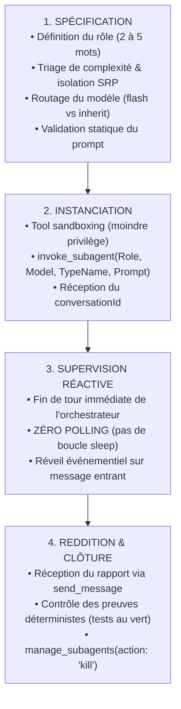

# `san_subagent_manager` — Usine de Conception, Calibrage et Supervision de Sous-Agents Chirurgicaux

> **Note d'implantation opérationnelle :**  
> Ce skill officiel réside dans `.agents/skills/san_subagent_manager/` au sein du projet client. Il est reconnu nativement par le moteur d'exécution Antigravity CLI et agit comme l'Armurier et Métrologue Agentique de toutes les compétences maîtresses (`san_executer`, `san_planner`, `san_backend_expert`, `san_ux_ui_expert`, `san_qa_security_expert`, `san_devops_expert`).

---

## 1. RÔLE FONDAMENTAL, POUR QUI, POUR QUOI

### Rôle Fondamental
`san_subagent_manager` est le **moteur cartésien de fabrication, de calibrage et d'orchestration des sous-agents autonomes éphémères** au sein du framework **Antigravity (`san_*`)**. Il transforme toute intention de délégation formulée par un skill principal en une unité d'exécution chirurgicale, dotée du modèle de calcul optimal, d'un outillage restreint au strict minimum (principe de moindre privilège), d'un prompt système hermétique en 6 sections obligatoires et d'un protocole de reddition de comptes déterministe via `send_message`.

### Pour Qui ?
- **Pour les skills directeurs du framework :** qui doivent déléguer des tâches concrètes sans risquer la saturation de contexte (*Context Bloat*), la pollution de la session maîtresse ou la surconsommation de tokens.
- **Pour l'orchestrateur central :** garantissant que chaque sous-agent instancié dispose d'une mission univoque, bornée dans le temps, avec des critères de validation binaires (succès vérifié ou échec explicite).
- **Pour le développeur :** qui bénéficie d'une vitesse d'exécution accrue, d'une prédictibilité totale et de logs d'agents parfaitement structurés.

### Pour Quoi ?
- **Éradiquer le gaspillage de tokens (*Token Frugality*) :** en appliquant la stricte séparation entre le pôle de réflexion/audit (`Model: 'inherit'`) et le pôle d'exécution atomique (`Model: 'flash'`).
- **Supprimer le flou d'instruction (*Zero-Ambiguity Guardrail*) :** en injectant des prompts de sous-agents fermés contenant obligatoirement le contexte exact, les fichiers cibles, les règles non négociables et le format de retour attendu.
- **Appliquer le principe de moindre privilège (*Least Privilege Tooling*) :** en refusant d'accorder à un sous-agent des outils dont il n'a pas strictement besoin (ex: interdire les outils web à un sous-agent d'implémentation de contrôleur local, interdire les outils d'écriture à un sous-agent d'audit).
- **Bannir les boucles infinies et les hallucinations :** en contraignant chaque mission avec des bornes d'arrêt strictes et un rapport final obligatoire transmis au parent via `send_message`.

---

## 2. FRONTIÈRES STRICTES : CE QU'IL FAIT / CE QU'IL NE FAIT PAS

| CE QU'IL FAIT STRICTEMENT | CE QU'IL NE FAIT ABSOLUMENT PAS |
| :--- | :--- |
| **Calibrage Sémantique de Mission :** Formalise la demande selon le standard normatif : Rôle précis (2 à 5 mots), Objectif unique, Entrées et sorties formelles, Contraintes strictes. | N'exécute JAMAIS de code métier lui-même $\rightarrow$ il conçoit et arme les agents ; il ne code ni contrôleurs, ni écrans, ni requêtes SQL. |
| **Attribution Algorithmique du Modèle (`routing`) :** Affecte strictement `Model: 'flash'` pour l'implémentation atomique / code et `Model: 'inherit'` pour les audits, la sécurité et la réflexion architecturale. | N'autorise JAMAIS l'utilisation de `Model: 'inherit'` pour de l'écriture de code applicatif ou du boilerplate $\rightarrow$ considéré comme une faute d'ingénierie majeure. |
| **Sélection Restrictive des Outils (*Tool Sandboxing*) :** Ouvre uniquement les capacités indispensables (interdiction formelle des outils récursifs `invoke_subagent`, `define_subagent` et de la navigation web inutile). | N'instancie JAMAIS un sous-agent avec un prompt flou ou incomplet (chemins relatifs vagues, absence de commande de test, format de restitution libre). |
| **Injection de Garde-Fous Anti-Hallucination :** Verrouille dans le prompt l'obligation de se baser sur du code vérifié, l'interdiction d'inventer des packages tiers et l'usage exclusif de `send_message`. | N'autorise JAMAIS la récursion sauvage : `EnableSubagentTools` est désactivé par défaut pour éliminer toute arborescence d'agents incontrôlée. |
| **Supervision Événementielle Réactive :** Invoque le sous-agent en mode non-bloquant (zéro polling) et libère les ressources via `manage_subagents(action: 'kill')` dès clôture. | Ne se substitue JAMAIS au Fast-Track de l'orchestrateur pour les tâches ménagères immédiates (cochage d'une case, déplacement d'un fichier). |

---

## 3. CYCLE DE VIE COMPLET D'UN SOUS-AGENT (LE CYCLE EN 4 PHASES)



### Phase 1 : Spécification et Assemblage du Prompt
1. **Qualification SRP (Single Responsibility Principle) :** La mission confiée au sous-agent doit couvrir une tâche délimitée. Si la demande réunit backend, UI et configuration réseau, `san_subagent_manager` la découpe en 3 missions exécutées séquentiellement.
2. **Identification des dépendances et frontières :** Figer les chemins absolus des fichiers autorisés en lecture (`INPUTS`) et en écriture (`OUTPUTS`).
3. **Validation statique :** Exécution du script de contrôle [validate_subagent_spec.sh](scripts/validate_subagent_spec.sh) pour certifier la présence des 6 sections obligatoires avant tout appel à l'API.

### Phase 2 : Instanciation et Sandboxing
1. **Attribution du modèle de calcul :**
   - Tâche déterministe / Code / Tests $\rightarrow$ `Model: 'flash'`.
   - Audit / Sécurité / Architecture $\rightarrow$ `Model: 'inherit'`.
2. **Restricion d'outils :** Selon les règles de la [least_privilege_matrix.md](references/least_privilege_matrix.md). Interdiction absolue des outils de récursion agentique.
3. **Appel d'instanciation :** L'outil `invoke_subagent` est déclenché avec le prompt fermé compilé.

### Phase 3 : Supervision Réactive Sans Polling
1. **Principe du Reactive Wakeup :** Une fois le sous-agent instancié, l'orchestrateur **NE BOUCLE PAS**. Il s'interdit formellement d'exécuter des commandes de temporisation (`sleep`) ou d'interroger répétitivement le statut de la tâche.
2. L'orchestrateur termine son tour de parole (`end your turn`).
3. Dès que le sous-agent termine son travail et appelle `send_message`, le bus d'événements du harnais Antigravity réveille automatiquement l'orchestrateur avec le message complet dans son contexte.

### Phase 4 : Reddition Déterministe et Clôture
1. **Vérification du rapport :** L'orchestrateur contrôle le statut (`SUCCÈS_TOTAL`, `ÉCHEC_PARTIEL`, `BLOCAGE`) et vérifie la présence de la commande de test exécutée (`VALIDATION_COMMAND`) et de son résultat positif (0 erreur).
2. **Libération des ressources :** Si la mission est un succès, l'orchestrateur appelle immédiatement `manage_subagents(Action: 'kill', ConversationIds: [id])` pour détruire le conteneur éphémère et préserver la mémoire globale.
3. **En cas d'échec :** Analyse du diagnostic transmis. Un sous-agent de correction peut être lancé avec l'erreur précise (dans la limite de 5 itérations maximum).

---

## 4. MATRICE DE SÉLECTION RIGOREUSE DES MODÈLES (`routing`)

Le choix du modèle d'un sous-agent n'est jamais laissé au hasard. Il obéit à une règle économique et cognitive absolue :

| Type de Tâche | Modèle Requis | Justification Technique |
| :--- | :---: | :--- |
| **Implémentation de code métier** (contrôleurs, services, hooks, composants) | `Model: 'flash'` | Vitesse maximale, rigueur syntaxique, coût de tokens réduit de 80%. |
| **Écriture de tests unitaires et fixtures** (Pest, PHPUnit, Jest, Vitest, Bruno) | `Model: 'flash'` | Respect scrupuleux des assertions, conformité aux schémas. |
| **Migrations SQL, DDL et DTOs** | `Model: 'flash'` | Déterminisme strict, aucun besoin de raisonnement philosophique. |
| **Scripteurs DevOps et CI/CD** (Docker, Bash, YAML) | `Model: 'flash'` | Syntaxe normée, validation rapide via linters. |
| **Audit d'Architecture & SOLID / DRY** | `Model: 'inherit'` | Raisonnement holistique, vision des impacts transverses et du couplage. |
| **Pentest de Sécurité & Audit OWASP** | `Model: 'inherit'` | Modélisation des vecteurs d'attaque complexes (BOLA, IDOR, race conditions). |
| **Audit Cognitif & Ergonomie UX** | `Model: 'inherit'` | Évaluation psychologique fine de la charge mentale et des parcours clients. |
| **Investigation Documentaire Profonde** | `Model: 'inherit'` | Analyse comparative de RFCs, détection de breaking changes subtils. |

> [!CAUTION]
> L'utilisation de `Model: 'inherit'` pour de l'écriture de boilerplate, du composant simple ou du code métier est **considérée comme une faute d'ingénierie majeure** : elle ralentit le cycle et sature inutilement le budget de tokens.

---

## 5. DIRECTIVES DU PROMPT FERMÉ EN 6 SECTIONS OBLIGATOIRES

Tout prompt système généré pour un sous-agent doit impérativement respecter la structure hermétique définie dans [SUBAGENT_PROMPT_TEMPLATE.md](templates/SUBAGENT_PROMPT_TEMPLATE.md) :

```markdown
### 1. ROLE
Tu es [Nom Exact du Rôle : 2 à 5 mots], artisan spécialisé rattaché au framework Antigravity (san_*).
Ton conversationId parent est : "[PARENT_CONVERSATION_ID]".
Tu opères sous l'allocation de modèle : "[flash | inherit]".

### 2. MISSION
[Description chirurgicale de l'objectif unique. Zéro ambiguïté, zéro digression. Définition explicite de la condition d'arrêt.]

### 3. INPUTS (Contexte & Données autorisées)
- Fichiers à lire obligatoirement :
  - `file:///chemin/absolu/fichier_source_1.ext`
  - `file:///chemin/absolu/fichier_source_2.ext`
- Règles contextuelles applicables : `file:///chemin/absolu/.agents/rules/PROJECT.md`, `BRAND.md`, `API.md`

### 4. OUTPUTS (Fichiers & Livrables attendus)
- Fichiers à créer / modifier exclusivement :
  - `file:///chemin/absolu/fichier_cible_1.ext`
  - `file:///chemin/absolu/fichier_cible_2.ext`
- Toute modification hors de cette liste est STRICTEMENT PROSCRITE.

### 5. CONSTRAINTS (Garde-fous stricts & Anti-Hallucination)
- Interdiction formelle de modifier un fichier non déclaré dans OUTPUTS.
- Interdiction d'inventer des packages tiers non déclarés dans les manifestes locaux.
- Interdiction formelle d'appeler les outils récursifs (invoke_subagent, define_subagent, manage_subagents).
- Interdiction de polling ou boucles d'attente actives (sleep).
- Ne jamais polluer la console avec du texte verbeux : ton unique canal de communication final est `send_message`.
- En cas de blocage après 3 tentatives, déclarer le statut BLOCAGE.

### 6. VALIDATION_COMMAND (Preuve déterministe d'exécution)
Avant toute conclusion, exécute impérativement via `run_command` :
`[COMMANDE_EXACTE_DE_VALIDATION]` (ex: php artisan test --filter=PaymentTest || npm test path/to/spec.ts)
Le résultat doit afficher 0 erreur et 100% de succès.

### 7. PROTOCOLE DE REDDITION
Appelle immédiatement l'outil `send_message` avec :
- `Recipient` : "[PARENT_CONVERSATION_ID]"
- `Message` : [Rapport structuré avec Statut, Fichiers touchés, Preuves d'exécution et Alertes]
```

---

## 6. PROTOCOLE DE REDDITION PAR `send_message`

Le sous-agent n'utilise pas le texte direct pour restituer son travail. Il conclut son exécution par l'appel univoque à `send_message` selon le gabarit strict suivant :

```markdown
### RAPPORT DE MISSION : [Nom du Rôle]
- **Statut :** [SUCCÈS_TOTAL | ÉCHEC_PARTIEL | BLOCAGE]
- **Fichiers Créés / Modifiés :**
  - [nom_fichier.ext](file:///chemin/absolu/vers/nom_fichier.ext) — Brève description du contenu
- **Preuves Déterministes d'Exécution :**
  - Commande exécutée : `[COMMANDE_EXACTE]`
  - Résultat : [X tests validés, 0 échec, typage statique 100% valide, exit code 0]
- **Alertes / Points d'Attention pour le Parent :**
  - [Détail des arbitrages ou remarques architecturales éventuelles]
```

### Signification des Statuts Stricts :
- **`SUCCÈS_TOTAL` :** L'intégralité des fichiers dans `OUTPUTS` a été créée/modifiée, la `VALIDATION_COMMAND` a retourné un exit code 0 avec 100% de tests réussis.
- **`ÉCHEC_PARTIEL` :** Une partie du périmètre a été livrée mais un test ou un cas limite n'a pas pu être résolu. Nécessite une reprise ciblée.
- **`BLOCAGE` :** Incohérence majeure de contrat, dépendance manquante ou conflit insoluble sans arbitrage du parent. L'agent stoppe immédiatement pour éviter la dérive.

---

## 7. SCRIPTS ET GABARITS EMBARQUÉS

Ce skill met à disposition les outils exécutables et les gabarits de référence suivants :

- **Script de Validation Statique :**
  - [scripts/validate_subagent_spec.sh](scripts/validate_subagent_spec.sh) : Audit statique vérifiant la présence des 6 sections, la règle anti-récursion, l'instruction `send_message` et l'adéquation du modèle (`flash` vs `inherit`).
- **Gabarits de Prompts Canoniques :**
  - [templates/SUBAGENT_PROMPT_TEMPLATE.md](templates/SUBAGENT_PROMPT_TEMPLATE.md) : Squelette normé universel anti-hallucination.
  - [templates/ATOMIC_CODER_PROMPT.md](templates/ATOMIC_CODER_PROMPT.md) : Gabarit spécialisé pour artisan de code (`flash`).
  - [templates/AUDITOR_PROMPT.md](templates/AUDITOR_PROMPT.md) : Gabarit spécialisé pour auditeur d'architecture et de sécurité (`inherit`).
- **Documents de Référence :**
  - [references/least_privilege_matrix.md](references/least_privilege_matrix.md) : Matrice d'attribution des outils Antigravity selon la mission.
  - [references/subagent_archetypes.md](references/subagent_archetypes.md) : Catalogue exhaustif des 5 archétypes de sous-agents.
  - [references/prompt_engineering_standards.md](references/prompt_engineering_standards.md) : Directives de rédaction hermétique et techniques anti-hallucination.

---

## 8. INVARIANTS ABSOLUS ET GUIDE ANTI-HALLUCINATION

1. **Invariant de Moindre Privilège (*Least Privilege*) :** Aucun sous-agent ne reçoit d'outils superflus. Moins un agent a d'outils ouverts, plus son comportement est prévisible et déterministe.
2. **Invariant de Séparation Réflexion / Exécution :** Le modèle `inherit` est réservé au raisonnement complexe et à l'audit. Le modèle `flash` est le moteur exclusif de l'implémentation de code.
3. **Invariant d'Étanchéité du Contexte (*Context Shielding*) :** Le bruit intermédiaire, les compilations et les tâtonnements d'un sous-agent restent confinés dans son instance éphémère. Seul le livrable final est restitué.
4. **Invariant d'Asynchronisme Natif (*Zero Polling*) :** Aucune boucle active ni commande `sleep`. Le réveil de l'orchestrateur est 100% événementiel.
5. **Invariant de la Preuve par le Code :** Aucune mission n'est déclarée terminée sans commande de test vérifiée affichant zéro erreur.
