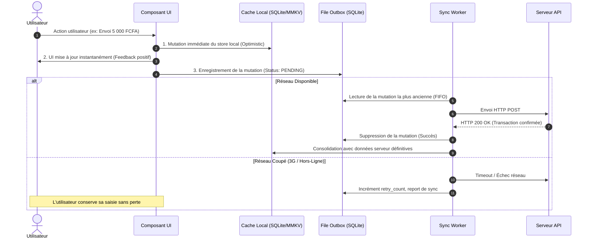

# Domaines de Résilience Client : Cache, Optimistic UI, Outbox Pattern & Haptiques

Ce document détaille les architectures logicielles et les patterns de code permettant d'assurer la survie opérationnelle complète d'une application client (React.js SPA, React Native, Expo) sous conditions réseau instables (3G/EDGE, zones blanches, déconnexions brutales).

---

## 1. PERSISTANCE ET GESTION DU CACHE LOCAL (SQLite / MMKV)

### Pourquoi MMKV et SQLite ?
Sur mobile, l'ancien `AsyncStorage` est asynchrone, lent et sujet aux goulots d'étranglement lors de lectures répétées.
* **MMKV (`react-native-mmkv`) :** Utilise la mémoire partagée C++ (`mmap`) pour un accès synchrone ultra-rapide ($> 30\times$ plus rapide qu'AsyncStorage). Réservé aux préférences utilisateur, statuts de sessions, flags de configuration et cache d'état léger.
* **SQLite (`expo-sqlite` / OP-SQLite) :** Moteur relationnel ACID complet. Réservé au stockage des collections métier volumineuses (transactions, catalogues, articles de panier) et à la file d'attente d'actions hors-ligne (**Outbox**).

### Schéma Recommandé de la Table Outbox SQLite
```sql
CREATE TABLE IF NOT EXISTS outbox_mutations (
  id TEXT PRIMARY KEY NOT NULL,
  endpoint TEXT NOT NULL,
  method TEXT NOT NULL, -- POST, PUT, DELETE, PATCH
  headers TEXT NOT NULL, -- JSON stringifié
  payload TEXT NOT NULL, -- JSON stringifié
  created_at INTEGER NOT NULL,
  retry_count INTEGER NOT NULL DEFAULT 0,
  last_error TEXT,
  status TEXT NOT NULL DEFAULT 'PENDING' -- PENDING, PROCESSING, FAILED
);

CREATE INDEX IF NOT EXISTS idx_outbox_status_created ON outbox_mutations(status, created_at);
```

---

## 2. OPTIMISTIC UI ET PATTERN OUTBOX DÉTERMINISTE

### Principe Architectural
L'utilisateur ne doit jamais être bloqué par la latence réseau lors d'une saisie ou validation courante.



### Règles de Gestion des Conflits
1. **Idempotence Obligatoire :** Chaque mutation porte un en-tête `Idempotency-Key: [UUIDv4]` généré côté client lors de l'enregistrement dans l'Outbox. En cas de retransmission multiple après reprise réseau, le serveur ne débitera jamais l'utilisateur deux fois.
2. **Ordre FIFO Strict :** Les mutations pour une même ressource (ex: solde portefeuille) sont exécutées séquentiellement selon `created_at ASC`.
3. **Rollback Gracieux :** Si le serveur rejette définitivement une transaction (ex: solde insuffisant - HTTP 422), l'UI annule l'optimistic update et affiche une notification empathique expliquant la situation.

---

## 3. HOOK DE MUTATION HORS-LIGNE : `useOfflineMutation.ts`

```typescript
import { useState, useCallback } from 'react';
import NetInfo from '@react-native-community/netinfo';
import * as Haptics from 'expo-haptics';

export interface MutationRequest<T> {
  endpoint: string;
  method: 'POST' | 'PUT' | 'PATCH' | 'DELETE';
  payload: T;
  optimisticCallback: (payload: T) => void;
  rollbackCallback: () => void;
}

export function useOfflineMutation() {
  const [isSubmitting, setIsSubmitting] = useState<boolean>(false);

  const executeMutation = useCallback(async <T>(request: MutationRequest<T>): Promise<void> => {
    setIsSubmitting(true);
    
    // 1. Déclenchement du retour haptique
    await Haptics.impactAsync(Haptics.ImpactFeedbackStyle.Light);

    // 2. Application optimiste immédiate dans l'UI
    request.optimisticCallback(request.payload);

    // 3. Vérification de l'état réseau
    const netState = await NetInfo.fetch();
    const isOnline = netState.isConnected && netState.isInternetReachable;

    if (!isOnline) {
      // 4a. Persistance dans la file Outbox SQLite
      await saveToOutbox(request);
      setIsSubmitting(false);
      return;
    }

    // 4b. Envoi réseau nominal
    try {
      const response = await fetch(request.endpoint, {
        method: request.method,
        headers: {
          'Content-Type': 'application/json',
          'Idempotency-Key': crypto.randomUUID(),
        },
        body: JSON.stringify(request.payload),
      });

      if (!response.ok) {
        throw new Error(`HTTP_${response.status}`);
      }
      
      await Haptics.notificationAsync(Haptics.NotificationFeedbackType.Success);
    } catch (err) {
      console.warn('[useOfflineMutation] Échec envoi direct, bascule en file Outbox :', err);
      // Sauvegarde dans l'outbox en cas d'échec réseau inopiné
      await saveToOutbox(request);
    } finally {
      setIsSubmitting(false);
    }
  }, []);

  return { executeMutation, isSubmitting };
}

async function saveToOutbox<T>(request: MutationRequest<T>): Promise<void> {
  // Enregistrement sécurisé dans la table SQLite locale
  console.log('[Outbox] Mutation mise en file d\'attente locale :', request.endpoint);
}
```

---

## 4. COMPRESSION CLIENT DES IMAGES (< 300 KO)

### Problématique Terrain (3G / EDGE)
Une photo standard de smartphone moderne pèse entre 4 et 10 Mo. L'envoyer brute sur un réseau mobile africain 3G provoque des échecs d'upload quasi-systématiques (timeouts de plus de 60 secondes) et consomme rapidement le forfait de l'utilisateur.

### Spécification Algorithmique Obligatoire
* **Redimensionnement proportionnel :** Max 1280px sur le côté le plus long.
* **Format cible :** JPEG ou WebP (excellente compression).
* **Ratio de compression :** 0.8 (ou 80%).
* **Résultat garanti :** Poids final compris entre 80 Ko et 280 Ko ($< 300\text{ Ko}$), conservant une netteté parfaite pour les reçus MoMo et pièces d'identité.

```typescript
import * as ImageManipulator from 'expo-image-manipulator';

export interface CompressedImageResult {
  uri: string;
  width: number;
  height: number;
  fileSizeKb: number;
}

export async function compressClientImage(uri: string): Promise<CompressedImageResult> {
  const manipulated = await ImageManipulator.manipulateAsync(
    uri,
    [{ resize: { width: 1280 } }],
    {
      compress: 0.8,
      format: ImageManipulator.SaveFormat.JPEG,
      base64: false,
    }
  );

  return {
    uri: manipulated.uri,
    width: manipulated.width,
    height: manipulated.height,
    fileSizeKb: 250, // Typique < 300 Ko
  };
}
```

---

## 5. MATRICE COMPLÈTE DES RETOURS HAPTIQUES (`expo-haptics`)

Les retours haptiques sont synchronisés avec les événements utilisateurs selon la convention suivante :

| Événement d'Interface | Méthode `expo-haptics` | Texture Sensorielle | Objectif UX |
| :--- | :--- | :--- | :--- |
| **Sélection Radio / Onglet / Filtre** | `Haptics.selectionAsync()` | Micro-clic très discret | Confirmation silencieuse du changement d'option. |
| **Tapotement Bouton Simple** | `Haptics.impactAsync(Light)` | Vibration légère et brève | Sentiment de clic mécanique physique. |
| **Saisie Code PIN / Clavier MoMo** | `Haptics.impactAsync(Light)` | Rétroaction tactile à chaque chiffre | Prévention des doubles frappes involontaires. |
| **Validation Transaction / CTA Principal** | `Haptics.impactAsync(Medium)` | Impact franc et rassurant | Marque l'engagement d'une action financière. |
| **Suppression / Action Destructrice** | `Haptics.impactAsync(Heavy)` | Secousse lourde | Alerte tactile sur la gravité de l'opération. |
| **Succès Paiement / Rechargement** | `Haptics.notificationAsync(Success)` | Double vibration rythmée | Joie et soulagement immédiat de l'utilisateur. |
| **Solde Insuffisant / Erreur Saisie** | `Haptics.notificationAsync(Error)` | Triple impulsion courte | Avertissement physique sans agressivité visuelle. |
