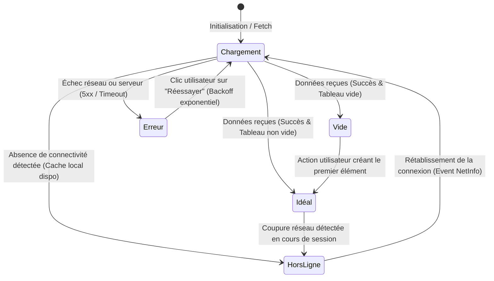

# Pattern des 5 États UI, Stale-While-Revalidate Non Destructif & Accessibilité WCAG 2.1 AAA

Ce document consigne les spécifications exhaustives de gestion d'état d'interface, de résilience au rafraîchissement asynchrone et d'accessibilité universelle sous `san_ux_ui_expert`.

---

## 1. LES 5 ÉTATS UI OBLIGATOIRES SUR CHAQUE VUE ASYNCHRONE

Toute vue ou composant majeur manipulant des données réseau doit obligatoirement implémenter sans exception les 5 états suivants :

1. **État 1 — Idéal (*Ideal State*) :** Affichage nominal des données complètes. Typographie hiérarchisée, micro-interactions tactiles réactives (`active:scale-[0.98]`).
2. **État 2 — Vide (*Empty State*) :** Données vides sans anomalie technique. Message empathique, visuel illustratif sobre et bouton d'action incitatif pour créer le premier élément (jamais d'écran blanc nu).
3. **État 3 — Chargement (*Loading State*) :** **Squelette géométrique fidèle (*Skeleton*)** calqué sur le gabarit réel du contenu final. Interdiction des spinners plein écran aveugles provoquant un décalage cumulatif de layout (*CLS* > 0.05).
4. **État 4 — Erreur (*Error State*) :** Échec réseau ou serveur. Diagnostic vulgarisé clair, code d'erreur identifiable et bouton d'action immédiate « Réessayer » avec intervalle de backoff exponentiel.
5. **État 5 — Hors-Ligne (*Offline / Cached State*) :** Absence de connectivité. Présentation des données en cache local (SQLite / MMKV), badge discret non bloquant informant de la consultation hors-ligne, et mise en file d'attente Outbox pour les mutations.

---

## 2. POLITIQUE STALE-WHILE-REVALIDATE (SWR) NON DESTRUCTIVE

Pour éviter toute sensation de saut d'écran ou de scintillement lors du rafraîchissement d'arrière-plan :
- **Règle Non Destructive :** Si des données périmées (*stale*) sont déjà présentes dans le cache mémoire ou local, le composant **doit continuer à afficher ces données** pendant la requête de revalidation au lieu de basculer sur un squelette de chargement.
- **Indicateur Discret :** Une barre fine ou un indicateur d'actualisation subtil et discret en haut de page signale la synchronisation en cours sans masquer le contenu déjà disponible.
- **Mise à Jour Fluide :** Lors de l'arrivée des nouvelles données fraîches, l'état se met à jour sans saut brutal de défilement (*Scroll Preservation*).

---

## 3. ACCESSIBILITÉ UNIVERSELLE WCAG 2.1 AAA & CONVIVIALITÉ TERRAIN

- **Ratios de Contraste Déterminants :**
  - Contraste nominal WCAG AA : $\ge 4.5:1$ pour le texte normal, $\ge 3:1$ pour les grands titres et composants interactifs.
  - **Norme Plein Soleil (Extérieur > 10 000 lux) :** $CR \ge 7.0:1$ (WCAG AAA) sur tous les montants financiers, badges d'état et boutons primaires.
- **Navigation au Clavier & Lecteurs d'Écran :**
  - Attributs ARIA explicites (`aria-live="polite"` pour les statuts dynamiques, `aria-busy="true"` lors des mutations).
  - Ordre de focus tabulaire séquentiel logique sans piège de focus (*Focus Trap*).
- **Cibles Tactiles Minimales :** $\ge 44 \times 44\text{ px}$ (`min-h-[44px] min-w-[44px]`), espacement minimum de $8\text{ px}$.
