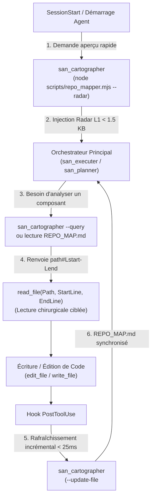

# `san_cartographer` — Moteur Hybride de Cartographie & Cache du Repo

> **Note d'implantation architecturale :**  
> Au sein du dépôt source `san_agy_framework`, ce sous-skill réside dans `sub-skills/` afin de formaliser la frontière entre les rôles de direction maîtres (points d'entrée dans `skills/`) et l'outillage transversal. Lors du déploiement dans une codebase cliente par le script d'initialisation, il est déployé dans `.agents/skills/san_cartographer/` pour être reconnu nativement par le moteur d'exécution Antigravity CLI.

---

## 1. RÔLE, POUR QUI, POUR QUOI

### Rôle Fondamental
`san_cartographer` est l'**architecte de repérage spatial, le moteur d'indexation déterministe et le gestionnaire de cache hybride** du framework **Antigravity (`san_*`)**.  
Il comble la fracture fondamentale entre la nécessité d'une vision globale d'une codebase et les contraintes strictes de consommation de tokens et de latence des modèles de langage.  
Plutôt que de contraindre un agent d'orchestration à balayer récursivement des répertoires entiers ou à deviner où se trouvent les déclarations de fonctions, `san_cartographer` produit et maintient un index local déterministe, instantané (< 80ms en scan complet, < 25ms en mise à jour incrémentale), 100 % autonome sans aucune dépendance npm tierce, couplé à une couche de synthèse sémantique métier.

### Pour Qui ?
- **Pour les stratèges et concepteurs ([san_planner](../skills/san_planner.md), [san_brainstorming](../skills/san_brainstorming.md)) :** Qui ont besoin d'une vue cartographique consolidée (Radar L1) pour évaluer l'impact d'une refonte, localiser les modules transverses et identifier les dépendances sans ingérer des dizaines de milliers de tokens.
- **Pour le maître d'œuvre d'exécution ([san_executer](../skills/san_executer.md)) :** Qui doit exécuter des tâches chirurgicales sans faire dériver la fenêtre de contexte de l'orchestrateur. Grâce aux plages de lignes exactes `#Lstart-Lend`, il invoque directement `read_file(Path, StartLine, EndLine)` sur la tranche utile.
- **Pour les spécialistes de domaine ([san_backend_expert](../skills/san_backend_expert.md), [san_ux_ui_expert](../skills/san_ux_ui_expert.md), [san_qa_security_expert](../skills/san_qa_security_expert.md)) :** Qui recherchent instantanément les signatures d'interfaces, les modèles Prisma, les schémas SQL ou les routes Express/Next/Laravel.
- **Pour le documentaliste et chercheur ([san_searcher](san_searcher.md)) :** Qui utilise la cartographie pour cibler les modules à documenter et enrichir les résumés fonctionnels manquants.

### Pour Quoi ?
- **Éradiquer l'Aveuglement Spatial de l'Agent (*Context Blindness*) :** Un agent arrivant dans une codebase inconnue commet fréquemment des recherches désordonnées (`find`, `grep` vagues). `san_cartographer` lui injecte un Radar compact (< 1.2 KB / < 1.5 KB) dès le démarrage.
- **Diviser la Consommation de Tokens par 10 (*Token Efficiency*) :** La lecture de fichiers entiers de 1 000 ou 3 000 lignes pour inspecter une méthode de 20 lignes gaspille inutilement le quota d'attention du LLM. L'indexation avec plages `#Lstart-Lend` autorise une extraction ultra-ciblée.
- **Assurer la Vérité Terrain en Temps Réel (*Zero Drift Guarantee*) :** Lors de modifications successives en cours de session, le cache est rafraîchi de façon incrémentale en moins de 25ms au hook `PostToolUse`, garantissant que les numéros de lignes restent mathématiquement exacts.
- **Garantir une Autonomie Totale Hors Ligne (*Zero-Dependency ESM*) :** Le moteur tourne en pur Node.js natif (`node:fs`, `node:path`, `node:crypto`), compatible avec n'importe quel environnement Linux/macOS/Windows disposant de Node.js `>= 18`.

---

## 2. FRONTIÈRES STRICTES : CE QU'IL FAIT / CE QU'IL NE FAIT PAS

| CE QU'IL FAIT STRICTEMENT | CE QU'IL NE FAIT ABSOLUMENT PAS |
| :--- | :--- |
| **Indexation Déterministe Locale :** Analyse les fichiers de code (TS, JS, PHP, PY, GO, Prisma, SQL, Bruno) en extrayant symboles, signatures, imports et plages `#Lstart-Lend`. | Ne modifie JAMAIS le code applicatif métier $\rightarrow$ il analyse et indexe, mais ne refactore ni ne code les fonctionnalités. |
| **Génération du Cache Hybride à 3 Couches :** Maintient `.agents/cache/repo-index.json`, `.agents/cache/semantic-summaries.json` et compile `.agents/cache/REPO_MAP.md`. | N'appelle AUCUN LLM externe dans son moteur d'extraction principal $\rightarrow$ l'extraction de symboles repose sur un parseur syntaxique déterministe rapide. |
| **Fourniture du Radar Niveau 1 (< 1.2 KB) :** Génère une synthèse ultra-compacte pour injection au `SessionStart` (statistiques, langages, points d'entrée, statuts résumés). | Ne déverse JAMAIS l'intégralité du code source dans le prompt principal ou le chat. |
| **Mise à Jour Incrémentale Chirurgicale :** Rafraîchit en moins de 25ms un fichier unique via `--update-file <path>` au `PostToolUse` (ou le supprime de l'index s'il a été effacé). | Ne déclenche pas de ré-indexation complète lourde lorsqu'un seul fichier a été modifié en vol. |
| **Recherche Ciblée de Symboles (`--query`) :** Localise en un clin d'œil n'importe quel symbole ou route avec son ancre de fichier et sa signature. | Ne prend aucune décision d'architecture $\rightarrow$ il expose la réalité physique du code pour éclairer les autres skills. |

---

## 3. COMMENT IL EST MOBILISÉ PAR LES SKILLS PRINCIPAUX



### Invocations Concrètes

#### 1. Mobilisation par [`san_planner`](../skills/san_planner.md)
* **Scénario :** Phase de cadrage et cartographie initiale d'une codebase existante.
* **Commande :** `node scripts/repo_mapper.mjs --json`
* **Exploitation :** Obtient la répartition des langages, la liste des points d'entrée, le volume de fichiers et la liste des dossiers non encore résumés afin de guider le plan de découpage.

#### 2. Mobilisation par [`san_executer`](../skills/san_executer.md)
* **Scénario :** Localisation d'une fonction avant refactorisation sans ouvrir 10 fichiers au hasard.
* **Commande :** `node scripts/repo_mapper.mjs --query "verifySignature"`
* **Réponse :** `src/services/billing/momo_client.ts#L98-L118: [function] export async function verifySignature(payload, sig)`
* **Action :** Appel direct à `read_file(Path: "src/services/billing/momo_client.ts", StartLine: 98, EndLine: 118)`.

#### 3. Mobilisation par [`san_backend_expert`](../skills/san_backend_expert.md)
* **Scénario :** Vérification des modèles de données et routes existantes dans un projet mixte Laravel / Next.js.
* **Consultation :** Lecture de la section dédiée dans `.agents/cache/REPO_MAP.md`.
* **Action :** Visualisation immédiate des `model User`, `Route::post('/webhooks/momo')` et interfaces associées.

#### 4. Mobilisation Automatique au `PostToolUse`
* **Scénario :** L'agent vient de modifier `src/auth/jwt_service.ts`.
* **Déclenchement :** `node scripts/repo_mapper.mjs --update-file src/auth/jwt_service.ts`
* **Résultat :** En 14ms, `.agents/cache/repo-index.json` et `.agents/cache/REPO_MAP.md` réajustent les numéros de lignes de `JwtService` pour les étapes suivantes.

---

## 4. STRUCTURE INTERNE DU SOUS-SKILL

Lors du déploiement au sein d'une codebase sous Antigravity CLI, le sous-skill présente l'arborescence normative suivante :

```txt
.agents/skills/san_cartographer/
├── SKILL.md                                 # Manifeste d'exécution et protocole séquentiel (< 115 lignes)
├── references/
│   ├── hybrid_cache_architecture.md         # Guide approfondi de l'architecture cache à 3 niveaux
│   └── symbol_extraction_rules.md           # Spécifications d'extraction déterministe et règles regex
├── templates/
│   ├── REPO_MAP_TEMPLATE.md                 # Gabarit canonique de restitution Markdown REPO_MAP.md
│   └── SEMANTIC_SUMMARIES_TEMPLATE.json     # Schéma JSON du dictionnaire de résumés sémantiques
└── scripts/
    └── repo_mapper.mjs                      # Moteur autonome d'indexation déterministe (ESM, chmod +x)
```

---

## 5. ARCHITECTURE HYBRIDE V2.0 & MODÈLE DE DONNÉES

Le cache est stocké dans le répertoire `.agents/cache/` à la racine de la codebase cible. Il s'articule autour de trois artefacts complémentaires :

### 1. `.agents/cache/repo-index.json` (Vérité Technique Statique)
Ce fichier est le miroir déterministe calculé par `repo_mapper.mjs`.

```json
{
  "version": "2.0.0",
  "updatedAt": "2026-11-07T03:00:00.000Z",
  "stats": {
    "totalFiles": 48,
    "totalSymbols": 264,
    "languages": {
      "typescript": 36,
      "php": 8,
      "sql": 4
    }
  },
  "entryPoints": [
    "src/index.ts",
    "routes/api.php"
  ],
  "files": {
    "src/services/billing/momo_client.ts": {
      "hash": "e3b0c44298fc1c14",
      "size": 3450,
      "lineCount": 118,
      "language": "typescript",
      "symbols": [
        {
          "name": "MomoClient",
          "type": "class",
          "start": 24,
          "end": 95,
          "signature": "export class MomoClient"
        },
        {
          "name": "verifySignature",
          "type": "function",
          "start": 98,
          "end": 118,
          "signature": "export function verifySignature(payload, sig)"
        }
      ],
      "imports": [
        "axios",
        "crypto",
        "./types"
      ]
    }
  }
}
```

### 2. `.agents/cache/semantic-summaries.json` (Enrichissement Fonctionnel)
Ce dictionnaire préserve l'intention métier des modules, dissociée des réécritures mineures de code.

```json
{
  "version": "2.0.0",
  "updatedAt": "2026-11-07T03:00:00.000Z",
  "directories": {
    "src/services/billing": "Intégration passerelles Mobile Money (MTN, Orange), réconciliation et génération PDF.",
    "src/auth": "Authentification JWT stateless, gestion des sessions Redis et contrôle d'accès RBAC."
  }
}
```

### 3. `.agents/cache/REPO_MAP.md` (Cartographie Compilée Accessible)
Ce document combine les deux sources en un Markdown structuré :
- **Section 1 :** Le Radar global (données de synthèse prêtes pour le survol de session).
- **Section 2 :** Cartographie détaillée groupée par répertoire, avec résumé fonctionnel et liste des symboles ancrés avec `#Lstart-Lend`.

---

## 6. PROTOCOLE D'INJECTION À 2 NIVEAUX & SURGICAL READS

Pour éviter la congestion de la fenêtre contextuelle, `san_cartographer` sépare l'ingestion de contexte en deux phases distinctes :

### Phase 1 : Injection du Radar Niveau 1 (< 1.5 KB)
Au démarrage d'une session ou en amorce de plan, l'agent intègre uniquement la section Radar :
```markdown
# 🧭 REPO RADAR (v2.2)
- **Fichiers**: 48 | **Symboles**: 264 | **Horodatage**: 2026-11-07T03:00:00.000Z
- **Langages**: typescript (75%), php (17%), sql (8%)
- **Points d'Entrée**: `src/index.ts`, `routes/api.php`
- **Domaines Métier**:
  - `src/services/billing`: Intégration passerelles Mobile Money et facturation
  - `src/auth`: Authentification JWT stateless et RBAC
  - `src/legacy`: ⚠️ _[Non résumé — hydrater via san_researcher]_
- **Accès Rapide**: `.agents/cache/REPO_MAP.md` (Cartographie détaillée)
```
*Poids moyen : 600 octets (~150 à 250 tokens).*

### Phase 2 : Lecture Chirurgicale Ciblée (Niveau 2)
Dès qu'une méthode précise doit être étudiée ou éditée :
1. Recherche via `node scripts/repo_mapper.mjs --query <nom>`.
2. L'outil retourne le fichier et les lignes exactes : `src/services/billing/momo_client.ts#L98-L118`.
3. Lecture ciblée via `read_file(Path: "src/services/billing/momo_client.ts", StartLine: 98, EndLine: 118)`.
4. *Gain mesuré :* 21 lignes lues au lieu de 118 lignes (économie de plus de 80 % de tokens sur ce fichier).

---

## 7. PROTOCOLE DE RAFRAÎCHISSEMENT TEMPS RÉEL AU `PostToolUse`

Pour maintenir la cohérence absolue entre le disque et l'index sans ralentir le cycle de développement :
1. **Déclencheur :** Toute commande de modification de fichier (`write_file`, `edit_file`).
2. **Action :** Exécution du hook ou de la commande :
   ```bash
   node scripts/repo_mapper.mjs --update-file <chemin_relatif>
   ```
3. **Comportement :**
   - Si le fichier existe : le script recalcule son hachage SHA-256, ré-extrait ses symboles et remplace son entrée dans `repo-index.json`.
   - Si le fichier a été supprimé : l'entrée est immédiatement purgée de `repo-index.json`.
   - Les statistiques globales et points d'entrée sont recalculés en mémoire.
   - `REPO_MAP.md` est régénéré de manière atomique.
   - Durée moyenne constatée : **10 à 20 ms**.

---

## 8. MANIFESTE DE COMMANDE CLI

Le script `scripts/repo_mapper.mjs` dispose d'une interface de ligne de commande intuitive :

```bash
# 1. Scan complet de la codebase et régénération du cache
node scripts/repo_mapper.mjs

# 2. Scan complet avec sortie structurée JSON (statistiques & statut)
node scripts/repo_mapper.mjs --json

# 3. Extraction exclusive du Radar Niveau 1 (< 1.2 KB) pour injection
node scripts/repo_mapper.mjs --radar

# 4. Mise à jour incrémentale ultra-rapide d'un fichier (< 25ms)
node scripts/repo_mapper.mjs --update-file src/services/billing/momo_client.ts

# 5. Définition du résumé fonctionnel d'un dossier
node scripts/repo_mapper.mjs --set-summary "src/services/billing=Gestion des transactions MoMo et factures PDF"

# 6. Import en masse de résumés sémantiques depuis un fichier JSON
node scripts/repo_mapper.mjs --summaries-file .agents/cache/semantic-summaries.json

# 7. Recherche instantanée d'un symbole, route ou fichier avec ancrage ligne
node scripts/repo_mapper.mjs --query "verifySignature"

# 8. Ciblage d'un répertoire racine personnalisé
node scripts/repo_mapper.mjs --root /chemin/vers/mon_projet --radar
```

---

## 9. INVARIANTS NON NÉGOCIABLES

1. **Zéro Dépendance Externe :** Le script `scripts/repo_mapper.mjs` doit fonctionner exclusivement avec les bibliothèques standards Node.js (`node:fs`, `node:path`, `node:crypto`).
2. **Ignorance Absolue des Dépendances Lourdes :** Les répertoires `node_modules`, `vendor`, `.git`, `.next`, `dist`, `build`, `coverage`, `.agents` ne doivent jamais être parcourus lors de la détection de code.
3. **Précision Algorithmique des Lignes :** Tout symbole listé dans `REPO_MAP.md` doit posséder sa coordonnée `#Lstart-Lend` calculée par équilibrage des accolades ou de l'indentation.
4. **Préservation du Contexte :** Ne jamais inonder l'orchestrateur avec le contenu brut de `REPO_MAP.md` si un survol par le Radar (< 1.5 KB) ou une requête ciblée `--query` suffit.
