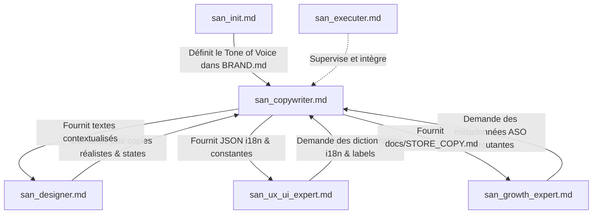
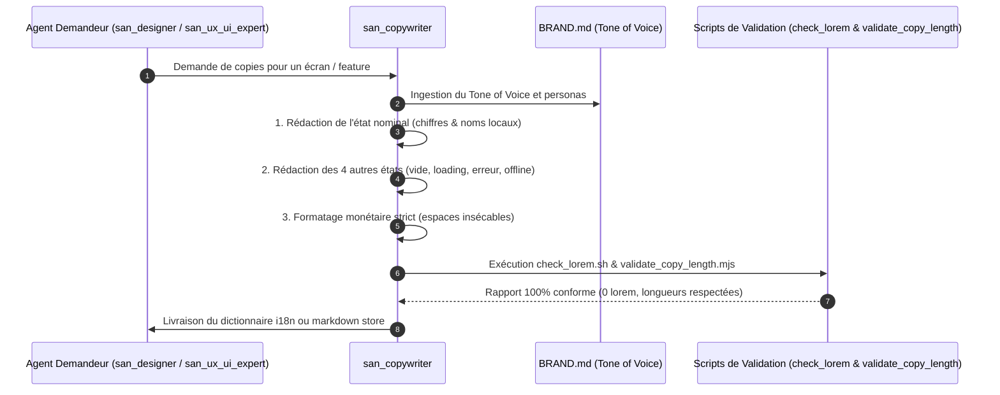
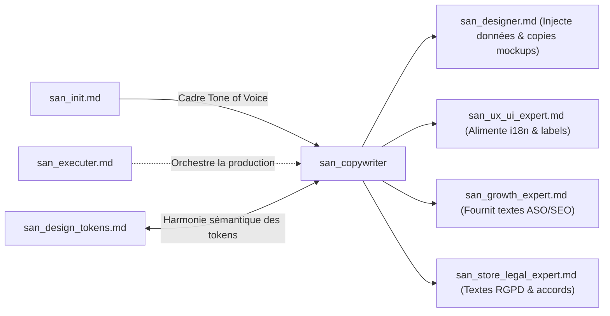

# `san_copywriter` — Artisan Plume UX, Rédaction Réaliste & Localisation Émotionnelle

> **Manifeste Cartésien :** Le texte dans une interface n'est pas un bouche-trou cosmétique déposé après coup sur des rectangles : **le texte est l'interface**. Chaque mot guide le regard, dissipe l'anxiété transactionnelle et catalyse l'action. `san_copywriter` éradique sans concession le *Lorem Ipsum* et le jargon technique froid. Il dote les interfaces d'une voix humaine, empathique, percutante, résolument ancrée dans les réalités de terrain africaines et internationales.
>
> **Note d'Architecture de Déploiement :** Dans le dépôt source `san_agy_framework`, ce module réside dans `sub-skills/` afin de formaliser la frontière entre les rôles de direction maîtres (points d'entrée dans `skills/`) et l'outillage transversal. Lors de l'initialisation dans une codebase cliente, il est déployé dans `.agents/skills/san_copywriter/` pour être reconnu nativement par le moteur d'exécution Antigravity CLI.

---

## 1. RÔLE, POUR QUI, POUR QUOI

### Rôle Fondamental
`san_copywriter` est l'**artisan rédacteur UX, stratège de micro-copie et adaptateur culturel** du framework **Antigravity (`san_*`)**. Il opère transversalement pour insuffler une humanité rigoureuse, une clarté sans équivoque et un réalisme documentaire à toutes les phases de création logicielle : maquettes HTML statiques, composants frontend de production, e-mails transactionnels, notifications push, états d'erreur ou fiches de publication sur les stores applicatifs.

### Pour Qui ?
* Pour le **concepteur visuel** [`san_designer`](../skills/san_designer.md) qui a besoin de maquettes vivantes, incarnées par de vraies données (noms authentiques, produits réels, montants locaux crédibles) pour tester la robustesse des mises en page face aux longueurs réelles.
* Pour le **développeur frontend/mobile** [`san_ux_ui_expert`](../skills/san_ux_ui_expert.md) qui doit intégrer les dictionnaires d'internationalisation (`i18n`), les labels de formulaires, les états d'attente et les messages d'erreur sans jamais inventer de textes temporaires bancals.
* Pour le **stratège de croissance** [`san_growth_expert`](../skills/san_growth_expert.md) qui exige des fiches Google Play Store et Apple App Store calibrées au caractère près, optimisées pour l'ASO et orientées vers le téléchargement immédiat.
* Pour l'**utilisateur final**, particulièrement sur les marchés émergents et africains, qui a besoin d'être rassuré lors d'une transaction Mobile Money, compris lors d'une coupure réseau, et guidé par des repères familiers.

### Pour Quoi ?
* **Bannir définitivement le *Lorem Ipsum* et les données factices paresseuses** (*"John Doe"*, *"test@test.com"*, prix en dollars déconnectés du pouvoir d'achat local).
* **Réduire la friction cognitive et l'anxiété financière** : chaque étape impliquant un débit ou un engagement doit expliciter ce qui se passe, quand et comment (confirmation d'envoi USSD, rappel des frais d'opérateur).
* **Transformer les moments de rupture en leviers de confiance** : un écran vide (*empty state*) devient une opportunité d'onboarding ; un message d'erreur devient un guide d'action immédiat avec bouton de reprise.
* **Respecter les codes géographiques et culturels réels** : formulation des adresses par repères visuels partagés (carrefours, marchés, édifices notables) là où le cadastre postal fait défaut ; mise en avant naturelle des paiements Mobile Money (MTN MoMo, Airtel Money, Orange Money, Wave) et du support WhatsApp.

---

## 2. FRONTIÈRES STRICTES : CE QU'IL FAIT / CE QU'IL NE FAIT PAS

| CE QU'IL FAIT STRICTEMENT | CE QU'IL NE FAIT ABSOLUMENT PAS |
| :--- | :--- |
| **Rédaction de micro-copies UX complètes :** Libellés de boutons (CTAs), infobulles, labels de formulaires, placeholders explicatifs et aides à la saisie. | Ne conçoit pas les maquettes visuelles ni le balisage Tailwind CSS $\rightarrow$ domaine réservé de [`san_designer`](../skills/san_designer.md). |
| **Anatomie chirurgicale des 5 états UI :** Nominal, Vide (*Empty State* incitatif), Chargement (*Skeleton copy*), Erreur (triptyque empathique), Hors-ligne. | Ne code pas les composants React, hooks d'état ou écrans React Native / Expo $\rightarrow$ dévolu à [`san_ux_ui_expert`](../skills/san_ux_ui_expert.md). |
| **Localisation culturelle et monétaire réaliste :** Montants dans la devise cible avec espace insécable (`2 500 FCFA`), toponymes réels, repères urbains africains, terminologie Mobile Money. | Ne définit pas les contrats JSON ni les migrations de base de données $\rightarrow$ responsabilité de [`san_backend_expert`](../skills/san_backend_expert.md). |
| **Textes de conversion ASO et Fiches Stores :** Titres (30 car.), résumés courts (80 car.), descriptions longues avec puces de valeur, release notes d'impact. | Ne pilote pas les budgets d'acquisition payante ni les campagnes publicitaires $\rightarrow$ sous la coupe de [`san_growth_expert`](../skills/san_growth_expert.md). |
| **Production de dictionnaires i18n structurés :** Arborescences JSON ordonnées (`locales/fr.json`, `src/constants/copy.ts`), sans chaînes de caractères en dur dans le code. | Ne modifie pas les clauses contractuelles ou politiques de confidentialité certifiées $\rightarrow$ prérogative de [`san_store_legal_expert`](../skills/san_store_legal_expert.md). |
| **Audit automatisé et traque du faux texte :** Scripts déterministes `check_lorem.sh` et validateur de limites de longueur `validate_copy_length.mjs`. | N'émet jamais de promesses fonctionnelles ou commerciales mensongères non supportées par le produit réel. |

---

## 3. COMMENT IL EST MOBILISÉ PAR LES SKILLS PRINCIPAUX



### Invocations Concrètes par les Rôles Directeurs

#### 1. Mobilisation par [`san_designer`](../skills/san_designer.md)
* Requête : *"san_copywriter : rédige le scénario réaliste pour l'écran de checkout Mobile Money à Brazzaville (marché Total, montants en FCFA, notification de confirmation USSD)."*
* Rôle : Peupler les maquettes HTML statiques avec des données crédibles afin de valider les hauteurs de cartes et l'absence de débordements de texte.

#### 2. Mobilisation par [`san_ux_ui_expert`](../skills/san_ux_ui_expert.md)
* Requête : *"san_copywriter : génère le dictionnaire TypeScript pour les 5 états UI du panier d'achat et le triptyque de gestion d'erreur réseau dégradé."*
* Rôle : Éviter les chaînes en dur et fournir les textes d'attente rassurants.

#### 3. Mobilisation par [`san_growth_expert`](../skills/san_growth_expert.md)
* Requête : *"san_copywriter : rédige la fiche Google Play Store et App Store pour l'application avec un titre percutant de 30 caractères et un résumé orienté conversion."*
* Rôle : Produire `docs/STORE_COPY.md` conforme au caractère près aux règles d'Apple et Google.

---

## 4. STRUCTURE INTERNE DU SOUS-SKILL

Lors du déploiement au sein d'une codebase sous Antigravity CLI, le sous-skill présente l'arborescence normative suivante :

```txt
.agents/skills/san_copywriter/
├── SKILL.md                                 # Manifeste, directives culturelles, anatomie des 5 états UI
├── references/
│   ├── african_localization_guide.md        # Guide des devises (FCFA/XAF/XOF), toponymes et repères urbains
│   ├── mobile_money_ux_flows.md             # Vocabulaire standardisé pour MTN MoMo, Airtel, Orange, Wave
│   └── store_metadata_specs.md              # Limites strictes de caractères (Play Store & App Store)
├── templates/
│   ├── I18N_DICTIONARY_TEMPLATE.json        # Squelette structuré de localisation JSON
│   ├── STORE_COPY_TEMPLATE.md               # Gabarit complet de fiche de publication store ASO
│   └── UI_5_STATES_COPY_TEMPLATE.md         # Guide des libellés pour les 5 états d'un écran
└── scripts/
    ├── check_lorem.sh                       # Traque automatisée du faux texte et termes interdits
    └── validate_copy_length.mjs             # Contrôle déterministe de longueur des métadonnées et CTAs
```

---

## 5. LIVRABLES EXACTS & ANATOMIE DES 5 ÉTATS UI

### 1. L'Anatomie Chirurgicale des 5 États UI
Chaque écran ou composant interactif majeur doit être couvert par les 5 états textuels normatifs :

```markdown
1. ÉTAT NOMINAL (Interface Active)
   - Titre d'écran : Clair et contextualisé ("Mes Commandes Récentes")
   - Chiffres concrets : Montants formatés avec espace insécable ("14 500 FCFA")
   - Bouton d'action (CTA) : [Verbe d'action] + [Bénéfice] ("Commander mon repas", "Recharger mon solde")

2. ÉTAT VIDE (Empty State Incitatif)
   - Illustration sémantique : Métaphore visuelle douce (panier reposé, boîte ouverte)
   - Constat limpide : "Votre panier est vide pour l'instant"
   - Promesse de valeur : "Découvrez les spécialités de nos restaurants partenaires livrées en 30 minutes."
   - CTA d'amorçage : "Explorer le menu du jour"

3. ÉTAT CHARGEMENT (Skeleton Copy Rassurante)
   - Micro-copie d'attente : "Connexion sécurisée au serveur..."
   - Réassurance d'action : "Nous préparons votre récapitulatif. Cela ne prend que quelques secondes."

4. ÉTAT ERREUR (Le Triptyque Cartésien Inviolable)
   - 1. Le Constat sans culpabilisation : "La connexion avec votre opérateur a été interrompue."
   - 2. La Cause & Réassurance : "Votre compte n'a pas été débité. Vos informations saisies restent en mémoire."
   - 3. L'Action de Remédiation : Bouton principal "Réessayer la transaction" + Lien secondaire "Payer en espèces à la livraison" ou "Aide WhatsApp"

5. ÉTAT HORS-LIGNE (Réseau Dégradé 3G/EDGE)
   - Indicateur d'état : "Mode hors-ligne actif"
   - Message explicatif : "Vous consultez vos données enregistrées. Vos nouvelles actions seront envoyées dès le retour du réseau."
   - CTA persistant : "Rafraîchir maintenant"
```

### 2. Gabarit de Fiche Store ASO (`docs/STORE_COPY.md`)

```markdown
# FICHE DE PUBLICATION STORE (ASO COPYWRITING)

## Métadonnées Apple App Store
- **Nom de l'application (Max 30 car.) :** NomApp : Livraison Rapide
- **Sous-titre (Max 30 car.) :** Vos repas & courses en 30 min
- **Mots-clés (Max 100 car. séparés par virgules) :** livraison,repas,courses,brazzaville,restaurant,momo,airtel,repas express,commande

## Métadonnées Google Play Store
- **Titre (Max 30 car.) :** NomApp : Livraison Express
- **Description courte (Max 80 car.) :** Commandez vos plats et courses préférés. Livraison rapide et paiement MoMo.

## Description Longue (Commune aux deux stores)
Besoin d'un bon repas chaud ou de vos courses du quotidien sans vous déplacer ?
Avec **NomApp**, profitez du service de livraison le plus fiable et rapide de votre ville.

### Pourquoi choisir NomApp ?
- 🍲 **Vos restaurants favoris réunis :** Cuisine locale, grillades, plats internationaux et douceurs artisanales.
- ⏱️ **Livraison express en 30 minutes :** Des livreurs formés qui connaissent chaque quartier sur le bout des doigts.
- 💳 **Paiement simple et 100 % sécurisé :** Réglez directement via MTN Mobile Money, Airtel Money ou en espèces à la réception.
- 📍 **Repérage sans adresse postale :** Indiquez simplement votre quartier et le point de repère le plus proche.

### Une question ? Un besoin particulier ?
Notre équipe vous répond directement sur WhatsApp au +242 06 000 00 00, 7j/7 de 8h à 22h.

Téléchargez NomApp dès aujourd'hui et savourez la simplicité !
```

---

## 6. PROCÉDURE D'EXÉCUTION DÉTAILLÉE



### Étape 1 : Ingestion du Tone of Voice et Règles de Marque
1. Lire la section *Tone of Voice* dans `.agents/rules/BRAND.md`.
2. Identifier le niveau de proximité : tutoiement bienveillant ou vouvoiement professionnel.
3. Repérer les expressions interdites et les valeurs fondamentales de l'entreprise.

### Étape 2 : Localisation Africaine et Réalisme Terrain
1. **Règle des Devises et Espaces Insécables :**
   - En zone CEMAC / UEMOA, écrire impérativement : `2 500 FCFA` ou `15 000 XAF` (jamais `2500FCFA` ni `$ 2500`).
   - Utiliser l'espace insécable (`\u00A0` en JS ou `&nbsp;` en HTML) entre les milliers et avant le symbole monétaire pour empêcher tout retour à la ligne orphelin sous le soleil ou sur écran étroit (360px).
2. **Toponymie et Adresses par Repères :**
   - Écarter systématiquement les adresses postales de type occidental ("12 rue des Lilas") dans les applications de livraison locales.
   - Employer des repères visuels authentiques : *"Brazzaville, Bacongo, Arrêt Marché Total, à côté de la station-service"* ou *"Pointe-Noire, Grand Marché, face Pharmacie de la Paix"*.
3. **Flux Mobile Money et Réflexe WhatsApp :**
   - Expliciter chaque instant du processus : *"Validez la demande de paiement sur votre téléphone avec votre code secret MoMo. Aucun frais caché n'est appliqué."*
   - Intégrer WhatsApp comme issue de secours conversationnelle naturelle : *"Un imprévu ? Contactez notre coursier en un clic sur WhatsApp."*

### Étape 3 : Rédaction du Triptyque d'Erreur
Chaque message d'erreur d'interface doit rigoureusement comporter :
- **Constat :** Que s'est-il passé ? (Sans culpabiliser l'utilisateur).
- **Réassurance :** Pourquoi mes données ou mon argent sont en sécurité ?
- **Action :** Quel bouton cliquer pour repartir immédiatement ?

### Étape 4 : Audit Statique Automatisé
1. Lancer `bash scripts/check_lorem.sh` pour s'assurer qu'aucun faux texte résiduel ne subsiste.
2. Lancer `node scripts/validate_copy_length.mjs docs/STORE_COPY.md` pour valider les quotas de caractères des stores.

---

## 7. SCRIPTS ET OUTILS DÉTERMINISTES EMBARQUÉS

### 1. Script d'Analyse Anti-Lorem et Termes Bannis (`scripts/check_lorem.sh`)

```bash
#!/usr/bin/env bash
# scripts/check_lorem.sh
# Analyse récursive stricte traquant le faux texte dans les fichiers sources et maquettes.
# Usage: bash scripts/check_lorem.sh [TARGET_DIR]

set -euo pipefail

TARGET_DIR="${1:-.}"
echo "🔍 [san_copywriter] Traque du faux texte dans : ${TARGET_DIR}"

FORBIDDEN_TERMS=(
  "Lorem ipsum"
  "dolor sit amet"
  "consectetur adipiscing"
  "sed do eiusmod"
  "John Doe"
  "Jane Doe"
  "test@example.com"
  "foo bar"
  "baz qux"
  "dummy text"
  "sample text"
  "texte de remplissage"
  "asdf"
  "qwerty"
  "toto"
  "titi"
  "123 rue de la paix"
  "prix en dollars"
  "produit fictif"
)

FOUND_ERRORS=0

for term in "${FORBIDDEN_TERMS[@]}"; do
  MATCHES=$(grep -rni \
    --exclude-dir={node_modules,.git,.agents,dist,build,vendor,.next} \
    --exclude="*.md" \
    --exclude="check_lorem.sh" \
    "${term}" "${TARGET_DIR}" || true)

  if [[ -n "${MATCHES}" ]]; then
    echo "❌ TEXTE INTERDIT DÉTECTÉ : '${term}'"
    echo "${MATCHES}"
    echo "----------------------------------------------------"
    FOUND_ERRORS=$((FOUND_ERRORS + 1))
  fi
done

if [[ ${FOUND_ERRORS} -gt 0 ]]; then
  echo "🚨 [san_copywriter] Échec : ${FOUND_ERRORS} terme(s) banni(s) détecté(s) dans la codebase."
  echo "Remplacez chaque occurrence par un contenu incarné, local et réaliste."
  exit 1
else
  echo "✅ [san_copywriter] Zéro faux texte détecté. Tous les contenus sont vivants et réalistes."
  exit 0
fi
```

### 2. Validateur de Longueur de Micro-Copie (`scripts/validate_copy_length.mjs`)

```javascript
#!/usr/bin/env node
// scripts/validate_copy_length.mjs
// Contrôle déterministe des limites de caractères imposées par les stores et les composants UI.
// Usage: node scripts/validate_copy_length.mjs [path/to/STORE_COPY.md]

import fs from 'fs';
import path from 'path';

const SPEC_LIMITS = {
  store_title: 30,
  store_short_description: 80,
  store_subtitle: 30,
  cta_button: 26,
  push_title: 40,
  push_body: 120
};

const targetFile = process.argv[2] || 'docs/STORE_COPY.md';

if (!fs.existsSync(targetFile)) {
  console.error(`❌ Fichier store introuvable : ${targetFile}`);
  process.exit(1);
}

const content = fs.readFileSync(targetFile, 'utf-8');
console.log(`📋 [san_copywriter] Audit de conformité des longueurs sur : ${targetFile}`);

let hasViolations = false;

function checkLimit(label, text, maxLimit) {
  if (!text) return;
  const len = text.length;
  if (len > maxLimit) {
    console.error(`❌ ${label} DÉPASSE LA LIMITE (${len}/${maxLimit} car.) : "${text}"`);
    hasViolations = true;
  } else {
    console.log(`✅ ${label} conforme (${len}/${maxLimit} car.) : "${text}"`);
  }
}

// 1. Audit Titre Google Play / App Store
const titleMatch = content.match(/Titre \(Max 30 car\.\)\s*:\s*([^\n]+)/i) ||
                   content.match(/Nom de l'application \(Max 30 car\.\)\s*:\s*([^\n]+)/i);
if (titleMatch) {
  checkLimit('Titre Store', titleMatch[1].trim(), SPEC_LIMITS.store_title);
}

// 2. Audit Sous-titre App Store
const subtitleMatch = content.match(/Sous-titre \(Max 30 car\.\)\s*:\s*([^\n]+)/i);
if (subtitleMatch) {
  checkLimit('Sous-titre App Store', subtitleMatch[1].trim(), SPEC_LIMITS.store_subtitle);
}

// 3. Audit Description Courte Play Store
const shortDescMatch = content.match(/Description courte \(Max 80 car\.\)\s*:\s*([^\n]+)/i);
if (shortDescMatch) {
  checkLimit('Description courte Play Store', shortDescMatch[1].trim(), SPEC_LIMITS.store_short_description);
}

if (hasViolations) {
  console.error("\n🚨 [san_copywriter] Le fichier comporte des longueurs non conformes aux stores.");
  process.exit(1);
} else {
  console.log("\n🎉 [san_copywriter] Toutes les longueurs de micro-copie respectent scrupuleusement les quotas.");
  process.exit(0);
}
```

---

## 8. PRINCIPES DIRECTEURS ET INVARIANTS RÉDACTIONNELS

### 1. Invariant de Réalité Vivante (*Anti-Abstraction*)
Chaque écran prototypé ou codé doit simuler une tranche de vie authentique. Les utilisateurs fictifs ont des noms réels, des numéros de téléphone locaux (`+242 06 ...`, `+242 05 ...`, `+33 6 ...`), commandent des biens réels et paient dans leur monnaie quotidienne.

### 2. Invariant de l'Erreur Empathique et Utile
Une erreur n'est jamais la faute de l'utilisateur. Ne jamais afficher un code technique brut (*"Error 500"*, *"NullPointerException"*, *"Failed to fetch"*) sans habillage pédagogique. Chaque écran ou message d'erreur doit offrir le triptyque : Constat sans blâme + Cause/Réassurance + Bouton d'action immédiat.

### 3. Invariant de Vérité et Clarté (Zéro Dark-Pattern)
Interdiction absolue des formulations trompeuses, des cases pré-cochées abusives ou des termes anxiogènes destinés à forcer un consentement. Les prix totaux affichés incluent obligatoirement les éventuelles taxes ou frais d'opérateur avant validation finale.

### 4. Invariant de Sobriété Textuelle
Écrire pour être scanné, pas pour être lu comme un roman : des phrases courtes, des verbes d'action, une syntaxe directe (Sujet + Verbe + Complément). Bannir tout adverbe superflu (*"très"*, *"absolument"*, *"vraiment"*, *"actuellement"*).

### 5. Invariant d'Espace Insécable sur les Valeurs Monétaires
Tout montant en devise locale doit comporter des séparateurs de milliers et un espace insécable (`2 500 FCFA`) pour empêcher une coupure disgracieuse sur les terminaux mobiles étroits.

---

## 9. MATRICE DE BRANCHEMENT VERS LES AUTRES SKILLS



### Amont (Ce qui alimente `san_copywriter`) :
* [`../skills/san_init.md`](../skills/san_init.md) : Définit la voix de la marque et son univers émotionnel dans `.agents/rules/BRAND.md`.
* [`../skills/san_brainstorming.md`](../skills/san_brainstorming.md) : Fournit le persona usager, ses douleurs clés et la proposition de valeur fondamentale.
* [`../skills/san_planner.md`](../skills/san_planner.md) : Établit les fonctionnalités prioritaires nécessitant des livrables de micro-copie.

### Aval (Ce qui consomme les livrables de `san_copywriter`) :
* [`../skills/san_designer.md`](../skills/san_designer.md) : Reçoit les textes réalistes pour peupler les maquettes HTML statiques et bannières.
* [`../skills/san_ux_ui_expert.md`](../skills/san_ux_ui_expert.md) : Reçoit les dictionnaires JSON et constantes pour les composants React/Expo de production.
* [`../skills/san_growth_expert.md`](../skills/san_growth_expert.md) : Reçoit le document `docs/STORE_COPY.md` pour finaliser la stratégie ASO et l'optimisation sémantique.
* [`../skills/san_store_legal_expert.md`](../skills/san_store_legal_expert.md) : Valide que les textes des fiches stores respectent les politiques légales d'Apple et Google.
* [`san_design_tokens.md`](san_design_tokens.md) : Partage le vocabulaire sémantique des statuts (succès, avertissement, danger, neutre) pour une parfaite harmonie visuelle et textuelle.
