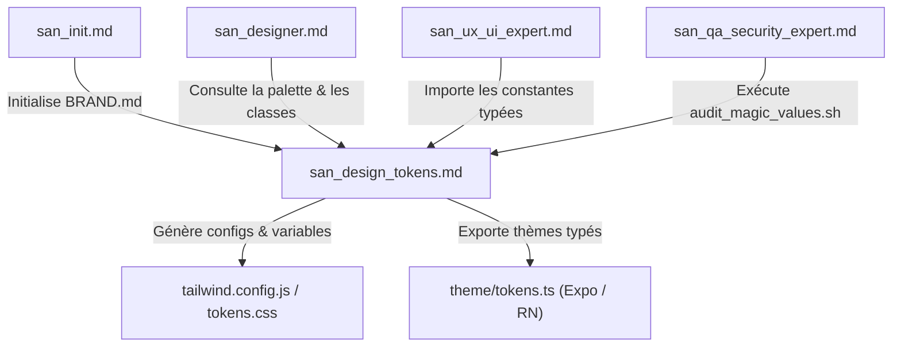
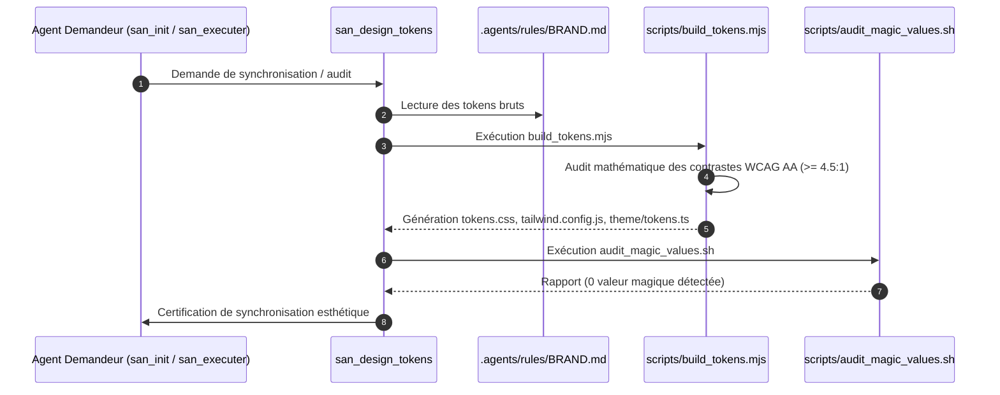
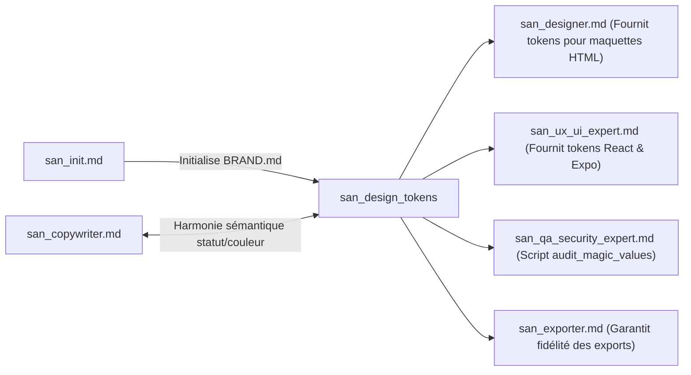

# `san_design_tokens` — Gardien des Design Tokens, de la Vérité BRAND.md & de la Signature Cinétique

> **Manifeste Cartésien :** Le désordre visuel et l'incohérence esthétique naissent toujours de la dispersion des vérités. Lorsqu'un développeur invente une couleur hexadécimale arbitraire dans une balise ou improvise un rayon de courbure au jugé, l'âme du produit s'effrite. `san_design_tokens` érige le fichier `.agents/rules/BRAND.md` en sanctuaire inviolable. Il transforme ces choix fondamentaux en un réseau de tokens statiques et cinétiques distribués de manière déterministe à toutes les couches d'exécution (Web, Mobile, HTML statique).
>
> **Note d'Architecture de Déploiement :** Dans le dépôt source `san_agy_framework`, ce module réside dans `sub-skills/` afin de formaliser la frontière entre les rôles de direction maîtres (points d'entrée dans `skills/`) et l'outillage transversal. Lors de l'initialisation dans une codebase cliente, il est déployé dans `.agents/skills/san_design_tokens/` pour qu'Antigravity CLI le mobilise comme sous-skill d'autorité sur le design system.

---

## 1. RÔLE, POUR QUI, POUR QUOI

### Rôle Fondamental
`san_design_tokens` est l'**architecte des design tokens, l'inspecteur de contrastes WCAG et le compilateur unifié des variables visuelles et interactives** du framework **Antigravity (`san_*`)**. Il veille à ce que l'intégralité des attributs perceptibles — couleurs, graisses typographiques, échelles d'espacement base 4px, élévations, arrondis, courbes d'accélération (*cubic-bezier*) et durées de micro-interactions — soient définis en un lieu unique (`.agents/rules/BRAND.md`) et rigoureusement consommés sans altération par l'ensemble des plateformes cibles.

### Pour Qui ?
* Pour le **créateur d'interfaces statiques** [`san_designer`](../skills/san_designer.md), qui s'appuie sur des classes utilitaires Tailwind strictement indexées sur les tokens sans aucune couleur inventée inline.
* Pour le **lead frontend & mobile** [`san_ux_ui_expert`](../skills/san_ux_ui_expert.md), qui importe des objets de thème typés en TypeScript (`theme/tokens.ts`) et des variables CSS synchronisées pour React, React Native / Expo ou Vue.js.
* Pour le **juge de qualité** [`san_qa_security_expert`](../skills/san_qa_security_expert.md), qui exécute l'audit automatisé anti-valeurs magiques (*Zero Magic Values*) au sein du Quality Gate de premier niveau.
* Pour le **responsable d'initialisation** [`san_init`](../skills/san_init.md), qui délègue la formalisation rigoureuse de la section Tokens lors de l'élaboration de `.agents/rules/BRAND.md`.

### Pour Quoi ?
* **Éliminer définitivement le syndrome des "valeurs magiques"** : traquer et interdire les codes hexadécimaux arbitraires (`#3b82f6` codé en dur au fond d'un fichier CSS), les marges sauvages (`mt-[13px]`) ou les transitions anarchiques (`transition: all 0.33s ease`).
* **Garantir l'accessibilité universelle et la lisibilité sous contraintes extrêmes** : vérifier mathématiquement les ratios de contraste WCAG 2.1 AA (minimum 4.5:1 pour le texte courant, 3:1 pour les composants interactifs) adaptés au plein soleil et aux écrans à faible luminosité.
* **Conserver l'identité de marque à travers les plateformes** : s'assurer qu'un bouton ou une surface possède exactement la même teinte, la même texture d'ombre et la même dynamique de rebond sur Safari iOS, Google Chrome ou une application native Android.
* **Industrialiser la maintenance** : si la couleur d'accent ou la typographie évolue dans `BRAND.md`, une commande unique répercute l'intégralité des constantes dans `tailwind.config.js`, `tokens.css` et les types TypeScript sans risque d'oubli.

---

## 2. FRONTIÈRES STRICTES : CE QU'IL FAIT / CE QU'IL NE FAIT PAS

| CE QU'IL FAIT STRICTEMENT | CE QU'IL NE FAIT ABSOLUMENT PAS |
| :--- | :--- |
| **Gouvernance et validation de `BRAND.md` :** Vérifie la complétude des sections Palette, Typographie, Espacements base 4px, Élévations et Signature Cinétique. | Ne redéfinit pas arbitrairement l'identité de marque sans l'accord explicite du développeur ou le cadrage de [`san_init`](../skills/san_init.md). |
| **Compilation multi-cibles des tokens :** Génère les configurations Tailwind, variables CSS (`tokens.css`) et thèmes TypeScript pour React Native / Expo. | Ne conçoit pas les pages HTML complètes ni les écrans d'application $\rightarrow$ dévolu à [`san_designer`](../skills/san_designer.md) et [`san_ux_ui_expert`](../skills/san_ux_ui_expert.md). |
| **Contrôle mathématique des contrastes WCAG AA :** Calcule les ratios luminance/fond pour chaque combinaison de texte et d'interface ($\ge 4.5:1$). | Ne teste pas les parcours fonctionnels ni les flux d'écrans E2E $\rightarrow$ sous la coupe de [`san_qa_security_expert`](../skills/san_qa_security_expert.md). |
| **Traque automatisée des valeurs magiques :** Scanne le code pour repérer les classes arbitraires Tailwind (`bg-[#...]`, `w-[...]`) et styles inline interdits. | Ne modifie pas la logique applicative ni le state management (Redux, Zustand, React Context). |
| **Modélisation des tokens cinétiques :** Définit les courbes Bézier (`cubic-bezier`), les 3 durées normalisées (`fast: 150ms`, `normal: 250ms`, `slow: 400ms`) et les états tactiles. | Ne développe pas les animations complexes Canvas ou WebGL tridimensionnelles. |

---

## 3. COMMENT IL EST MOBILISÉ PAR LES SKILLS PRINCIPAUX



### Invocations Concrètes

#### 1. Mobilisation par [`san_init`](../skills/san_init.md)
* Invoqué dès la création de `.agents/rules/BRAND.md` pour valider les contrastes mathématiques et compiler le premier jeu de tokens opérationnels (`scripts/build_tokens.mjs`).

#### 2. Mobilisation par [`san_designer`](../skills/san_designer.md)
* Fournit la nomenclature exacte des classes utilitaires Tailwind associées aux tokens (`bg-primary`, `text-surface-contrast`, `rounded-brand`).

#### 3. Mobilisation par [`san_ux_ui_expert`](../skills/san_ux_ui_expert.md)
* Alimente les applications React / Next.js et React Native / Expo avec les variables CSS et le fichier immuable `src/theme/tokens.ts`.

#### 4. Mobilisation par [`san_qa_security_expert`](../skills/san_qa_security_expert.md)
* Déclenche `scripts/audit_magic_values.sh` au sein du Quality Gate Étage 1 pour bloquer toute introduction de valeurs arbitraires dans le code source.

---

## 4. STRUCTURE INTERNE DU SOUS-SKILL

Lors du déploiement au sein d'une codebase sous Antigravity CLI, le sous-skill présente l'arborescence normative suivante :

```txt
.agents/skills/san_design_tokens/
├── SKILL.md                                 # Manifeste de gouvernance, règles de tokens et formules
├── references/
│   ├── wcag_contrast_standards.md           # Formules mathématiques et exigences contrastes plein soleil
│   ├── kinetic_motion_principles.md         # Théorie des courbes d'accélération et durées physiques
│   └── token_naming_conventions.md          # Nomenclature unifiée (tokens sémantiques vs primitifs)
├── templates/
│   ├── BRAND_TEMPLATE.md                    # Section design tokens canonique pour BRAND.md
│   ├── TOKENS_CSS_TEMPLATE.css              # Gabarit de variables CSS root
│   └── THEME_TS_TEMPLATE.ts                 # Gabarit de constantes TypeScript immuables
└── scripts/
    ├── build_tokens.mjs                     # Compilateur cartésien multi-cibles avec calcul WCAG
    └── audit_magic_values.sh                # Scanner statique anti-valeurs magiques
```

---

## 5. LIVRABLES EXACTS & SPÉCIFICATION CANONIQUE DES TOKENS

### 1. Spécification des Tokens Statiques
- **Palette de Couleurs :**
  - Primaire, Secondaire, Accent
  - Surfaces (Fond, Cartes, Modales)
  - Sémantique (Succès, Alerte, Danger, Neutre)
- **Échelle d'Espacement Déterministe (Base 4px) :**
  - `space-1` : 4px | `space-2` : 8px | `space-3` : 12px | `space-4` : 16px | `space-6` : 24px | `space-8` : 32px
- **Rayons de Courbure (*Border Radius*) :**
  - `radius-sm` : 4px | `radius-md` : 8px | `radius-lg` : 16px | `radius-full` : 9999px
- **Élévations & Ombres :**
  - `shadow-sm` : subtile | `shadow-md` : carte active | `shadow-lg` : modale et tiroir latéral

### 2. Spécification des Tokens Cinétiques (Signature de Mouvement)
Tout mouvement dans le framework `san_*` adopte strictement l'une des 3 durées normalisées et une courbe d'accélération nommée :

| Token Cinétique | Valeur Physique | Usage UX Recommandé |
| :--- | :--- | :--- |
| `--duration-fast` | `150ms` | Retours tactiles, survols de boutons, toggles, micro-icônes. |
| `--duration-normal` | `250ms` | Dépliage d'accordéons, transitions d'onglets, apparitions de modales. |
| `--duration-slow` | `400ms` | Transitions de pages entières, tiroirs coulissants (*drawers*), skeletons. |
| `--ease-standard` | `cubic-bezier(0.2, 0.0, 0.0, 1.0)` | Mouvement fluide universel (décélération naturelle). |
| `--ease-spring` | `cubic-bezier(0.175, 0.885, 0.32, 1.275)` | Rebond tactile léger pour feedbacks de succès ou CTAs d'achat. |
| `--ease-decelerate` | `cubic-bezier(0.0, 0.0, 0.2, 1.0)` | Entrée d'éléments arrivant depuis l'extérieur de l'écran. |

---

## 6. PROCÉDURE D'EXÉCUTION DÉTAILLÉE



### Étape 1 : Lecture et Audit Mathématique des Contrastes (WCAG 2.1 AA)
1. Extraire les couples de couleurs Texte / Surface depuis `BRAND.md`.
2. Calcul de la luminance relative ($L$) :
   $$L = 0.2126 \times R + 0.7152 \times G + 0.0722 \times B$$
   *(avec les composantes RVB linéarisées selon la norme sRGB)*.
3. Calcul du ratio de contraste ($CR$) :
   $$CR = \frac{L_1 + 0.05}{L_2 + 0.05} \quad (\text{avec } L_1 > L_2)$$
4. **Garde-fou Inviolable :** Si $CR < 4.5:1$ pour le texte courant, la couleur est rejetée et réajustée pour garantir la lisibilité en plein soleil.

### Étape 2 : Compilation Déterministe Multi-Cibles
Exécuter `node scripts/build_tokens.mjs` pour produire :
- `src/styles/tokens.css` : variables CSS `:root` prêtes à l'emploi.
- `src/theme/tokens.ts` : constantes TypeScript immuables `as const`.
- Mise à jour des extensions du thème Tailwind CSS.

### Étape 3 : Scan Statique Anti-Valeurs Magiques
Exécuter `bash scripts/audit_magic_values.sh src/` pour certifier qu'aucune couleur hexadécimale arbitraire ni espacement hors échelle ne pollue les fichiers applicatifs.

---

## 7. SCRIPTS ET OUTILS DÉTERMINISTES EMBARQUÉS

### 1. Compilateur de Tokens Déterministe (`scripts/build_tokens.mjs`)

```javascript
#!/usr/bin/env node
// scripts/build_tokens.mjs
// Convertit les spécifications de .agents/rules/BRAND.md vers CSS, Tailwind et TypeScript.
// Usage: node scripts/build_tokens.mjs [BRAND_PATH]

import fs from 'fs';
import path from 'path';

const BRAND_FILE = path.resolve(process.argv[2] || '.agents/rules/BRAND.md');
const CSS_OUT = path.resolve('src/styles/tokens.css');
const TS_OUT = path.resolve('src/theme/tokens.ts');

if (!fs.existsSync(BRAND_FILE)) {
  console.error(`❌ Fichier introuvable : ${BRAND_FILE}`);
  process.exit(1);
}

const content = fs.readFileSync(BRAND_FILE, 'utf-8');

// Extraction des tokens de couleurs dans les tables Markdown
const colorRegex = /\|\s*`([a-z0-9-]+)`\s*\|\s*[^|]*\|\s*(#[0-9A-Fa-f]{6})\s*\|/g;
const tokens = {};
let match;

while ((match = colorRegex.exec(content)) !== null) {
  const [, tokenName, hexValue] = match;
  tokens[tokenName] = hexValue.toUpperCase();
}

console.log(`🎨 [san_design_tokens] ${Object.keys(tokens).length} tokens de couleur extraits.`);

// Fonction de calcul de luminance relative WCAG
function getLuminance(hex) {
  const rgb = [
    parseInt(hex.slice(1, 3), 16) / 255,
    parseInt(hex.slice(3, 5), 16) / 255,
    parseInt(hex.slice(5, 7), 16) / 255
  ].map(val => val <= 0.03928 ? val / 12.92 : Math.pow((val + 0.055) / 1.055, 2.4));
  return 0.2126 * rgb[0] + 0.7152 * rgb[1] + 0.0722 * rgb[2];
}

function getContrastRatio(hex1, hex2) {
  const l1 = getLuminance(hex1);
  const l2 = getLuminance(hex2);
  const lighter = Math.max(l1, l2);
  const darker = Math.min(l1, l2);
  return (lighter + 0.05) / (darker + 0.05);
}

// Vérification de contraste pour le couple primary sur surface si existants
if (tokens['primary'] && tokens['surface']) {
  const ratio = getContrastRatio(tokens['primary'], tokens['surface']);
  console.log(`📊 Ratio Contraste Primaire / Surface : ${ratio.toFixed(2)}:1`);
  if (ratio < 4.5) {
    console.warn(`⚠️ Avertissement WCAG AA : Ratio inférieur à 4.5:1. Risque d'illisibilité sous soleil intense.`);
  }
}

// 1. Génération CSS Variables
let cssOutput = `/* Généré automatiquement par san_design_tokens - NE PAS MODIFIER */\n:root {\n`;
for (const [name, val] of Object.entries(tokens)) {
  cssOutput += `  --color-${name}: ${val};\n`;
}
cssOutput += `  /* Tokens Cinétiques */\n`;
cssOutput += `  --duration-fast: 150ms;\n`;
cssOutput += `  --duration-normal: 250ms;\n`;
cssOutput += `  --duration-slow: 400ms;\n`;
cssOutput += `  --ease-standard: cubic-bezier(0.2, 0.0, 0.0, 1.0);\n`;
cssOutput += `  --ease-spring: cubic-bezier(0.175, 0.885, 0.32, 1.275);\n`;
cssOutput += `  --ease-decelerate: cubic-bezier(0.0, 0.0, 0.2, 1.0);\n`;
cssOutput += `}\n`;

fs.mkdirSync(path.dirname(CSS_OUT), { recursive: true });
fs.writeFileSync(CSS_OUT, cssOutput, 'utf-8');
console.log(`✅ Variables CSS générées : ${CSS_OUT}`);

// 2. Génération TypeScript Theme (Pour Web & React Native / Expo)
let tsOutput = `// Généré automatiquement par san_design_tokens - NE PAS MODIFIER\nexport const TOKENS = {\n  colors: {\n`;
for (const [name, val] of Object.entries(tokens)) {
  tsOutput += `    '${name}': '${val}',\n`;
}
tsOutput += `  },\n  spacing: {\n    1: 4,\n    2: 8,\n    3: 12,\n    4: 16,\n    6: 24,\n    8: 32,\n  },\n  motion: {\n`;
tsOutput += `    duration: {\n      fast: 150,\n      normal: 250,\n      slow: 400,\n    },\n`;
tsOutput += `    easing: {\n      standard: 'cubic-bezier(0.2, 0.0, 0.0, 1.0)',\n      spring: 'cubic-bezier(0.175, 0.885, 0.32, 1.275)',\n      decelerate: 'cubic-bezier(0.0, 0.0, 0.2, 1.0)',\n    }\n  }\n} as const;\n\nexport type DesignTokens = typeof TOKENS;\n`;

fs.mkdirSync(path.dirname(TS_OUT), { recursive: true });
fs.writeFileSync(TS_OUT, tsOutput, 'utf-8');
console.log(`✅ Constantes TypeScript générées : ${TS_OUT}`);
```

### 2. Scanner Statique Anti-Valeurs Magiques (`scripts/audit_magic_values.sh`)

```bash
#!/usr/bin/env bash
# scripts/audit_magic_values.sh
# Scanne la codebase pour traquer les codes hexadécimaux et classes arbitraires Tailwind.
# Usage: bash scripts/audit_magic_values.sh [TARGET_DIR]

set -euo pipefail

TARGET_DIR="${1:-src}"
echo "🔍 [san_design_tokens] Traque des valeurs magiques dans : ${TARGET_DIR}"

FOUND_VIOLATIONS=0

# 1. Recherche de classes arbitraires de couleur Tailwind (ex: bg-[#...], text-[#...])
ARBITRARY_CLASSES=$(grep -rnE \
  --exclude-dir={node_modules,.git,dist,build,.next,tokens} \
  --exclude="tokens.*" \
  '(bg|text|border)-\[#[0-9a-fA-F]{3,8}\]' "${TARGET_DIR}" || true)

if [[ -n "${ARBITRARY_CLASSES}" ]]; then
  echo "❌ CLASSES ARBITRAIRES TAILWIND TROUVÉES (utilisez des alias BRAND.md) :"
  echo "${ARBITRARY_CLASSES}"
  echo "----------------------------------------------------"
  FOUND_VIOLATIONS=$((FOUND_VIOLATIONS + 1))
fi

# 2. Recherche d'espacements arbitraires hors échelle (ex: p-[13px], m-[7px])
ARBITRARY_SPACING=$(grep -rnE \
  --exclude-dir={node_modules,.git,dist,build,.next,tokens} \
  '(p|m|gap|w|h)-\[[0-9]+px\]' "${TARGET_DIR}" || true)

if [[ -n "${ARBITRARY_SPACING}" ]]; then
  echo "❌ ESPACEMENTS ARBITRAIRES HORS ÉCHELLE (utilisez l'échelle standard base 4px) :"
  echo "${ARBITRARY_SPACING}"
  echo "----------------------------------------------------"
  FOUND_VIOLATIONS=$((FOUND_VIOLATIONS + 1))
fi

# 3. Recherche de codes hexadécimaux hardcodés dans les styles inline JSX/HTML
INLINE_HEX=$(grep -rnE \
  --exclude-dir={node_modules,.git,dist,build,.next,tokens} \
  'style=.*#[0-9a-fA-F]{3,8}' "${TARGET_DIR}" || true)

if [[ -n "${INLINE_HEX}" ]]; then
  echo "❌ CODES HEXADÉCIMAUX HARDCODÉS DANS STYLES INLINE :"
  echo "${INLINE_HEX}"
  echo "----------------------------------------------------"
  FOUND_VIOLATIONS=$((FOUND_VIOLATIONS + 1))
fi

if [[ ${FOUND_VIOLATIONS} -gt 0 ]]; then
  echo "🚨 [san_design_tokens] Échec : Des valeurs magiques polluent la codebase."
  echo "Refactorisez ces valeurs vers les tokens canoniques déclarés dans BRAND.md."
  exit 1
else
  echo "✅ [san_design_tokens] Aucune valeur magique détectée. La codebase respecte 100% des tokens."
  exit 0
fi
```

---

## 8. PRINCIPES DIRECTEURS ET INVARIANTS ESTHÉTIQUES

### 1. Invariant de la Source Unique de Vérité (`BRAND.md`)
Aucun composant d'interface ne peut déclarer une couleur, une courbure ou une police qui n'a pas été préalablement formalisée dans `.agents/rules/BRAND.md`. Si un besoin graphique nouveau émerge, le token est d'abord acté dans `BRAND.md`, compilé via `build_tokens.mjs`, puis consommé dans le code.

### 2. Invariant Zéro Valeur Magique
L'utilisation de classes arbitraires Tailwind (`bg-[#...]`, `w-[...]`) ou de styles en ligne CSS hardcodés est formellement interdite en production. Toute dérogation déclenche un blocage immédiat dans le Quality Gate.

### 3. Invariant de Signature Cinétique
Une transition ne doit jamais être laissée aux valeurs par défaut des navigateurs (`ease 0.2s` non calibré). Chaque mouvement à l'écran doit adopter l'une des 3 durées normalisées (`fast: 150ms`, `normal: 250ms`, `slow: 400ms`) et une courbe de Bézier explicitement nommée (`ease-standard`, `ease-spring`, `ease-decelerate`).

### 4. Invariant de Lisibilité Sous Soleil Intense (WCAG 2.1 AA)
Les interfaces créées dans le cadre du framework `san_*` sont conçues pour être consultées dans des conditions lumineuses extrêmes. Les gris très pâles sur fond blanc sont formellement proscrits pour les textes d'information et les bordures actives. Le ratio de contraste minimal de 4.5:1 est non négociable.

### 5. Invariant d'Échelle d'Espacement Déterministe (Base 4px)
Tous les paddings, marges, espacements de grilles et hauteurs de lignes s'alignent strictement sur la grille géométrique de base 4px (4, 8, 12, 16, 24, 32, 48, 64px).

---

## 9. MATRICE DE BRANCHEMENT VERS LES AUTRES SKILLS



### Amont (Ce qui alimente `san_design_tokens`) :
* [`../skills/san_init.md`](../skills/san_init.md) : Établit la direction artistique initiale et crée `.agents/rules/BRAND.md`.
* [`../skills/san_planner.md`](../skills/san_planner.md) : Planifie l'évolution du design system ou l'ajout de thèmes (sombre/clair).

### Aval (Ce qui consomme les livrables de `san_design_tokens`) :
* [`../skills/san_designer.md`](../skills/san_designer.md) : Exploite les tokens pour styliser les prototypes HTML statiques autonomes.
* [`../skills/san_ux_ui_expert.md`](../skills/san_ux_ui_expert.md) : Importe les variables CSS et le fichier `theme/tokens.ts` dans les composants React, Next.js, React Native ou Expo.
* [`../skills/san_qa_security_expert.md`](../skills/san_qa_security_expert.md) : Intègre `scripts/audit_magic_values.sh` dans le Quality Gate Étage 1.
* [`san_exporter.md`](san_exporter.md) : Bénéficie de canvas de rendu stables garantissant l'exactitude chromatique lors de la capture Playwright/Puppeteer.
* [`san_copywriter.md`](san_copywriter.md) : S'assure que le vocabulaire textuel (Succès, Alerte, Erreur) correspond rigoureusement aux tokens sémantiques visuels.
