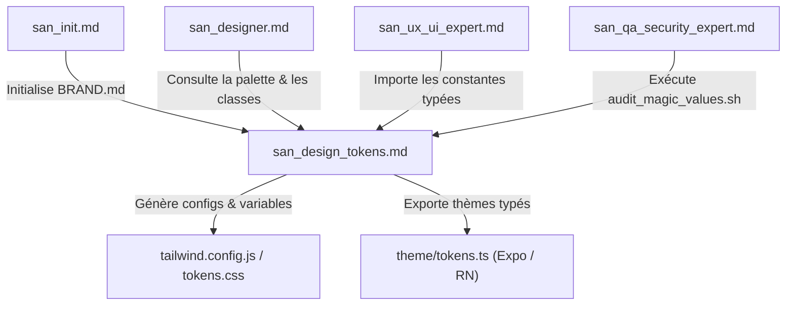
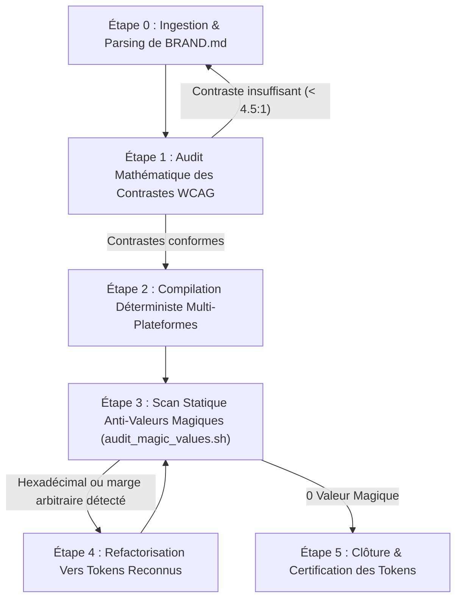
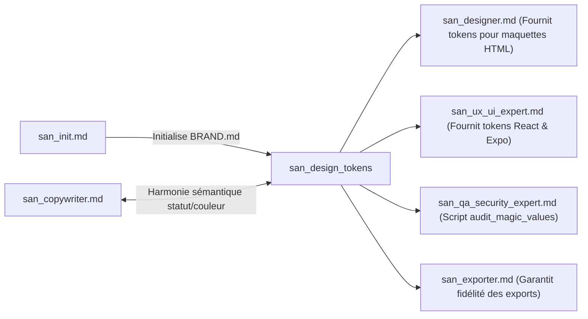

# SUB-SKILL : `san_design_tokens` — Gardien des Design Tokens, de la Vérité BRAND.md & de la Signature Cinétique

> **Manifeste Cartésien :** Le désordre visuel et l'incohérence esthétique naissent toujours de la dispersion des vérités. Lorsqu'un développeur invente une couleur hexadécimale arbitraire dans une balise ou improvise un rayon de courbure au jugé, l'âme du produit s'effrite. `san_design_tokens` érige le fichier `.agents/rules/BRAND.md` en sanctuaire inviolable. Il transforme ces choix fondamentaux en un réseau de tokens statiques et cinétiques distribués de manière déterministe à toutes les couches d'exécution (Web, Mobile, HTML statique).
>
> **Note d'Architecture de Déploiement :** Dans le dépôt source `san_agy_framework`, ce module réside dans `sub-skills/` pour séparer clairement les rôles de gouvernance stratégique de l'outillage transversal. Lors de l'initialisation ou de l'installation dans une codebase cliente (React, Next.js, Laravel, Expo, AdonisJS, etc.), l'installateur le déploie automatiquement dans `.agents/skills/san_design_tokens.md` pour qu'Antigravity le mobilise comme sous-skill d'autorité sur le design system.

---

## 1. RÔLE, POUR QUI, POUR QUOI

### Rôle
`san_design_tokens` est l'inspecteur en chef et le compilateur unifié des variables visuelles et interactives du framework **Antigravity (`san_*`)**. Il veille à ce que l'intégralité des attributs perceptibles — couleurs, graisses typographiques, échelles d'espacement, élévations, arrondis, courbes d'accélération (*easing*) et durées de micro-interactions — soient définis en un lieu unique et rigoureusement consommés sans altération par l'ensemble des plateformes cibles.

### Pour qui ?
* Pour le **créateur d'interfaces statiques** [`san_designer`](../skills/san_designer.md), qui s'appuie sur des classes utilitaires Tailwind strictement indexées sur les tokens sans aucune couleur inventée inline.
* Pour le **lead frontend & mobile** [`san_ux_ui_expert`](../skills/san_ux_ui_expert.md), qui a besoin d'importer des objets de thème typés en TypeScript (`theme/tokens.ts`) et des variables CSS synchronisées pour React, React Native / Expo ou Vue.js.
* Pour le **juge de qualité** [`san_qa_security_expert`](../skills/san_qa_security_expert.md), qui exécute l'audit automatisé anti-valeurs magiques (*Zero Magic Values*) au sein du Quality Gate de premier niveau.
* Pour le **responsable d'initialisation** [`san_init`](../skills/san_init.md), qui délègue la formalisation rigoureuse de la section Tokens lors de l'élaboration de `.agents/rules/BRAND.md`.

### Pour quoi ?
* **Éliminer définitivement le syndrome des "valeurs magiques"** : traquer et interdire les codes hexadécimaux arbitraires (`#3b82f6` codé en dur au fond d'un fichier CSS), les marges sauvages (`mt-[13px]`) ou les transitions anarchiques (`transition: all 0.33s ease`).
* **Garantir l'accessibilité universelle et la lisibilité sous contraintes** : vérifier mathématiquement les ratios de contraste WCAG 2.1 AA (minimum 4.5:1 pour le texte courant, 3:1 pour les composants interactifs) adaptés au plein soleil et aux écrans à faible luminosité.
* **Conserver l'identité de marque à travers les plateformes** : s'assurer qu'un bouton ou une surface possède exactement la même teinte, la même texture d'ombre et la même dynamique de rebond sur Safari iOS, Google Chrome ou une application native Android.
* **Industrialiser la maintenance** : si la couleur d'accent ou la typographie évolue dans `BRAND.md`, une commande unique répercute l'intégralité des constantes dans `tailwind.config.js`, `tokens.css` et les types TypeScript sans risque d'oubli.

---

## 2. FRONTIÈRES STRICTES : CE QU'IL FAIT / CE QU'IL NE FAIT PAS

| CE QU'IL FAIT STRICTEMENT | CE QU'IL NE FAIT ABSOLUMENT PAS |
| :--- | :--- |
| **Gouvernance et validation de `BRAND.md` :** Vérifie la complétude des sections Palette, Typographie, Espacements, Élévations et Signature Cinétique. | Ne redéfinit pas arbitrairement l'identité de marque sans l'accord explicite du développeur ou le cadrage de [`san_init`](../skills/san_init.md). |
| **Compilation multi-cibles des tokens :** Génère les configurations `tailwind.config.js`, variables CSS (`globals.css` / `tokens.css`) et thèmes TypeScript pour React Native / Expo. | Ne conçoit pas les pages HTML complètes ni les écrans d'application $\rightarrow$ dévolu à [`san_designer`](../skills/san_designer.md) et [`san_ux_ui_expert`](../skills/san_ux_ui_expert.md). |
| **Contrôle mathématique des contrastes WCAG AA :** Calcule les ratios luminance/fond pour chaque combinaison de texte et d'interface. | Ne teste pas les parcours fonctionnels ni les flux d'écrans E2E $\rightarrow$ sous la coupe de [`san_qa_security_expert`](../skills/san_qa_security_expert.md). |
| **Traque automatisée des valeurs magiques :** Scanne le code pour repérer les classes arbitraires Tailwind (`bg-[#...]`, `w-[...]`) et styles inline interdits. | Ne modifie pas la logique applicative ni le state management (Redux, Zustand, React Context). |
| **Modélisation des tokens cinétiques :** Définit les courbes Bézier (`cubic-bezier`), les échelles temporelles (`fast`, `normal`, `slow`) et les états tactiles (`:active`, scale haptique). | Ne développe pas les animations complexes Canvas ou WebGL tridimensionnelles. |

---

## 3. COMMENT IL EST MOBILISÉ PAR LES SKILLS PRINCIPAUX



### 1. Par [`san_init`](../skills/san_init.md) (Phase d'Onboarding & Setup)
Dès que `san_init` recueille les volontés esthétiques du produit ou rétro-ingénie une codebase existante, il appelle `san_design_tokens` pour formaliser l'annexe technique de `BRAND.md` et compiler le premier jeu de fichiers de tokens opérationnels.

### 2. Par [`san_designer`](../skills/san_designer.md) (Prototypage Visuel Haute Fidélité)
`san_designer` interroge `san_design_tokens` pour s'assurer que chaque classe Tailwind utilisée dans ses maquettes (`/design/mockup/*`) correspond strictement à un alias déclaré dans le design system (ex: `bg-primary`, `text-surface-contrast`, `rounded-brand`).

### 3. Par [`san_ux_ui_expert`](../skills/san_ux_ui_expert.md) (Intégration Web & Mobile)
Lors du codage des composants réutilisables (boutons, cartes, fenêtres modales, barres de navigation), `san_ux_ui_expert` consomme les tokens cinétiques (ex: durée `250ms`, accélération `ease-brand-out`, effet tactile `scale(0.98)`) et les variables CSS fournies par `san_design_tokens`.

### 4. Par [`san_qa_security_expert`](../skills/san_qa_security_expert.md) (Quality Gate Étage 1)
Lors de l'analyse statique du code avant toute revue, `san_qa_security_expert` invoque le script d'audit de `san_design_tokens` pour s'assurer qu'aucun contributeur n'a introduit de valeurs hexadécimales hardcodées ou de styles en ligne suspects.

---

## 4. STRUCTURE INTERNE DU SOUS-SKILL

```txt
sub-skills/san_design_tokens/         # (Déployé dans .agents/skills/san_design_tokens/ chez le client)
├── SKILL.md                          # Ce manifeste de gouvernance cartésienne
├── references/
│   ├── brand_contract_spec.md        # Schéma normé attendu pour .agents/rules/BRAND.md
│   ├── wcag_contrast_ratios.md       # Tables de conformité et calculs de ratios de contraste
│   └── kinetic_design_rules.md       # Spécifications des courbes de bézier, haptique et vélocité
├── templates/
│   ├── tailwind.config.template.js   # Modèle de configuration Tailwind intégrant les tokens
│   ├── tokens.template.css           # Variables CSS natives (:root / [data-theme])
│   ├── theme.template.ts             # Thème typé TypeScript pour React Native / Expo
│   └── brand_tokens_schema.json      # Schéma JSON Schema pour validation formelle de BRAND.md
└── scripts/
    ├── audit_magic_values.sh         # Scanner bash de détection des valeurs magiques dans le code
    └── build_tokens.mjs              # Compilateur node convertissant BRAND.md en artefacts cibles
```

---

## 5. LIVRABLES EXACTS

`san_design_tokens` génère et maintient à jour les artefacts suivants à la racine de la codebase cliente :

```txt
[racine_du_projet]/
├── .agents/rules/
│   └── BRAND.md                      # Source de vérité suprême (Palette, Typo, Motion)
├── tailwind.config.js (ou .ts)       # Extension du thème avec les alias exacts de BRAND.md
├── src/ (ou app/, ou resources/css/)
│   ├── styles/
│   │   └── tokens.css                # Variables CSS :root injectées au build
│   └── theme/
│       └── tokens.ts                 # Constantes TS typées pour React Native, Expo ou Styled
└── docs/
    └── DESIGN_TOKENS_AUDIT.md        # Rapport périodique de conformité et scores WCAG
```

### Spécification des Tokens Statiques et Cinétiques dans `BRAND.md`
```markdown
# BRAND.md — Source de Vérité Visuelle & Cinétique

## 1. Direction Artistique & Archétype
- Archétype : L'Artisan Bienveillant & Haute Efficacité
- Atmosphère : Chaleureuse, épurée, rigoureuse, lisible sous plein soleil.

## 2. Palette Hexadécimale Stricte
| Token | Rôle / Usage | Hex | Contraste sur Fond |
| :--- | :--- | :--- | :--- |
| `primary` | Couleur dominante d'action | `#1D4ED8` | 7.8:1 (WCAG AAA) |
| `primary-hover`| Survol et appui bouton principal| `#1E40AF` | 9.2:1 (WCAG AAA) |
| `secondary` | Marqueurs secondaires, badges | `#0F766E` | 6.5:1 (WCAG AA) |
| `accent` | Indicateurs d'urgence / notifications | `#D97706` | 4.8:1 (WCAG AA) |
| `background` | Fond général des écrans | `#F8FAFC` | Réf (Fond) |
| `surface` | Fond des cartes et conteneurs | `#FFFFFF` | 1.1:1 sur Background |
| `text-primary`| Titres et corps de texte critique| `#0F172A` | 14.5:1 (WCAG AAA)|
| `text-muted` | Labels secondaires, métadonnées | `#475569` | 5.2:1 (WCAG AA) |
| `border-subtle`| Bordures de cartes et séparateurs| `#E2E8F0` | 1.3:1 (Subtil) |
| `success` | Confirmation paiement, état valide | `#16A34A` | 4.6:1 (WCAG AA) |
| `warning` | Alerte réseau, attente USSD | `#CA8A04` | 4.5:1 (WCAG AA) |
| `danger` | Erreurs bloquantes, annulations | `#DC2626` | 5.1:1 (WCAG AA) |

## 3. Typographies & Hiérarchie
- Famille Titres : `Inter`, -apple-system, sans-serif (Display robuste)
- Famille Corps : `Inter`, Roboto, sans-serif (Lisibilité immédiate)
- Échelle :
  * `xs`: 12px (leading: 16px) — Badges, mentions légales
  * `sm`: 14px (leading: 20px) — Métadonnées, sous-titres de cartes
  * `base`: 16px (leading: 24px) — Corps de texte, inputs de formulaires
  * `lg`: 18px (leading: 28px) — Boutons principaux, sous-titres d'écrans
  * `xl`: 20px (leading: 28px) — Titres de cartes et sections
  * `2xl`: 24px (leading: 32px) — Titres d'écrans mobile
  * `3xl`: 30px (leading: 36px) — Hero titles et synthèses financières

## 4. Échelle d'Espacement & Forme
- Unité de base : `4px`
- Échelle : `4px` (1), `8px` (2), `12px` (3), `16px` (4), `24px` (6), `32px` (8), `48px` (12), `64px` (16)
- Rayons de courbure :
  * `rounded-sm`: 4px (Badges, tags)
  * `rounded-md`: 8px (Champs de texte, inputs)
  * `rounded-lg`: 12px (Boutons d'action, cartes standard)
  * `rounded-xl`: 16px (Modales, conteneurs principaux)
  * `rounded-full`: 9999px (Pastilles de statut, avatars)

## 5. Signature Cinétique & Motion Design
- Courbes d'Accélération (Cubic-Bezier) :
  * `ease-standard` : `cubic-bezier(0.2, 0.0, 0.0, 1.0)` (Navigation, ouverture de volet)
  * `ease-decelerate` : `cubic-bezier(0.0, 0.0, 0.2, 1.0)` (Entrée d'éléments à l'écran)
  * `ease-accelerate` : `cubic-bezier(0.4, 0.0, 1.0, 1.0)` (Sortie d'éléments)
  * `ease-spring` : `cubic-bezier(0.175, 0.885, 0.32, 1.275)` (Rebond tactile boutons)
- Durées Normalisées :
  * `duration-fast` : `150ms` (Micro-états d'appui, survols, toggles)
  * `duration-normal` : `250ms` (Transitions de pages, modales, accordéons)
  * `duration-slow` : `400ms` (Transitions d'écran complètes, animations d'orchestration)
- Micro-interactions Tactiles Obligatoires :
  * Boutons : Réaction active immédiate avec réduction d'échelle `transform: scale(0.98)` et retour haptique léger.
```

---

## 6. PROCÉDURE « ZÉRO NÉGLIGENCE » EN 5 ÉTAPES



### Étape 0 : Ingestion et Vérification Formelle de `BRAND.md`
1. Le sous-skill lit `.agents/rules/BRAND.md`.
2. Il s'assure que toutes les sections clés sont renseignées sans valeur `TBD` ou `undefined`.
3. Chaque token doit être muni d'un libellé fonctionnel (`primary`, `surface`, etc.) et d'une valeur hexadécimale à 6 caractères (`#RRGGBB`).

### Étape 1 : Audit Mathématique des Ratios de Contraste (WCAG 2.1 AA)
1. Calcul de la luminance relative ($L$) pour chaque couple couleur de texte / couleur de fond :
   $$L = 0.2126 \times R + 0.7152 \times G + 0.0722 \times B$$
   avec les composantes RVB linéarisées.
2. Calcul du ratio de contraste ($CR$) :
   $$CR = \frac{L_1 + 0.05}{L_2 + 0.05} \quad (\text{avec } L_1 > L_2)$$
3. **Règle de rejet :** Si $CR < 4.5:1$ pour le texte principal sur son fond, le token est formellement retoqué et ajusté pour préserver la lisibilité en plein soleil.

### Étape 2 : Compilation Déterministe Multi-Plateformes
Lancement du compilateur `scripts/build_tokens.mjs` qui génère automatiquement :
* `tailwind.config.js` (ou enrichit le bloc `theme.extend`) ;
* `tokens.css` (variables CSS `--color-primary`, `--ease-standard`, etc.) ;
* `theme/tokens.ts` (constantes immuables `as const` pour applications React Native / Expo).

### Étape 3 : Scan Statique Anti-Valeurs Magiques
Exécution du script d'audit dans la racine du projet :
```bash
bash scripts/audit_magic_values.sh src/
```
Le script passe au crible chaque fichier source pour relever :
* Les codes hexadécimaux non déclarés (`#123456`, `#abc`) dans les fichiers CSS, TSX, JSX, HTML.
* Les classes Tailwind arbitraires de couleur (`bg-[#...]`, `text-[#...]`).
* Les espacements arbitraires (`p-[11px]`, `gap-[17px]`).
* Les durées arbitraires (`duration-[230ms]`).

### Étape 4 : Refactorisation et Alignement
Toute valeur brute détectée est immédiatement convertie en token canonique :
* `text-[#1D4ED8]` $\rightarrow$ `text-primary`
* `px-[16px]` $\rightarrow$ `px-4`
* `transition-all duration-300` $\rightarrow$ `transition-all duration-normal ease-standard`

### Étape 5 : Clôture & Archivage
Génération du rapport `docs/DESIGN_TOKENS_AUDIT.md` certifiant la conformité totale de la codebase.

---

## 7. SCRIPTS ET COMPILATEUR EMBARQUÉS

### 1. Compilateur de Tokens Déterministe (`scripts/build_tokens.mjs`)
```javascript
#!/usr/bin/env node
// scripts/build_tokens.mjs
// Convertit les spécifications de .agents/rules/BRAND.md vers Tailwind, CSS et TypeScript.

import fs from 'fs';
import path from 'path';

const BRAND_FILE = path.resolve('.agents/rules/BRAND.md');
const CSS_OUT = path.resolve('src/styles/tokens.css');
const TS_OUT = path.resolve('src/theme/tokens.ts');

if (!fs.existsSync(BRAND_FILE)) {
  console.error(`❌ Fichier introuvable : ${BRAND_FILE}`);
  process.exit(1);
}

const content = fs.readFileSync(BRAND_FILE, 'utf-8');

// Extraction simple de la table de couleurs hexadécimales
const colorRegex = /\|\s*`([a-z0-9-]+)`\s*\|\s*[^|]*\|\s*(#[0-9A-Fa-f]{6})\s*\|/g;
const tokens = {};
let match;

while ((match = colorRegex.exec(content)) !== null) {
  const [, tokenName, hexValue] = match;
  tokens[tokenName] = hexValue;
}

console.log(`🎨 [san_design_tokens] ${Object.keys(tokens).length} tokens de couleur extraits.`);

// 1. Génération CSS Variables
let cssOutput = `/* Généré automatiquement par san_design_tokens - NE PAS MODIFIER */\n:root {\n`;
for (const [name, val] of Object.entries(tokens)) {
  cssOutput += `  --color-${name}: ${val};\n`;
}
cssOutput += `  --ease-standard: cubic-bezier(0.2, 0.0, 0.0, 1.0);\n`;
cssOutput += `  --ease-spring: cubic-bezier(0.175, 0.885, 0.32, 1.275);\n`;
cssOutput += `  --duration-fast: 150ms;\n`;
cssOutput += `  --duration-normal: 250ms;\n`;
cssOutput += `  --duration-slow: 400ms;\n`;
cssOutput += `}\n`;

fs.mkdirSync(path.dirname(CSS_OUT), { recursive: true });
fs.writeFileSync(CSS_OUT, cssOutput, 'utf-8');
console.log(`✅ Fichier CSS généré : ${CSS_OUT}`);

// 2. Génération TypeScript Theme
let tsOutput = `// Généré automatiquement par san_design_tokens - NE PAS MODIFIER\nexport const TOKENS = {\n  colors: {\n`;
for (const [name, val] of Object.entries(tokens)) {
  tsOutput += `    '${name}': '${val}',\n`;
}
tsOutput += `  },\n  motion: {\n`;
tsOutput += `    fast: 150,\n    normal: 250,\n    slow: 400,\n`;
tsOutput += `    easing: {\n      standard: 'cubic-bezier(0.2, 0.0, 0.0, 1.0)',\n      spring: 'cubic-bezier(0.175, 0.885, 0.32, 1.275)',\n    }\n  }\n} as const;\n\nexport type DesignTokens = typeof TOKENS;\n`;

fs.mkdirSync(path.dirname(TS_OUT), { recursive: true });
fs.writeFileSync(TS_OUT, tsOutput, 'utf-8');
console.log(`✅ Fichier TypeScript généré : ${TS_OUT}`);
```

### 2. Scanner Bash Anti-Valeurs Magiques (`scripts/audit_magic_values.sh`)
```bash
#!/usr/bin/env bash
# scripts/audit_magic_values.sh
# Scanne la codebase pour traquer les codes hexadécimaux et classes arbitraires Tailwind.

set -euo pipefail

TARGET_DIR="${1:-src}"
echo "🔍 [san_design_tokens] Traque des valeurs magiques dans : ${TARGET_DIR}"

FOUND_VIOLATIONS=0

# 1. Recherche de classes arbitraires de couleur Tailwind (ex: bg-[#...], text-[#...])
ARBITRARY_CLASSES=$(grep -rnE '(bg|text|border)-\[#[0-9a-fA-F]{3,8}\]' "${TARGET_DIR}" || true)
if [[ -n "${ARBITRARY_CLASSES}" ]]; then
  echo "❌ CLASSES ARBITRAIRES TAILWIND TROUVÉES (utilisez des alias BRAND.md) :"
  echo "${ARBITRARY_CLASSES}"
  FOUND_VIOLATIONS=$((FOUND_VIOLATIONS + 1))
fi

# 2. Recherche d'espacements arbitraires (ex: p-[13px], m-[7px])
ARBITRARY_SPACING=$(grep -rnE '(p|m|gap|w|h)-\[[0-9]+px\]' "${TARGET_DIR}" || true)
if [[ -n "${ARBITRARY_SPACING}" ]]; then
  echo "❌ ESPACEMENTS ARBITRAIRES HORS ÉCHELLE (utilisez l'échelle standard base 4px) :"
  echo "${ARBITRARY_SPACING}"
  FOUND_VIOLATIONS=$((FOUND_VIOLATIONS + 1))
fi

# 3. Recherche de codes hexadécimaux hardcodés dans les styles inline JSX/HTML
INLINE_HEX=$(grep -rnE 'style=.*#[0-9a-fA-F]{3,8}' "${TARGET_DIR}" || true)
if [[ -n "${INLINE_HEX}" ]]; then
  echo "❌ CODES HEXADÉCIMAUX HARDCODÉS DANS STYLES INLINE :"
  echo "${INLINE_HEX}"
  FOUND_VIOLATIONS=$((FOUND_VIOLATIONS + 1))
fi

if [[ ${FOUND_VIOLATIONS} -gt 0 ]]; then
  echo "🚨 [san_design_tokens] Échec : Des valeurs magiques polluent la codebase."
  exit 1
else
  echo "✅ [san_design_tokens] Aucune valeur magique détectée. La codebase respecte 100% des tokens."
  exit 0
fi
```

---

## 8. PRINCIPES DIRECTEURS & INVARIANTS ESTHÉTIQUES

### 1. Invariant de la Source Unique de Vérité (`BRAND.md`)
Aucun composant d'interface ne peut déclarer une couleur, une courbure ou une police qui n'a pas été préalablement formalisée dans `.agents/rules/BRAND.md`. Si un besoin graphique nouveau émerge, le token est d'abord acté dans `BRAND.md`, compilé via `build_tokens.mjs`, puis consommé dans le code.

### 2. Invariant Zéro Valeur Magique
L'utilisation de classes arbitraires Tailwind (`bg-[#...]`, `w-[...]`) ou de styles en ligne CSS hardcodés est formellement interdite en production. Toute dérogation déclenche un blocage immédiat dans le Quality Gate.

### 3. Invariant de Signature Cinétique
Une transition ne doit jamais être laissée aux valeurs par défaut des navigateurs (`ease 0.2s` non calibré). Chaque mouvement à l'écran doit adopter l'une des 3 durées normalisées (`fast: 150ms`, `normal: 250ms`, `slow: 400ms`) et une courbe de Bézier explicitement nommée (`ease-standard`, `ease-spring`).

### 4. Invariant de Lisibilité Sous Soleil Intense
Les interfaces créées dans le cadre du framework `san_*` sont destinées à être consultées dans des conditions lumineuses extrêmes. Les gris très pâles sur fond blanc sont formellement proscrits pour les textes d'information et les bordures actives. Le ratio de contraste minimal de 4.5:1 est non négociable.

---

## 9. MATRICE DE BRANCHEMENT VERS LES AUTRES SKILLS



### Amont (Ce qui alimente `san_design_tokens`)
* [`../skills/san_init.md`](../skills/san_init.md) : Établit la direction artistique initiale et crée `.agents/rules/BRAND.md`.
* [`../skills/san_planner.md`](../skills/san_planner.md) : Planifie l'évolution du design system ou l'ajout de thèmes (sombre/clair).

### Aval (Ce qui consomme les livrables de `san_design_tokens`)
* [`../skills/san_designer.md`](../skills/san_designer.md) : Exploite les tokens pour styliser les prototypes HTML statiques autonomes.
* [`../skills/san_ux_ui_expert.md`](../skills/san_ux_ui_expert.md) : Importe les variables CSS et le fichier `theme/tokens.ts` dans les composants React, Next.js, React Native ou Expo.
* [`../skills/san_qa_security_expert.md`](../skills/san_qa_security_expert.md) : Intègre `scripts/audit_magic_values.sh` dans le Quality Gate Étage 1.
* [`san_exporter.md`](san_exporter.md) : Bénéficie de canvas de rendu stables garantissant l'exactitude chromatique lors de la capture Playwright/Puppeteer.
* [`san_copywriter.md`](san_copywriter.md) : S'assure que le vocabulaire textuel (Succès, Alerte, Erreur) correspond rigoureusement aux tokens sémantiques visuels.
