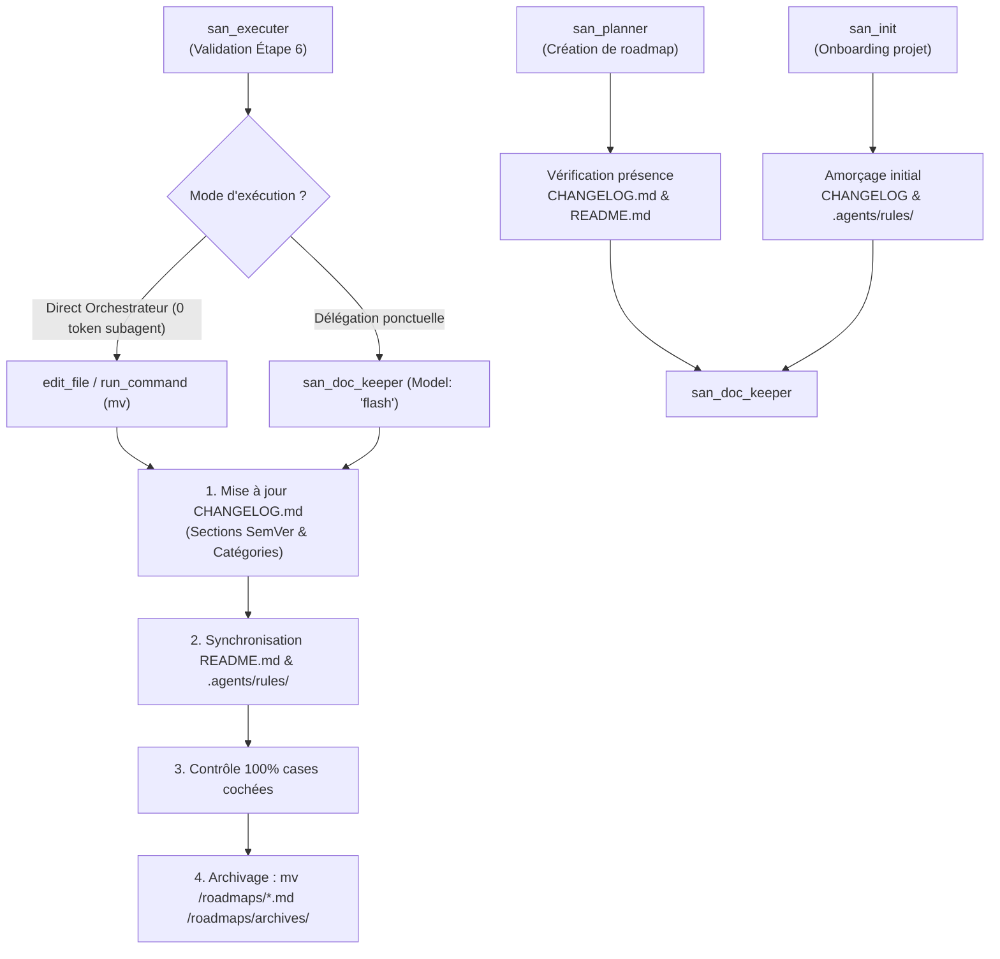
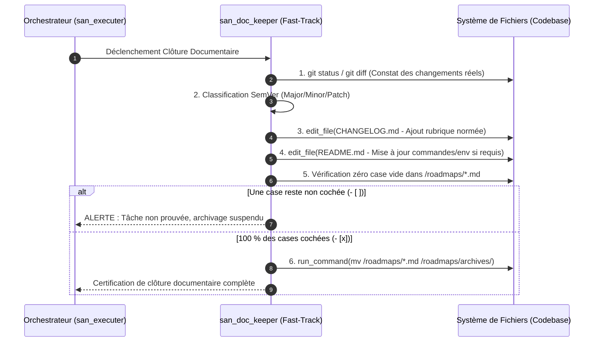
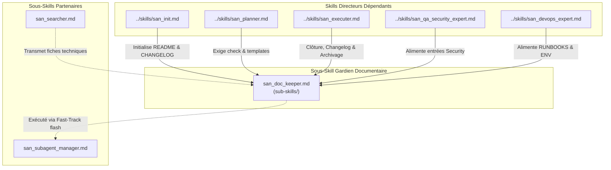

# `san_doc_keeper` — Gardien de l'Intégrité Documentaire, Synchronisation et Hygiène de Versioning

> **Note d'implantation architecturale :**  
> Au sein du dépôt source `san_agy_framework`, ce sous-skill réside dans `sub-skills/` afin de distinguer structurellement les rôles directeurs (entry points dans `skills/`) de l'outillage transversal. Lors de l'installation au sein d'une codebase cliente par le script d'initialisation, il est déployé dans `.agents/skills/san_doc_keeper/` pour être reconnu nativement par le moteur d'exécution Antigravity CLI.

---

## 1. RÔLE, POUR QUI, POUR QUOI

### Rôle Fondamental
`san_doc_keeper` est le **gardien de l'intégrité documentaire, de la traçabilité et de l'hygiène de versioning** du framework **Antigravity (`san_*`)**. Il incarne le **Scribe Rigoureux & Archiviste Technique Continu** : sa mission est de veiller à ce qu'aucune modification de code ne reste sans trace écrite, qu'aucun `README.md` ne devienne désaligné de la réalité de la codebase, que les feuilles de route achevées soient promptement archivées dans `/roadmaps/archives/`, et que le journal des modifications (`CHANGELOG.md`) soit rigoureusement tenu selon la norme internationale **Keep a Changelog 1.1.0** couplée à **Semantic Versioning 2.0.0 (SemVer)**.

### Pour Qui ?
- **Pour le développeur et l'équipe technique :** qui disposent d'un historique limpide, daté et catégorisé de chaque livraison, facilitant les revues de code, la publication de release notes et la maintenance à long terme.
- **Pour l'ensemble des agents du framework ([san_executer](../skills/san_executer.md), [san_planner](../skills/san_planner.md), [san_init](../skills/san_init.md)) :** qui s'appuient sur une mémoire vivante et des règles contextuelles `.agents/rules/*.md` toujours en phase avec les dépendances et commandes réelles du projet.

### Pour Quoi ?
- **Prévenir la pourriture documentaire (*Documentation Rot*) :** lorsque le code évolue mais que la documentation stagne, les agents futurs sont induits en erreur par des informations périmées, entraînant hallucinations et régressions.
- **Garantir le protocole « Fast-Track d'Hygiène » (*Zero-Token Waste*) :** les opérations ménagères (cochage de cases de tâches prouvées, déplacement de fichiers via `mv`, insertion d'entrées textuelles dans le changelog) sont exécutées directement par l'orchestrateur ou par un ouvrier ultra-rapide en **`Model: 'flash'`**, évitant de mobiliser des modèles lourds pour de la simple tenue de registre.
- **Assurer la clôture déterministe des roadmaps :** aucune roadmap active ne traîne indéfiniment dans `/roadmaps/` une fois terminée ; elle est formellement vérifiée (100 % de cases cochées sur preuves de code) puis migrée vers `/roadmaps/archives/`.

---

## 2. CE QU'IL FAIT / CE QU'IL NE FAIT PAS

### Ce qu'il FAIT :
1. **Tenue Normée du `CHANGELOG.md` :**
   - Maintient la structure canonique conforme à **Keep a Changelog (v1.1.0)** et **SemVer (v2.0.0)**.
   - Gère les sections `[Unreleased]` (travaux en cours) et les versions figées `[X.Y.Z] - YYYY-MM-DD`.
   - Classe chaque modification sous les 7 catégories normatives exclusives :
     * `Added` : Nouvelles fonctionnalités métier ou techniques.
     * `Changed` : Modifications de comportements existants ou refontes.
     * `Deprecated` : Fonctionnalités marquées pour suppression future.
     * `Removed` : Éléments ou dépendances supprimés.
     * `Fixed` : Corrections de bugs et dysfonctionnements.
     * `Security` : Correctifs de vulnérabilités et renforcements de sécurité.
     * `Performance` : Optimisations de vitesse, mémoire ou requêtes.
2. **Synchronisation Permanente du `README.md` :**
   - Met à jour les prérequis système, les versions de runtimes (Node, PHP, Python, Docker).
   - Actualise la liste des variables d'environnement indispensables (`.env.example`).
   - Maintient la liste des commandes d'amorçage, de build et de test (`npm run ...`, `composer ...`, `php artisan ...`).
3. **Audit et Archivage Cartésien des Roadmaps :**
   - Inspecte le fichier cible dans `/roadmaps/*.md` et s'assure que **100 % des cases `- [x]` sont cochées**.
   - Vérifie par sondage déterministe dans le code que chaque tâche cochée correspond à une implémentation réelle et prouvée.
   - Déplace le fichier vers `/roadmaps/archives/[PHASE]_[PROBLEMATIQUE]_[JJMMAAAA].md` via une opération atomique de déplacement (`mv`).
4. **Mise à Jour de la Base de Règles Décentralisée :**
   - Actualise `.agents/rules/PROJECT.md` lors de l'ajout d'une nouvelle commande ou d'une évolution de workflow.
   - Actualise `.agents/rules/technicals/endpoints/*.md` et `.agents/rules/API.md` lors de la livraison de nouveaux contrats d'API.
5. **Mode d'Exécution Fast-Track Sobre en Tokens :**
   - Autorise l'orchestrateur à effectuer directement les modifications documentaires avec `edit_file` / `run_command` sans invoquer de sous-agent supplémentaire.
   - En cas de délégation, assigne strictement le profil **`Model: 'flash'`** pour minimiser la latence et la dépense de tokens.

### Ce qu'il NE FAIT PAS :
- **Il n'invente JAMAIS d'entrée de changelog :** Chaque ligne consignée dans `CHANGELOG.md` doit correspondre à une modification effective, prouvée et commitable dans la codebase.
- **Il n'archive JAMAIS une roadmap incomplète :** La présence d'une seule case non cochée `- [ ]` ou non prouvée entraîne le refus catégorique d'archivage.
- **Il ne supprime JAMAIS de fichiers de roadmap (`rm`) :** L'archivage est toujours une opération de préservation d'historique (`mv` vers `/roadmaps/archives/`), garantissant une auditabilité totale dans le temps.
- **Il ne modifie JAMAIS le code source applicatif :** Il n'écrit pas de code TypeScript, PHP, SQL ou CSS ; son périmètre est circonscrit aux documents Markdown, manifestes et fichiers de configuration documentaire.
- **Il ne mobilise JAMAIS de modèle lourd (`inherit` / `pro`) :** Coder une mise à jour de changelog ou archiver un fichier avec un modèle à fort raisonnement constitue une anomalie d'allocation des ressources.

---

## 3. COMMENT IL EST MOBILISÉ PAR LES SKILLS PRINCIPAUX



### 1. Mobilisation par [san_executer](../skills/san_executer.md) (Clôture de Phase ou de Feature)
À l'Étape 6 du pipeline d'implémentation, `san_executer` invoque le protocole de `san_doc_keeper` :
- Consignation des briques livrées dans la section `[Unreleased]` ou dans la version courante du `CHANGELOG.md`.
- Vérification que tous les tests E2E et unitaires sont passés avant de cocher définitivement les tâches restantes de la roadmap active.
- Déplacement de la roadmap terminée vers `/roadmaps/archives/`.

### 2. Mobilisation par [san_planner](../skills/san_planner.md) (Initialisation de Roadmap)
Lors de la création d'une nouvelle feuille de route :
- Vérification de l'existence de `CHANGELOG.md` à la racine ; création immédiate avec en-têtes officiels si absent.
- Création du dossier `/roadmaps/archives/` s'il n'existe pas encore.

### 3. Mobilisation par [san_init](../skills/san_init.md) (Onboarding & Rétro-Ingénierie)
Lors du cadrage initial du dépôt :
- Amorçage d'un `README.md` standardisé et d'un `CHANGELOG.md` vierge.
- Génération des règles de gouvernance `.agents/rules/PROJECT.md` reflétant la stack technique détectée.

### 4. Mobilisation par [san_qa_security_expert](../skills/san_qa_security_expert.md)
Après un audit de sécurité ou une correction de vulnérabilité :
- Inscription immédiate de l'entrée dans la catégorie `### Security` du `CHANGELOG.md` (mentionnant la nature du risque comblé, sans divulguer de secrets).

---

## 4. STRUCTURE INTERNE DU SOUS-SKILL

Lors du déploiement au sein d'une codebase sous Antigravity CLI, le sous-skill présente l'arborescence normative suivante :

```txt
.agents/skills/san_doc_keeper/
├── SKILL.md                                 # Manifeste d'intégrité documentaire, normes et directives
├── references/
│   ├── keep_a_changelog_standard.md         # Guide exhaustif des 7 rubriques et règles sémantiques SemVer
│   ├── readme_best_practices.md             # Standard d'anatomie d'un README d'ingénierie (badges, stack, setup)
│   └── documentation_hygiene_checklist.md   # Grille de contrôle avant tout archivage de roadmap
├── templates/
│   ├── CHANGELOG_TEMPLATE.md                # Squelette initial conforme Keep a Changelog v1.1.0
│   ├── README_TEMPLATE.md                   # Squelette de README universel pour projets Full-Stack
│   └── ROADMAP_ARCHIVE_HEADER.md            # En-tête de certification inséré dans les roadmaps archivées
└── scripts/
    ├── check_roadmap_completion.sh          # Script vérifiant l'absence de case non cochée (- [ ])
    └── archive_roadmap.sh                   # Script sécurisé déplaçant la roadmap vers archives avec horodatage
```

---

## 5. LIVRABLES EXACTS

`san_doc_keeper` maintient et délivre les artefacts normatifs suivants :

```txt
Livrables Documentaires Maintenus :
<root>/
├── CHANGELOG.md                             # Journal chronologique SemVer strictement formaté
├── README.md                                # Guide d'onboarding et d'exploitation synchronisé
├── roadmaps/
│   └── archives/
│       └── [PHASE]_[NOM]_[JJMMAAAA].md      # Feuilles de route 100 % cochées et archivées
└── .agents/rules/
    ├── PROJECT.md                           # Règles de build, scripts et commandes opérationnelles
    └── API.md                               # Registre des contrats d'endpoints à jour
```

### Modèle de Référence Canonique pour `CHANGELOG.md` :
```markdown
# Changelog
Toutes les modifications notables apportées à ce projet sont consignées dans ce fichier.

Le format est basé sur [Keep a Changelog](https://keepachangelog.com/fr/1.1.0/),
et ce projet adhère à [Semantic Versioning](https://semver.org/lang/fr/).

## [Unreleased]
### Added
- Implémentation du système de cache Redis avec verrous atomiques pour la réservation de stock.

### Security
- Renforcement de la validation des webhooks de paiement via signature cryptographique HMAC-SHA256.

## [1.2.0] - 2026-10-23
### Added
- Synchronisation hors-ligne avec stockage persistant local et file d'attente d'actions différées.
- Endpoint de réconciliation des statuts de transaction (`POST /api/v1/payments/verify`).

### Changed
- Refactorisation du service de notification pour supporter les envois par lots (*batching*).

### Fixed
- Correction d'une condition de course lors de retries simultanés avec la même `Idempotency-Key`.
```

---

## 6. PROCÉDURE D'EXÉCUTION DÉTAILLÉE (FAST-TRACK EN 6 ÉTAPES)



### Étape 1 : Diagnostic des Modifications Effectives
1. Inspecter l'état des fichiers modifiés dans la codebase via `git status` ou l'historique d'exécution de la session.
2. Identifier la nature exacte des ajouts : nouveaux composants d'UI, nouvelles migrations de base de données, correctifs de bugs, nouvelles variables d'environnement.

### Étape 2 : Classification Sémantique Cartésienne
Classer rigoureusement chaque modification sous l'une des rubriques officielles :
- Si nouvelle fonctionnalité rétrocompatible $\rightarrow$ `Minor` (`Added`).
- Si correction d'anomalie sans rupture $\rightarrow$ `Patch` (`Fixed`).
- Si faille ou durcissement $\rightarrow$ `Security`.
- Si rupture de contrat d'API ou changement cassant $\rightarrow$ `Major` (`Changed` / `Removed`).

### Étape 3 : Écriture Atomique dans `CHANGELOG.md`
1. Lire l'en-tête de `CHANGELOG.md` via `read_file`.
2. Insérer les lignes de description rédigées à l'infinitif ou au participe présent clair, sans jargon vague ni bavardage superflu.
3. Si la livraison correspond à un tag de version, clore la section `[Unreleased]` sous le tag daté `[X.Y.Z] - YYYY-MM-DD` et réamorcer une nouvelle section `[Unreleased]` vide.

### Étape 4 : Synchronisation du `README.md` et des Règles Projet
1. Si de nouvelles variables d'environnement ont été introduites, s'assurer qu'elles figurent dans `.env.example` et dans le tableau de configuration de `README.md`.
2. Si de nouveaux scripts de test, de build ou de seed ont été créés, les intégrer dans la section *« Commandes Utiles »* de `README.md` et dans `.agents/rules/PROJECT.md`.

### Étape 5 : Contrôle Déterministe de Complétude de la Roadmap
1. Inspecter le fichier actif dans `/roadmaps/*.md`.
2. Lancer la vérification de conformité via script ou regex :
   ```bash
   grep -n '\- \[ \]' /roadmaps/ACTIVE_ROADMAP.md || echo "ZERO_UNCHECKED"
   ```
3. Si une ligne `- [ ]` est détectée :
   - Refuser l'archivage.
   - Demander la preuve de code correspondante à l'orchestrateur.
   - Ne jamais forcer le cochage sans confirmation que le code existe et a été testé.

### Étape 6 : Archivage Atomique & Auto-Nettoyage
1. Dès que la roadmap affiche un taux de complétion de 100 % sur preuves :
2. Déplacer le fichier vers le dossier d'archives :
   ```bash
   mkdir -p /roadmaps/archives
   mv /roadmaps/ACTIVE_ROADMAP.md /roadmaps/archives/ACTIVE_ROADMAP_23102026.md
   ```
3. Nettoyer les scripts scratch ou fichiers temporaires créés lors de la session de développement.
4. Confirmer la complétude de l'hygiène documentaire à l'orchestrateur.

---

## 7. PRINCIPES DIRECTEURS ET INVARIANTS

### 1. Invariant de Preuve Documentaire (*Code is Truth, Doc is Mirror*)
La documentation n'anticipe pas et n'invente pas : elle reflète fidèlement l'état réel et vérifié du code. Une fonctionnalité n'est documentée comme livrée que lorsqu'elle est effective, testée et fonctionnelle.

### 2. Invariant de Conformité Stricte Keep a Changelog & SemVer
Aucune liberté stylistique désordonnée n'est tolérée dans le `CHANGELOG.md`. Les dates au format ISO `YYYY-MM-DD`, les 7 catégories officielles et la nomenclature sémantique `X.Y.Z` sont obligatoires.

### 3. Invariant de Zéro Perte d'Historique (*Archival over Deletion*)
Les roadmaps achevées, fiches d'idées concrétisées et rapports de tests validés ne sont jamais détruits. Ils sont déplacés dans des répertoires d'archives dédiés (`/roadmaps/archives/`, `roadmaps/audits/`) pour conserver la mémoire infalsifiable de l'évolution du projet.

### 4. Invariant Fast-Track & Sobriété en Tokens (*Token-Light Hygiene*)
Les opérations de maintenance documentaire doivent s'exécuter avec le coût cognitif minimal : soit directement par l'orchestrateur (Fast-Track sans sous-agent), soit via un sous-agent d'exécution rapide `Model: 'flash'`. L'utilisation d'un modèle lourd pour éditer du markdown ménager est bannie.

### 5. Invariant d'Intégrité de Clôture (*100% Checkbox Completeness*)
Aucun fichier de roadmap ne peut rejoindre `/roadmaps/archives/` s'il contient ne serait-ce qu'une seule case non cochée `- [ ]`. Si une tâche est abandonnée d'un commun accord avec le développeur, elle doit être explicitement rayée ou annotée `[ANNULÉ : justification]` avant archivage.

---

## 8. MATRICE DE BRANCHEMENT ET RÉFÉRENCES CROISÉES



### Amont (Compétences maîtresses qui mobilisent ce sous-skill) :
- [san_init](../skills/san_init.md) : Fait appel à `san_doc_keeper` lors de l'onboarding pour générer l'architecture documentaire initiale (`README.md`, `CHANGELOG.md`, `.agents/rules/PROJECT.md`).
- [san_planner](../skills/san_planner.md) : Sollicite `san_doc_keeper` pour valider l'intégrité des conventions avant d'émettre une nouvelle roadmap.
- [san_executer](../skills/san_executer.md) : Déclenche systématiquement le protocole Fast-Track de `san_doc_keeper` pour sceller chaque fin de phase et archiver la roadmap achevée.
- [san_qa_security_expert](../skills/san_qa_security_expert.md) : Transmet les résolutions de vulnérabilités pour consignation formelle dans la section `Security` du changelog.
- [san_devops_expert](../skills/san_devops_expert.md) : Fournit les instructions de déploiement et les variables d'environnement à synchroniser dans le `README.md`.

### Synergies avec les autres sous-skills :
- [san_subagent_manager](san_subagent_manager.md) : Utilisé pour instancier un ouvrier documentaire dédié en `Model: 'flash'` si l'orchestrateur préfère déléguer la mise à jour sans polluer son tour d'action.
- [san_searcher](san_searcher.md) : Fournit des fiches de synthèse archivées dans `docs/research/`, indexées et référencées par `san_doc_keeper` dans la documentation technique globale.
