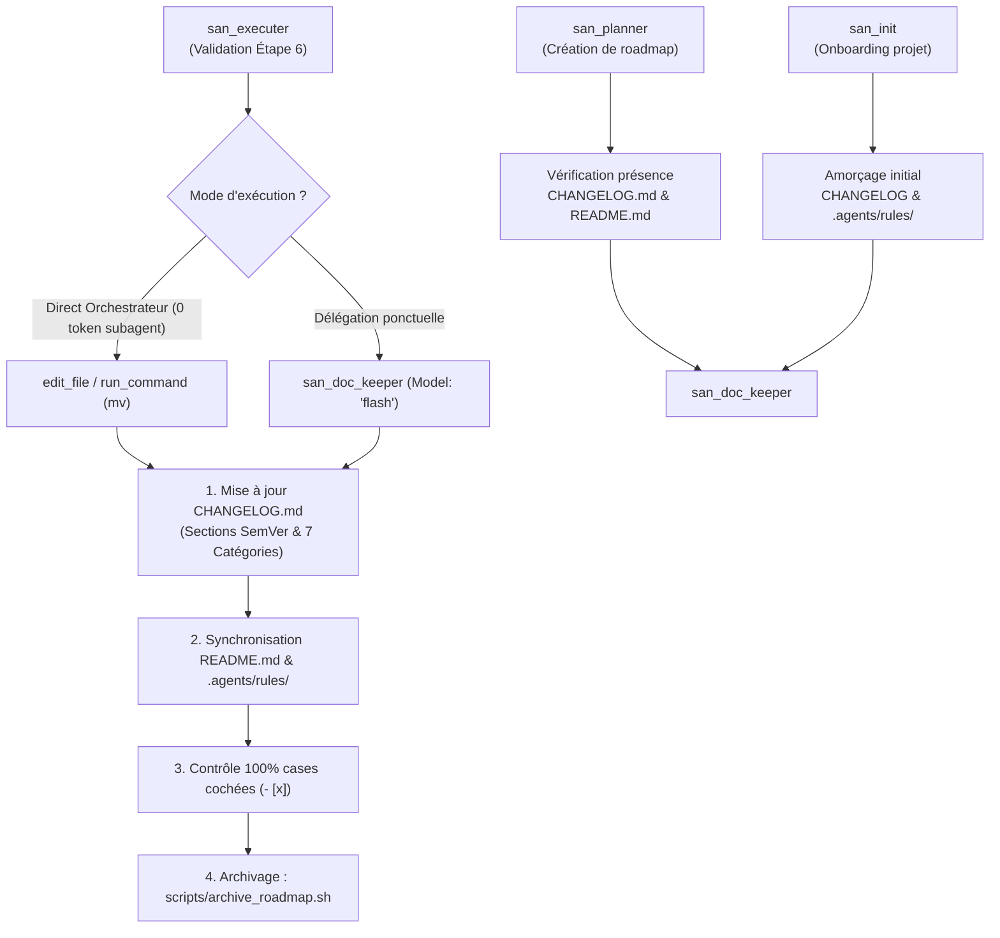
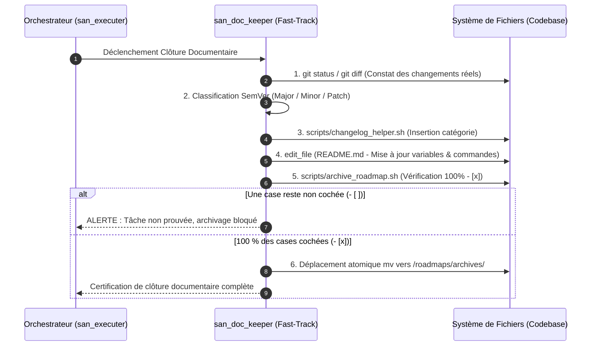
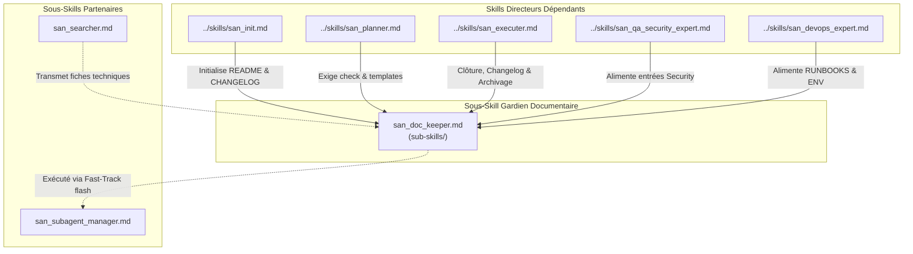

# `san_doc_keeper` — Gardien de l'Intégrité Documentaire, Synchronisation et Hygiène de Versioning

> **Note d'implantation architecturale :**  
> Au sein du dépôt source `san_agy_framework`, ce sous-skill réside dans `sub-skills/` afin de formaliser la frontière entre les rôles de direction maîtres (points d'entrée dans `skills/`) et l'outillage transversal. Lors de l'installation dans une codebase cliente par le script d'initialisation, il est déployé dans `.agents/skills/san_doc_keeper/` pour être reconnu nativement par le moteur d'exécution Antigravity CLI.

---

## 1. RÔLE, POUR QUI, POUR QUOI

### Rôle Fondamental
`san_doc_keeper` est le **gardien de l'intégrité documentaire, de la traçabilité et de l'hygiène de versioning** du framework **Antigravity (`san_*`)**. Il incarne le **Scribe Rigoureux & Archiviste Technique Continu** : sa mission est de veiller à ce qu'aucune modification de code ne reste orpheline de trace écrite, qu'aucun `README.md` ne devienne désaligné de la réalité de la codebase, que les feuilles de route achevées soient promptement archivées dans `/roadmaps/archives/`, et que le journal des modifications (`CHANGELOG.md`) soit rigoureusement tenu selon la norme internationale **Keep a Changelog 1.1.0** couplée à **Semantic Versioning 2.0.0 (SemVer)**.

### Pour Qui ?
- **Pour le développeur et l'équipe technique :** qui disposent d'un historique limpide, daté et catégorisé de chaque livraison, facilitant les revues de code, la publication de release notes et la maintenance à long terme.
- **Pour l'ensemble des agents du framework ([san_executer](../skills/san_executer.md), [san_planner](../skills/san_planner.md), [san_init](../skills/san_init.md)) :** qui s'appuient sur une mémoire vivante et des règles contextuelles `.agents/rules/*.md` toujours en phase avec les dépendances et commandes réelles du projet.

### Pour Quoi ?
- **Prévenir la pourriture documentaire (*Documentation Rot*) :** lorsque le code évolue mais que la documentation stagne, les agents futurs sont induits en erreur par des informations périmées, entraînant hallucinations et régressions.
- **Garantir le protocole « Fast-Track d'Hygiène » (*Zero-Token Waste*) :** les opérations ménagères (cochage de cases de tâches prouvées, déplacement de fichiers via `mv`, insertion d'entrées textuelles dans le changelog) sont exécutées directement par l'orchestrateur ou par un ouvrier ultra-rapide en **`Model: 'flash'`**, évitant de mobiliser des modèles lourds pour de la simple tenue de registre.
- **Assurer la clôture déterministe des roadmaps :** aucune roadmap active ne traîne indéfiniment dans `/roadmaps/` une fois terminée ; elle est formellement vérifiée (100 % de cases cochées sur preuves de code) puis migrée vers `/roadmaps/archives/`.

---

## 2. FRONTIÈRES STRICTES : CE QU'IL FAIT / CE QU'IL NE FAIT PAS

| CE QU'IL FAIT STRICTEMENT | CE QU'IL NE FAIT ABSOLUMENT PAS |
| :--- | :--- |
| **Tenue Normée du `CHANGELOG.md` :** Structure canonique Keep a Changelog (v1.1.0) et SemVer (v2.0.0). Classe chaque changement sous les 7 catégories exclusives (`Added`, `Changed`, `Deprecated`, `Removed`, `Fixed`, `Security`, `Performance`). | N'invente JAMAIS d'entrée de changelog $\rightarrow$ chaque ligne doit correspondre à une modification effective, prouvée et commitable dans la codebase. |
| **Synchronisation du `README.md` :** Met à jour les versions de runtimes, variables d'environnement (`.env.example`) et commandes d'amorçage/test réelles. | N'archive JAMAIS une roadmap incomplète : la présence d'une seule case non cochée `- [ ]` ou non prouvée entraîne le refus catégorique d'archivage. |
| **Audit et Archivage Cartésien des Roadmaps :** Inspecte le fichier cible dans `/roadmaps/*.md`, s'assure que **100 % des cases `- [x]` sont cochées**, calcule l'empreinte SHA-256 et déplace le fichier vers `/roadmaps/archives/`. | Ne supprime JAMAIS de fichiers de roadmap (`rm`) : l'archivage est toujours une opération de préservation d'historique (`mv`). |
| **Mise à Jour de la Base de Règles Décentralisée :** Actualise `.agents/rules/PROJECT.md` et `.agents/rules/API.md` lors de l'ajout d'une commande ou d'une évolution de contrat. | Ne modifie JAMAIS le code source applicatif (`.ts`, `.php`, `.tsx`, `.sql`) : son périmètre est strictement documentaire. |
| **Mode d'Exécution Fast-Track Sobre en Tokens :** Autorise l'orchestrateur à agir directement avec `edit_file` / `run_command` ou assigne strictement `Model: 'flash'` en cas de délégation. | Ne mobilise JAMAIS de modèle lourd (`Model: 'inherit'`) pour éditer du markdown ménager ou déplacer des fichiers. |

---

## 3. COMMENT IL EST MOBILISÉ PAR LES SKILLS PRINCIPAUX



### Invocations Concrètes

#### 1. Mobilisation par [`san_executer`](../skills/san_executer.md) (Clôture de Feature / Palier)
* Déclenché à l'issue des tests de validation pour :
  - Insérer les entrées dans `CHANGELOG.md` via `scripts/changelog_helper.sh`.
  - Vérifier que toutes les tâches de la feuille de route sont achevées.
  - Déplacer la roadmap vers `roadmaps/archives/` via `scripts/archive_roadmap.sh`.

#### 2. Mobilisation par [`san_planner`](../skills/san_planner.md) (Initialisation de Roadmap)
* Vérifier l'existence et la validité syntaxique de `CHANGELOG.md`.
* S'assurer de la présence du répertoire `roadmaps/archives/`.

#### 3. Mobilisation par [`san_init`](../skills/san_init.md) (Onboarding Initial)
* Amorcer `README.md`, `CHANGELOG.md` et `.agents/rules/PROJECT.md` avec la stack détectée.

#### 4. Mobilisation par [`san_qa_security_expert`](../skills/san_qa_security_expert.md)
* Inscrire immédiatement les correctifs de vulnérabilités dans la section `### Security` du changelog.

---

## 4. STRUCTURE INTERNE DU SOUS-SKILL

Lors du déploiement au sein d'une codebase sous Antigravity CLI, le sous-skill présente l'arborescence normative suivante :

```txt
.agents/skills/san_doc_keeper/
├── SKILL.md                                 # Manifeste d'intégrité documentaire, normes et directives
├── references/
│   ├── keep_a_changelog_standard.md         # Guide exhaustif des 7 rubriques et règles sémantiques SemVer
│   ├── readme_best_practices.md             # Standard d'anatomie d'un README d'ingénierie
│   └── documentation_hygiene_checklist.md   # Grille de contrôle avant tout archivage de roadmap
├── templates/
│   ├── CHANGELOG_TEMPLATE.md                # Squelette initial conforme Keep a Changelog v1.1.0
│   ├── README_TEMPLATE.md                   # Squelette de README universel pour projets Full-Stack
│   └── ROADMAP_ARCHIVE_HEADER.md            # En-tête de certification inséré dans les roadmaps archivées
└── scripts/
    ├── changelog_helper.sh                  # Script d'insertion automatisée sous les 7 rubriques
    └── archive_roadmap.sh                   # Script d'archivage cartésien avec contrôle 100% des cases cochées
```

---

## 5. LIVRABLES EXACTS & LES 7 CATÉGORIES NORMÉES

### Les 7 Catégories Normatives Keep a Changelog v1.1.0
Toute entrée inscrite dans `CHANGELOG.md` doit obligatoirement relever d'une de ces 7 rubriques exclusives :

1. `### Added` : Nouvelles fonctionnalités métier, nouveaux écrans, nouveaux endpoints ou services.
2. `### Changed` : Modifications de comportements existants, refactorisations d'architecture ou mises à jour de flux.
3. `### Deprecated` : Fonctionnalités marquées pour suppression future, alertant les développeurs en amont.
4. `### Removed` : Fonctionnalités, dépendances, endpoints ou fichiers obsolètes définitivement supprimés.
5. `### Fixed` : Résolution d'anomalies, corrections de régressions ou de bugs identifiés.
6. `### Security` : Correctifs de vulnérabilités, durcissement cryptographique, protection CSRF/XSS/BOLA.
7. `### Performance` : Optimisations de requêtes SQL (suppression N+1), mise en cache Redis, réduction du bundle client.

### Modèle de Référence Canonique pour `CHANGELOG.md`

```markdown
# Changelog
Toutes les modifications notables apportées à ce projet sont consignées dans ce fichier.

Le format est basé sur [Keep a Changelog](https://keepachangelog.com/fr/1.1.0/),
et ce projet adhère à [Semantic Versioning](https://semver.org/lang/fr/).

## [Unreleased]
### Added
- Implémentation du système de cache Redis avec verrous atomiques pour la réservation de stock.

### Security
- Renforcement de la validation des webhooks de paiement via signature cryptographique HMAC-SHA256.

## [1.2.0] - 2026-10-23
### Added
- Synchronisation hors-ligne avec stockage persistant local et file d'attente d'actions différées.
- Endpoint de réconciliation des statuts de transaction (`POST /api/v1/payments/verify`).

### Changed
- Refactorisation du service de notification pour supporter les envois par lots (*batching*).

### Performance
- Indexation composite B-Tree sur la table des transactions SQL réduisant le temps de requête de 85%.

### Fixed
- Correction d'une condition de course lors de retries simultanés avec la même `Idempotency-Key`.
```

---

## 6. PROCÉDURE D'EXÉCUTION DÉTAILLÉE (FAST-TRACK EN 6 ÉTAPES)



### Étape 1 : Diagnostic des Modifications Effectives
1. Inspecter `git status` et `git diff --stat` pour inventorier les fichiers modifiés.
2. Distinguer les nouvelles fonctionnalités (`Added`), correctifs (`Fixed`), renforcements (`Security`) ou optimisations (`Performance`).

### Étape 2 : Classification Sémantique Cartésienne (SemVer)
- **Patch (0.0.X) :** Corrections rétrocompatibles (`Fixed`, `Performance`).
- **Minor (0.X.0) :** Nouvelles fonctionnalités rétrocompatibles (`Added`, `Changed`).
- **Major (X.0.0) :** Ruptures de contrats d'API, modifications cassantes (`Changed`, `Removed`).

### Étape 3 : Écriture Atomique dans `CHANGELOG.md` via Script
Exécuter `scripts/changelog_helper.sh` pour insérer la ligne sous la section active :
```bash
bash scripts/changelog_helper.sh "Added" "Support des remboursements partiels Mobile Money MTN."
```

### Étape 4 : Synchronisation du `README.md` et des Règles Projet
1. Si de nouvelles variables d'environnement sont requises, les inscrire dans `.env.example` et dans le tableau de configuration de `README.md`.
2. Si de nouvelles commandes CLI sont introduites (`npm run ...`, `php artisan ...`), les documenter immédiatement dans `README.md` et `.agents/rules/PROJECT.md`.

### Étape 5 : Contrôle Déterministe de Complétude de la Roadmap
1. Lancer `scripts/archive_roadmap.sh` sur la feuille de route active.
2. Le script vérifie l'absence absolue de case non cochée (`- [ ]`).
3. En cas de case vide, l'archivage est interrompu et l'orchestrateur est alerté.

### Étape 6 : Archivage Atomique & Auto-Nettoyage
1. Le script appose l'en-tête de certification cartésienne avec empreinte SHA-256.
2. Déplacement atomique (`mv`) vers `/roadmaps/archives/`.
3. Suppression des fichiers temporaires ou scripts scratch résiduels.

---

## 7. SCRIPTS ET OUTILS DÉTERMINISTES EMBARQUÉS

### 1. Script d'Insertion Automatisée dans le Changelog (`scripts/changelog_helper.sh`)

```bash
#!/usr/bin/env bash
# scripts/changelog_helper.sh
# Insertion automatisée d'entrées dans CHANGELOG.md selon Keep a Changelog.
# Usage: bash scripts/changelog_helper.sh <CATEGORY> <MESSAGE> [VERSION] [CHANGELOG_PATH]

set -euo pipefail

CATEGORY="${1:-}"
MESSAGE="${2:-}"
VERSION="${3:-Unreleased}"
CHANGELOG_FILE="${4:-CHANGELOG.md}"

VALID_CATEGORIES=("Added" "Changed" "Deprecated" "Removed" "Fixed" "Security" "Performance")

if [[ -z "${CATEGORY}" || -z "${MESSAGE}" ]]; then
  echo "❌ Erreur : Catégorie ou message manquant."
  echo "Usage: $0 <CATEGORY> <MESSAGE> [VERSION] [CHANGELOG_PATH]"
  echo "Catégories valides : ${VALID_CATEGORIES[*]}"
  exit 1
fi

# Validation de la catégorie
IS_VALID=0
for cat in "${VALID_CATEGORIES[@]}"; do
  if [[ "${cat}" == "${CATEGORY}" ]]; then
    IS_VALID=1
    break
  fi
done

if [[ ${IS_VALID} -eq 0 ]]; then
  echo "❌ Catégorie invalide : '${CATEGORY}'"
  echo "Catégories autorisées (Keep a Changelog 1.1.0) : ${VALID_CATEGORIES[*]}"
  exit 1
fi

# Vérification présence CHANGELOG.md
if [[ ! -f "${CHANGELOG_FILE}" ]]; then
  echo "📝 Création d'un nouveau CHANGELOG.md canonique..."
  cat << 'EOF' > "${CHANGELOG_FILE}"
# Changelog
Toutes les modifications notables apportées à ce projet sont consignées dans ce fichier.

Le format est basé sur [Keep a Changelog](https://keepachangelog.com/fr/1.1.0/),
et ce projet adhère à [Semantic Versioning](https://semver.org/lang/fr/).

## [Unreleased]

EOF
fi

# Injection propre via Node.js pour manipulation cartésienne du texte
node -e "
const fs = require('fs');
let content = fs.readFileSync('${CHANGELOG_FILE}', 'utf-8');

const targetVersion = '${VERSION}';
const targetCategory = '${CATEGORY}';
const message = '${MESSAGE}';

const versionHeader = '## [' + targetVersion + ']';
let versionIdx = content.indexOf(versionHeader);

if (versionIdx === -1) {
  // Création de la section de version si inexistante
  const mainHeader = '# Changelog';
  const insertPos = content.indexOf(mainHeader) + mainHeader.length;
  content = content.slice(0, insertPos) + '\n\n' + versionHeader + '\n' + content.slice(insertPos);
  versionIdx = content.indexOf(versionHeader);
}

// Recherche de la catégorie sous la version cible
const nextVersionIdx = content.indexOf('## [', versionIdx + versionHeader.length);
const versionBlock = nextVersionIdx === -1 ? content.slice(versionIdx) : content.slice(versionIdx, nextVersionIdx);

const catHeader = '### ' + targetCategory;
let catIdx = versionBlock.indexOf(catHeader);

if (catIdx !== -1) {
  // La catégorie existe déjà, insérer la puce juste en dessous
  const globalCatIdx = versionIdx + catIdx;
  const insertPos = globalCatIdx + catHeader.length;
  content = content.slice(0, insertPos) + '\n- ' + message + content.slice(insertPos);
} else {
  // La catégorie n'existe pas encore, l'ajouter dans le bloc de version
  const insertPos = versionIdx + versionHeader.length;
  content = content.slice(0, insertPos) + '\n\n' + catHeader + '\n- ' + message + content.slice(insertPos);
}

// Nettoyage des sauts de ligne multiples
content = content.replace(/\n{3,}/g, '\n\n');
fs.writeFileSync('${CHANGELOG_FILE}', content, 'utf-8');
console.log('✅ Entrée ajoutée avec succès sous [' + targetVersion + '] -> ' + targetCategory + ' : ' + message);
"

echo "🎉 [san_doc_keeper] CHANGELOG.md synchronisé avec rigueur."
exit 0
```

### 2. Script d'Archivage Cartésien des Roadmaps (`scripts/archive_roadmap.sh`)

```bash
#!/usr/bin/env bash
# scripts/archive_roadmap.sh
# Contrôle déterministe de complétude (100% de cases cochées) et archivage sécurisé.
# Usage: bash scripts/archive_roadmap.sh <CHEMIN_ROADMAP>

set -euo pipefail

ROADMAP_PATH="${1:-}"

if [[ -z "${ROADMAP_PATH}" || ! -f "${ROADMAP_PATH}" ]]; then
  echo "❌ Erreur : Fichier de roadmap introuvable ou non spécifié."
  echo "Usage: $0 <CHEMIN_ROADMAP>"
  exit 1
fi

echo "🔍 [san_doc_keeper] Audit de complétude de la feuille de route : ${ROADMAP_PATH}"

# 1. Vérification stricte des cases non cochées
UNCHECKED=$(grep -nE -- '- \[ \]' "${ROADMAP_PATH}" || true)

if [[ -n "${UNCHECKED}" ]]; then
  echo "🚨 REFUS D'ARCHIVAGE : Des tâches restent non complétées dans la feuille de route !"
  echo "Lignes incriminées :"
  echo "${UNCHECKED}"
  echo "Toutes les tâches doivent être cochées (- [x]) sur preuve de code avant archivage."
  exit 1
fi

# 2. Vérification de la présence d'au moins une tâche cochée
CHECKED_COUNT=$(grep -cE -- '- \[[xX]\]' "${ROADMAP_PATH}" || true)
if [[ ${CHECKED_COUNT} -eq 0 ]]; then
  echo "⚠️ Avertissement : Aucune case cochée détectée dans ce fichier."
  exit 1
fi

echo "✅ Complétude vérifiée : ${CHECKED_COUNT} tâche(s) cochée(s) et validée(s) (100%)."

# 3. Calcul de l'empreinte cryptographique SHA-256
SHA_HASH=$(sha256sum "${ROADMAP_PATH}" | awk '{print $1}')
ARCHIVE_DATE=$(date "+%Y-%m-%d %H:%M:%S")
DATE_STAMP=$(date +%d%m%Y)

BASENAME=$(basename "${ROADMAP_PATH}" .md)
ARCHIVES_DIR="roadmaps/archives"
TARGET_ARCHIVE="${ARCHIVES_DIR}/${BASENAME}_ARCHIVED_${DATE_STAMP}.md"

mkdir -p "${ARCHIVES_DIR}"

# 4. Injection de l'en-tête de certification
TEMP_FILE=$(mktemp)
cat << EOF > "${TEMP_FILE}"
> **CERTIFICATION D'ARCHIVAGE CARTÉSIENNE :**  
> - **Statut :** 100 % des tâches vérifiées et prouvées dans la codebase.  
> - **Date d'Archivage :** ${ARCHIVE_DATE}  
> - **Empreinte SHA-256 Initiale :** \`${SHA_HASH}\`  
> - **Archivé par :** san_doc_keeper (Antigravity Framework)

---

EOF

cat "${ROADMAP_PATH}" >> "${TEMP_FILE}"
mv "${TEMP_FILE}" "${TARGET_ARCHIVE}"
rm -f "${ROADMAP_PATH}"

echo "📦 [san_doc_keeper] Feuille de route archivée avec succès :"
echo "   Origine : ${ROADMAP_PATH}"
echo "   Archive : ${TARGET_ARCHIVE}"
echo "   SHA-256 : ${SHA_HASH}"
exit 0
```

---

## 8. PRINCIPES DIRECTEURS ET INVARIANTS

### 1. Invariant de Preuve Documentaire (*Code is Truth, Doc is Mirror*)
La documentation n'anticipe pas et n'invente pas : elle reflète fidèlement l'état réel et vérifié du code. Une fonctionnalité n'est consignée comme livrée que lorsqu'elle est effective, testée et fonctionnelle.

### 2. Invariant de Conformité Stricte Keep a Changelog & SemVer
Aucune liberté stylistique désordonnée n'est tolérée dans le `CHANGELOG.md`. Les dates au format ISO `YYYY-MM-DD`, les 7 catégories normatives et la nomenclature sémantique `X.Y.Z` sont obligatoires.

### 3. Invariant de Zéro Perte d'Historique (*Archival over Deletion*)
Les roadmaps achevées, fiches d'idées concrétisées et rapports de tests validés ne sont jamais détruits via `rm`. Ils sont déplacés dans des répertoires d'archives dédiés (`/roadmaps/archives/`, `docs/research/`) pour conserver la mémoire infalsifiable de l'évolution du produit.

### 4. Invariant Fast-Track & Sobriété en Tokens (*Token-Light Hygiene*)
Les opérations de maintenance documentaire doivent s'exécuter avec le coût cognitif minimal : soit directement par l'orchestrateur (Fast-Track sans sous-agent), soit via un sous-agent d'exécution rapide `Model: 'flash'`. L'utilisation d'un modèle lourd pour éditer du markdown ménager est formellement bannie.

### 5. Invariant d'Intégrité de Clôture (*100% Checkbox Completeness*)
Aucun fichier de roadmap ne peut rejoindre `/roadmaps/archives/` s'il contient ne serait-ce qu'une seule case non cochée `- [ ]`. Si une tâche est abandonnée d'un commun accord avec le développeur, elle doit être explicitement rayée ou annotée `[ANNULÉ : justification]` avant archivage.

---

## 9. MATRICE DE BRANCHEMENT ET RÉFÉRENCES CROISÉES



### Amont (Compétences maîtresses qui mobilisent ce sous-skill) :
- [`../skills/san_init.md`](../skills/san_init.md) : Fait appel à `san_doc_keeper` lors de l'onboarding pour générer l'architecture documentaire initiale (`README.md`, `CHANGELOG.md`, `.agents/rules/PROJECT.md`).
- [`../skills/san_planner.md`](../skills/san_planner.md) : Sollicite `san_doc_keeper` pour valider l'intégrité des conventions avant d'émettre une nouvelle roadmap.
- [`../skills/san_executer.md`](../skills/san_executer.md) : Déclenche systématiquement le protocole Fast-Track de `san_doc_keeper` pour sceller chaque fin de phase et archiver la roadmap achevée.
- [`../skills/san_qa_security_expert.md`](../skills/san_qa_security_expert.md) : Transmet les résolutions de vulnérabilités pour consignation formelle dans la section `Security` du changelog.
- [`../skills/san_devops_expert.md`](../skills/san_devops_expert.md) : Fournit les instructions de déploiement et les variables d'environnement à synchroniser dans le `README.md`.

### Synergies avec les autres sous-skills :
- [`san_subagent_manager.md`](san_subagent_manager.md) : Utilisé pour instancier un ouvrier documentaire dédié en `Model: 'flash'` si l'orchestrateur préfère déléguer la mise à jour sans polluer son tour d'action.
- [`san_searcher.md`](san_searcher.md) : Fournit des fiches de synthèse archivées dans `docs/research/`, indexées et référencées par `san_doc_keeper` dans la documentation technique globale.
