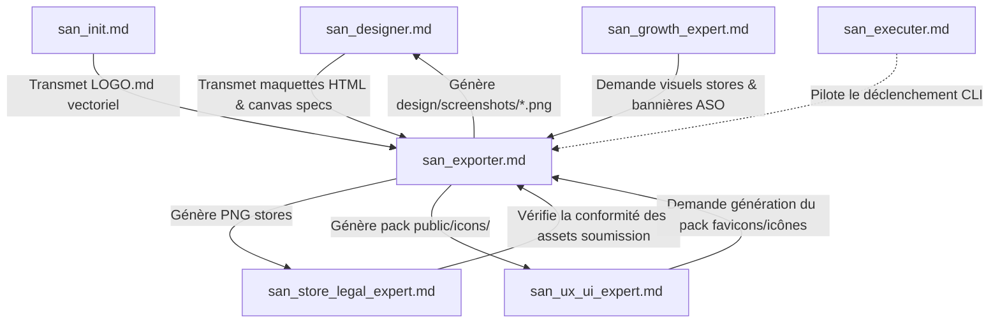
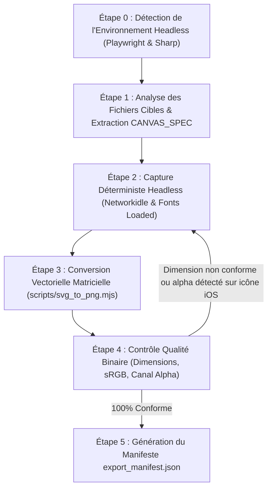
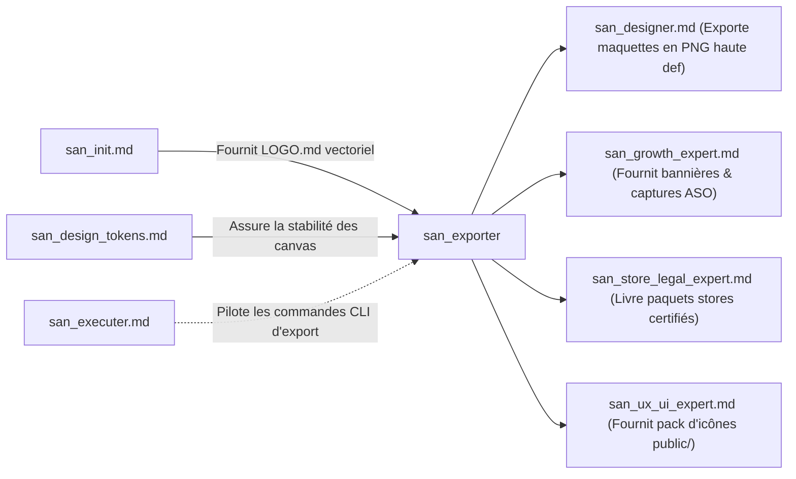

# SUB-SKILL : `san_exporter` — Artisan Exportation Headless, Rendu Graphique & Pipeline d'Assets

> **Manifeste Cartésien :** Dans un flux d'ingénierie moderne, aucune capture d'écran, aucun favicon et aucun asset de publication sur les stores ne doit être découpé manuellement au curseur dans un logiciel graphique. Le processus de restitution doit être **déterministe, automatisé et reproductible en une commande CLI unique**. `san_exporter` orchestre le moteur de capture headless (Playwright/Puppeteer) et le pipeline vectoriel matriciel (`sharp`/`resvg`) pour transformer le code HTML et les vecteurs SVG en livrables d'une netteté absolue au pixel près.
>
> **Note d'Architecture de Déploiement :** Dans le dépôt source `san_agy_framework`, ce module réside dans `sub-skills/` afin de séparer les compétences de pilotage conceptuel de l'outillage transversal. Lors de l'initialisation ou de l'installation dans une codebase cliente (React, Next.js, Laravel, Expo, AdonisJS, etc.), l'installateur le déploie automatiquement dans `.agents/skills/san_exporter.md` pour qu'Antigravity puisse l'invoquer directement comme exécutant graphique.

---

## 1. RÔLE, POUR QUI, POUR QUOI

### Rôle
`san_exporter` est l'ingénieur de rendu headless et le gestionnaire de pipeline d'assets du framework **Antigravity (`san_*`)**. Il comble le fossé entre le code source visuel (fichiers HTML statiques avec Tailwind CSS, logos au format SVG vectoriel) et les artefacts binaires d'affichage final (fichiers PNG haute définition, WebP compressés sans perte, bundles d'icônes d'applications, favicons et illustrations OpenGraph).

### Pour qui ?
* Pour le **concepteur d'interfaces** [`san_designer`](../skills/san_designer.md), qui a besoin de figer ses prototypes d'écrans (`/design/mockup/*`) en images haute fidélité pour des revues visuelles ou des présentations clients.
* Pour l'**expert de publication et conformité** [`san_store_legal_expert`](../skills/san_store_legal_expert.md), qui exige des screenshots calibrés aux dimensions exactes imposées par Google Play Console et Apple App Store Connect, sous peine de rejet immédiat de la soumission.
* Pour le **responsable de croissance** [`san_growth_expert`](../skills/san_growth_expert.md), qui exploite les captures certifiées pour habiller les fiches ASO et générer les bannières promotionnelles ou visuels de partage social (OpenGraph).
* Pour le **développeur frontend/mobile** [`san_ux_ui_expert`](../skills/san_ux_ui_expert.md), qui a besoin d'un ensemble complet d'icônes généré depuis le logo source (`favicon.ico`, `apple-touch-icon.png`, `adaptive-icon.png`, `splash.png` Expo).

### Pour quoi ?
* **Éradiquer le travail manuel d'exportation** : éviter les approximations de découpage d'écran, les pertes de ratio, les flous de mise à l'échelle ou les bordures parasites.
* **Garantir la conformité géométrique absolue aux exigences des stores** :
  * Apple App Store 6.7" : `1290×2796 px` (iPhone 15/16 Pro Max).
  * Apple App Store 6.5" / 5.5" : `1242×2688 px` / `1242×2208 px`.
  * Apple iPad Pro 12.9" : `2048×2732 px`.
  * Google Play Store Téléphone : `1080×1920 px` (ratio 16:9) ou `1080×2400 px` (ratio 20:9).
  * Google Play Store Feature Graphic : `1024×500 px` (sans canal alpha).
  * App Store App Icon : `1024×1024 px` (PNG 24-bit sans transparence).
  * Google Play App Icon : `512×512 px` (PNG 32-bit avec transparence autorisée).
* **Préserver l'intégrité vectorielle** : dériver l'ensemble des formats d'icônes et de favicons directement à partir du SVG validé dans `.agents/rules/LOGO.md` sans jamais repartir d'un PNG pixélisé.
* **Assurer une autonomie complète sans connexion réseau** : tous les scripts s'exécutent en local via les binaires Playwright et Sharp, sans dépendre d'une API de capture distante ou d'un service SaaS en ligne.

---

## 2. FRONTIÈRES STRICTES : CE QU'IL FAIT / CE QU'IL NE FAIT PAS

| CE QU'IL FAIT STRICTEMENT | CE QU'IL NE FAIT ABSOLUMENT PAS |
| :--- | :--- |
| **Capture headless déterministe via Playwright/Puppeteer :** Rendu au pixel près des pages HTML locales avec gestion du facteur d'échelle rétina (`deviceScaleFactor: 2` ou `3`). | Ne conçoit pas les pages HTML, la hiérarchie visuelle ni le CSS $\rightarrow$ rôle exclusif de [`san_designer`](../skills/san_designer.md). |
| **Conversion vectorielle vers matriciel (SVG $\rightarrow$ PNG) :** Déclinaison de logos en favicons, icônes PWA, icônes adaptatives Android et splash screens. | Ne dessine pas les logos ni ne crée les concepts graphiques $\rightarrow$ établi par [`san_init`](../skills/san_init.md) et validé dans `LOGO.md`. |
| **Contrôle binaire de conformité géométrique :** Vérifie que les fichiers générés respectent la largeur, la hauteur, l'espace colorimétrique sRGB et les contraintes de transparence. | Ne rédige pas les textes d'accroche ni les sous-titres des captures stores $\rightarrow$ dévolu à [`san_copywriter`](san_copywriter.md). |
| **Optimisation et compression sans perte :** Réduction du poids binaire des images générées (PNG/WebP) pour préserver la bande passante mobile 3G/EDGE. | Ne gère pas la soumission automatisée des binaires aux APIs des stores $\rightarrow$ orchestré par [`san_store_legal_expert`](../skills/san_store_legal_expert.md). |
| **Génération du manifeste d'intégrité :** Production de `export_manifest.json` répertoriant les chemins, dimensions, poids et hachages SHA-256. | Ne prend pas de décisions d'architecture d'interface ni de refonte applicative. |

---

## 3. COMMENT IL EST MOBILISÉ PAR LES SKILLS PRINCIPAUX



### 1. Par [`san_designer`](../skills/san_designer.md) (Validation Visuelle & Screenshots)
Dès qu'une page HTML autonome de mockup ou de capture store est rédigée dans `/design/mockup/` ou `/design/screenshots/`, `san_designer` déclenche `san_exporter` :
* Le script parse le commentaire d'en-tête `<!-- CANVAS_SPEC ... -->` de la page.
* Le moteur headless capture le viewport ciblé et écrit le fichier `.png` jumeau en haute résolution.

### 2. Par [`san_init`](../skills/san_init.md) (Génération Initiale de la Marque)
Dès que la proposition vectorielle de logo est adoptée dans `.agents/rules/LOGO.md` :
* `san_init` invoque `san_exporter` via `scripts/svg_to_png.mjs`.
* Le logo SVG est décliné instantanément en 12 résolutions d'icônes réparties dans `public/icons/` et `assets/`.

### 3. Par [`san_growth_expert`](../skills/san_growth_expert.md) & [`san_store_legal_expert`](../skills/san_store_legal_expert.md) (Publication Stores)
Avant toute mise en ligne :
* `san_store_legal_expert` sollicite l'export complet de la matrice des captures requises par Apple et Google.
* `san_exporter` produit la grille d'images certifiée et valide l'absence de canal alpha sur l'icône iOS 1024x1024 (clause bloquante chez Apple).

---

## 4. STRUCTURE INTERNE DU SOUS-SKILL

```txt
sub-skills/san_exporter/              # (Déployé dans .agents/skills/san_exporter/ chez le client)
├── SKILL.md                          # Ce manifeste de gouvernance cartésienne
├── references/
│   ├── store_asset_dimensions.md     # Spécifications détaillées des résolutions Apple et Google
│   ├── headless_browser_setup.md     # Configuration Playwright/Puppeteer et options GPU headless
│   └── image_compression_rules.md    # Niveaux de compression PNG/WebP et conservation sRGB
├── templates/
│   ├── export_manifest.template.json # Structure type du fichier d'audit d'intégrité
│   └── canvas_spec_comment.html      # Gabarit du tag CANVAS_SPEC à insérer dans les maquettes
└── scripts/
    ├── export_png.mjs                # Pipeline de capture headless pour pages HTML statiques
    ├── svg_to_png.mjs                # Compilateur vectoriel d'icônes d'application et favicons
    └── optimize_assets.sh            # Script d'optimisation et compression sans perte des assets
```

---

## 5. LIVRABLES EXACTS

Tous les livrables générés par `san_exporter` s'organisent selon une nomenclature rigoureuse à la racine du projet :

```txt
[racine_du_projet]/
├── design/
│   ├── export_manifest.json          # Journal d'export certifiant les résolutions et hachages
│   ├── screenshots/
│   │   ├── app-store/
│   │   │   ├── 01-hero-accueil.png   # 1290×2796 px (iPhone 6.7")
│   │   │   └── 02-momo-paiement.png  # 1290×2796 px
│   │   └── play-store/
│   │       ├── 01-hero-catalogue.png # 1080×1920 px (Android 16:9)
│   │       ├── 02-suivi-course.png   # 1080×1920 px
│   │       └── feature-graphic.png   # 1024×500 px
│   └── poster/
│       └── flyer-a4.png              # 2480×3508 px (A4 à 300 DPI)
│
├── public/ (ou assets/icons/ pour Expo/React Native)
│   ├── favicon.ico                   # Multi-résolution (16x16, 32x32, 48x48)
│   ├── favicon-16x16.png
│   ├── favicon-32x32.png
│   ├── apple-touch-icon.png          # 180×180 px
│   ├── icon-192.png                  # PWA standard
│   ├── icon-512.png                  # PWA splash
│   └── maskable-icon-512.png         # PWA adaptive maskable
│
└── app.json (ou store-assets/)
    ├── adaptive-icon.png             # 1024×1024 px (Foreground Android Expo)
    ├── icon.png                      # 1024×1024 px (App Store Icon sans alpha)
    └── splash.png                    # 2048×2048 px (Splash screen universel)
```

### Spécification du Tag de Canvas (`CANVAS_SPEC`)
Chaque fichier HTML destiné à la capture par `san_exporter` doit débuter par son commentaire formel de spécification :
```html
<!-- CANVAS_SPEC: width=1080px height=1920px device="Google Play Phone" export_scale=1 -->
```
Ou pour un export rétina haute densité :
```html
<!-- CANVAS_SPEC: width=390px height=844px device="iPhone 15" export_scale=3 -->
```

---

## 6. PROCÉDURE « ZÉRO NÉGLIGENCE » EN 5 ÉTAPES



### Étape 0 : Vérification des Dépendances de Runtime
Avant toute capture, le script vérifie la présence de `playwright` (ou `puppeteer`) et de `sharp` dans l'environnement Node.js local. Si l'un des paquets manque, une consigne claire d'installation est émise :
```bash
npm install --save-dev playwright sharp
npx playwright install chromium
```

### Étape 1 : Analyse des Spécifications de Canvas
Pour chaque maquette HTML passée en argument :
1. Extraction par expression régulière des directives `width`, `height` et `export_scale` depuis le commentaire `<!-- CANVAS_SPEC ... -->`.
2. Si le tag est absent, le script adopte par défaut les dimensions de la balise principale `#app` ou `#canvas`.

### Étape 2 : Capture Déterministe Headless
1. Instanciation du navigateur Chromium en mode headless (`--no-sandbox`, `--disable-setuid-sandbox`).
2. Configuration du viewport exact correspondant aux dimensions spécifiées, avec le `deviceScaleFactor` adéquat.
3. Chargement de l'URL locale (`file://...`).
4. **Invariant de synchronisation cartésienne :**
   * Attente de l'événement `networkidle` pour garantir la fin des requêtes locales.
   * Attente de `document.fonts.ready` pour s'assurer qu'aucune police ne bascule en police système de secours pendant la capture.
   * Pause stabilisatrice de 150 ms pour purger toute transition CSS initiale.
5. Déclenchement de la capture d'écran PNG sans perte.

### Étape 3 : Conversion Vectorielle Matricielle (Iconographie)
Exécution de `scripts/svg_to_png.mjs` à partir du fichier SVG de référence :
1. Rendu matriciel via Sharp du logo source.
2. Pour l'icône de l'App Store (`1024×1024 px`), suppression stricte du canal alpha :
   ```javascript
   await sharp(svgBuffer).resize(1024, 1024).removeAlpha().png().toFile('icon.png');
   ```
3. Génération des formats PWA, Android adaptatifs et multi-favicons.

### Étape 4 : Contrôle Qualité Binaire
Le script vérifie automatiquement sur chaque fichier généré :
* [ ] Largeur et hauteur exactes au pixel près par rapport aux exigences des stores.
* [ ] Espace colorimétrique conforme au standard `sRGB`.
* [ ] Poids optimisé (alerte si une capture store dépasse 8 Mo, seuil limite des consoles de déploiement).

### Étape 5 : Clôture & Manifeste
Écriture de `/design/export_manifest.json` avec la date, la liste des fichiers, les résolutions et la signature d'intégrité SHA-256 de chaque image.

---

## 7. SCRIPTS EXÉCUTABLES EMBARQUÉS

### 1. Script de Capture Headless (`scripts/export_png.mjs`)
```javascript
#!/usr/bin/env node
// scripts/export_png.mjs
// Moteur de capture headless automatisé basé sur Playwright.

import fs from 'fs';
import path from 'path';
import { chromium } from 'playwright';

async function parseCanvasSpec(htmlContent) {
  const match = htmlContent.match(/<!--\s*CANVAS_SPEC:\s*width=([0-9]+)px\s+height=([0-9]+)px(?:\s+export_scale=([0-9]+))?/i);
  if (match) {
    return {
      width: parseInt(match[1], 10),
      height: parseInt(match[2], 10),
      scale: match[3] ? parseInt(match[3], 10) : 1
    };
  }
  return { width: 1080, height: 1920, scale: 1 };
}

async function captureHtmlFile(browser, filePath, outputPath) {
  const absoluteHtmlPath = path.resolve(filePath);
  if (!fs.existsSync(absoluteHtmlPath)) {
    throw new Error(`Fichier introuvable : ${absoluteHtmlPath}`);
  }

  const content = fs.readFileSync(absoluteHtmlPath, 'utf-8');
  const spec = await parseCanvasSpec(content);

  console.log(`📸 Capture de ${path.basename(filePath)} : ${spec.width}x${spec.height} (scale: ${spec.scale})`);

  const page = await browser.newPage({
    viewport: { width: spec.width, height: spec.height },
    deviceScaleFactor: spec.scale
  });

  await page.goto(`file://${absoluteHtmlPath}`, { waitUntil: 'networkidle' });
  await page.evaluate(() => document.fonts.ready);
  await page.waitForTimeout(150); // Stabilisation des animations

  fs.mkdirSync(path.dirname(outputPath), { recursive: true });
  await page.screenshot({ path: outputPath, type: 'png', fullPage: false });
  await page.close();

  console.log(`✅ Image enregistrée : ${outputPath}`);
}

async function main() {
  const args = process.argv.slice(2);
  let targetFile = null;
  let targetDir = null;
  let outputFile = null;

  for (const arg of args) {
    if (arg.startsWith('--file=')) targetFile = arg.split('=')[1];
    if (arg.startsWith('--target=')) targetDir = arg.split('=')[1];
    if (arg.startsWith('--out=')) outputFile = arg.split('=')[1];
  }

  const browser = await chromium.launch({
    args: ['--no-sandbox', '--disable-setuid-sandbox']
  });

  try {
    if (targetFile) {
      const out = outputFile || targetFile.replace(/\.html$/, '.png');
      await captureHtmlFile(browser, targetFile, out);
    } else if (targetDir) {
      const files = fs.readdirSync(targetDir).filter(f => f.endsWith('.html'));
      for (const f of files) {
        const fullPath = path.join(targetDir, f);
        const out = path.join(targetDir, f.replace(/\.html$/, '.png'));
        await captureHtmlFile(browser, fullPath, out);
      }
    } else {
      console.log("Usage: node scripts/export_png.mjs --file=path/to/mockup.html [--out=out.png]");
      console.log("       node scripts/export_png.mjs --target=design/mockup/mobile/");
    }
  } finally {
    await browser.close();
  }
}

main().catch(err => {
  console.error("❌ Erreur d'exportation :", err);
  process.exit(1);
});
```

### 2. Compilateur d'Icônes Vectorielles (`scripts/svg_to_png.mjs`)
```javascript
#!/usr/bin/env node
// scripts/svg_to_png.mjs
// Convertisseur vectoriel SVG vers suites d'icônes multi-plateformes via Sharp.

import fs from 'fs';
import path from 'path';
import sharp from 'sharp';

const ICON_TARGETS = [
  { path: 'public/icons/favicon-16x16.png', size: 16, alpha: true },
  { path: 'public/icons/favicon-32x32.png', size: 32, alpha: true },
  { path: 'public/icons/apple-touch-icon.png', size: 180, alpha: true },
  { path: 'public/icons/icon-192.png', size: 192, alpha: true },
  { path: 'public/icons/icon-512.png', size: 512, alpha: true },
  { path: 'assets/adaptive-icon.png', size: 1024, alpha: true },
  { path: 'assets/icon.png', size: 1024, alpha: false }, // iOS App Store (Zéro canal alpha !)
  { path: 'assets/play-store-icon.png', size: 512, alpha: true }
];

async function generateIcons(svgPath) {
  if (!fs.existsSync(svgPath)) {
    console.error(`❌ Fichier SVG introuvable : ${svgPath}`);
    process.exit(1);
  }

  const svgBuffer = fs.readFileSync(svgPath);
  console.log(`🎨 [san_exporter] Génération du pack d'icônes à partir de : ${svgPath}`);

  for (const target of ICON_TARGETS) {
    fs.mkdirSync(path.dirname(target.path), { recursive: true });

    let pipeline = sharp(svgBuffer).resize(target.size, target.size);
    if (!target.alpha) {
      // Élimination formelle du canal alpha (exigence stricte Apple App Store 1024x1024)
      pipeline = pipeline.removeAlpha().flatten({ background: '#FFFFFF' });
    }

    await pipeline.png().toFile(target.path);
    console.log(`✅ Généré : ${target.path} (${target.size}x${target.size} px, alpha: ${target.alpha})`);
  }

  console.log("🌟 [san_exporter] Suite d'icônes générée avec succès.");
}

const inputSvg = process.argv[2] || '.agents/rules/logo.svg';
generateIcons(inputSvg).catch(err => {
  console.error("❌ Erreur de génération d'icônes :", err);
  process.exit(1);
});
```

---

## 8. PRINCIPES DIRECTEURS & INVARIANTS D'EXPORTATION

### 1. Invariant de Reproductibilité Déterministe
Toute image d'illustration, mockup ou icône doit pouvoir être entièrement régénérée de zéro en exécutant une ligne de commande documentée. Aucune retouche d'image ne doit être faite manuellement sur un fichier PNG isolé.

### 2. Invariant de Zéro Perte Vectorielle
Les icônes matricielles dérivent systématiquement et exclusivement d'un fichier source SVG vectoriel propre. Il est formellement interdit d'agrandir un PNG de 128px pour en produire une icône de 1024px.

### 3. Invariant de Conformité aux Règles des Stores
* Toute capture pour l'App Store doit strictement respecter le ratio requis sans rognage déformant.
* L'icône soumise à l'App Store (`1024×1024 px`) ne doit comporter aucun canal alpha (transparence) : sa présence déclenche une erreur irréversible `ITMS-90717` lors de l'envoi de l'archive IPA.

### 4. Invariant de Sobriété des Tailles Fichiers
Chaque asset généré subit une compression d'optimisation sans perte afin de garantir que les applications légères restent téléchargeables rapidement sur des réseaux à faible débit (3G/EDGE).

---

## 9. MATRICE DE BRANCHEMENT VERS LES AUTRES SKILLS



### Amont (Ce qui alimente `san_exporter`)
* [`../skills/san_designer.md`](../skills/san_designer.md) : Fournit les fichiers HTML statiques prêts à être capturés et tagués avec `CANVAS_SPEC`.
* [`../skills/san_init.md`](../skills/san_init.md) : Fournit le logo vectoriel validé dans `.agents/rules/LOGO.md` ou `.agents/rules/logo.svg`.
* [`san_design_tokens.md`](san_design_tokens.md) : Garantit que les polices locales et les variables de couleur sont stables et déterministes lors du rendu headless.

### Aval (Ce qui consomme les livrables de `san_exporter`)
* [`../skills/san_store_legal_expert.md`](../skills/san_store_legal_expert.md) : Récupère les paquets d'assets validés pour la constitution du dossier de soumission officiel.
* [`../skills/san_growth_expert.md`](../skills/san_growth_expert.md) : Exploite les captures exportées pour illustrer les fiches ASO sur Google Play Console et App Store Connect.
* [`../skills/san_ux_ui_expert.md`](../skills/san_ux_ui_expert.md) : Intègre les favicons et les icônes applicatives générées au sein de la codebase React, Next.js ou Expo.
* [`../skills/san_executer.md`](../skills/san_executer.md) : Invoque les commandes d'exportation dans les phases de delivery et d'archivage des roadmaps.
