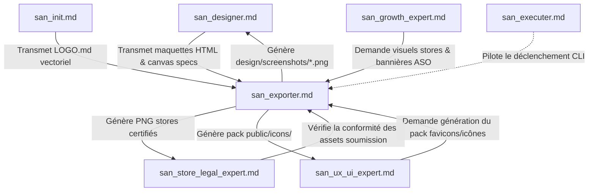
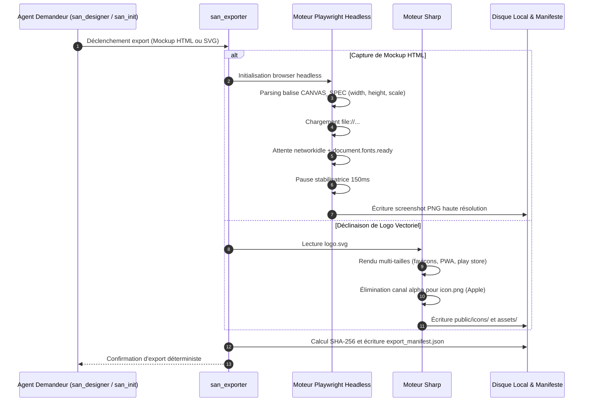
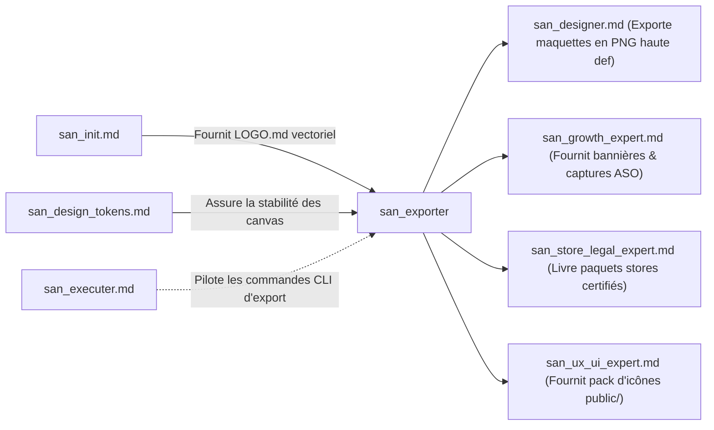

# `san_exporter` — Artisan Exportation Headless, Rendu Graphique & Pipeline d'Assets

> **Manifeste Cartésien :** Dans un flux d'ingénierie moderne, aucune capture d'écran, aucun favicon et aucun asset de publication sur les stores ne doit être découpé manuellement au curseur dans un logiciel graphique. Le processus de restitution doit être **déterministe, automatisé et reproductible en une commande CLI unique**. `san_exporter` orchestre le moteur de capture headless (Playwright) et le pipeline vectoriel matriciel (`sharp`) pour transformer le code HTML statique et les vecteurs SVG en livrables d'une netteté absolue au pixel près.
>
> **Note d'Architecture de Déploiement :** Dans le dépôt source `san_agy_framework`, ce module réside dans `sub-skills/` afin de formaliser la frontière entre les rôles de direction maîtres (points d'entrée dans `skills/`) et l'outillage transversal. Lors de l'initialisation dans une codebase cliente, il est déployé dans `.agents/skills/san_exporter/` pour être reconnu nativement par le moteur d'exécution Antigravity CLI.

---

## 1. RÔLE, POUR QUI, POUR QUOI

### Rôle Fondamental
`san_exporter` est l'**ingénieur de rendu headless et le gestionnaire de pipeline d'assets** du framework **Antigravity (`san_*`)**. Il comble le fossé entre le code source visuel (fichiers HTML statiques stylisés par Tailwind CSS, logos au format vectoriel SVG) et les artefacts binaires finaux indispensables à la production (fichiers PNG haute définition, WebP compressés sans perte, bundles complets d'icônes d'applications, favicons multi-résolutions, visuels OpenGraph et documents A4 haute fidélité).

### Pour Qui ?
* Pour le **concepteur d'interfaces** [`san_designer`](../skills/san_designer.md), qui a besoin de figer ses prototypes d'écrans (`/design/mockup/*`) en images haute fidélité pour des revues visuelles ou des présentations clients.
* Pour l'**expert de publication et conformité** [`san_store_legal_expert`](../skills/san_store_legal_expert.md), qui exige des screenshots calibrés aux dimensions exactes imposées par Google Play Console et Apple App Store Connect, sous peine de rejet immédiat de la soumission.
* Pour le **responsable de croissance** [`san_growth_expert`](../skills/san_growth_expert.md), qui exploite les captures certifiées pour habiller les fiches ASO et générer les bannières promotionnelles ou visuels de partage social (OpenGraph).
* Pour le **développeur frontend/mobile** [`san_ux_ui_expert`](../skills/san_ux_ui_expert.md), qui a besoin d'un ensemble complet d'icônes généré depuis le logo source (`favicon.ico`, `apple-touch-icon.png`, `adaptive-icon.png`, `splash.png` Expo).

### Pour Quoi ?
* **Éradiquer le travail manuel d'exportation** : éviter les approximations de découpage d'écran, les pertes de ratio, les flous de mise à l'échelle ou les bordures parasites.
* **Garantir la conformité géométrique absolue aux exigences des stores** :
  * Apple App Store 6.7" : `1290×2796 px` (iPhone 15/16 Pro Max).
  * Apple App Store 6.5" / 5.5" : `1242×2688 px` / `1242×2208 px`.
  * Apple iPad Pro 12.9" : `2048×2732 px`.
  * Google Play Store Téléphone : `1080×1920 px` (ratio 16:9) ou `1080×2400 px` (ratio 20:9).
  * Google Play Store Feature Graphic : `1024×500 px` (sans canal alpha).
  * App Store App Icon : `1024×1024 px` (PNG 24-bit **sans canal alpha**, évitant l'erreur critique Apple `ITMS-90717`).
  * Google Play App Icon : `512×512 px` (PNG 32-bit avec transparence autorisée).
* **Préserver l'intégrité vectorielle** : dériver l'ensemble des formats d'icônes et de favicons directement à partir du SVG validé dans `.agents/rules/LOGO.md` sans jamais repartir d'un PNG pixélisé.
* **Assurer une autonomie complète sans connexion réseau** : tous les scripts s'exécutent en local via les binaires Playwright et Sharp, sans dépendre d'une API de capture distante ou d'un service SaaS en ligne.

---

## 2. FRONTIÈRES STRICTES : CE QU'IL FAIT / CE QU'IL NE FAIT PAS

| CE QU'IL FAIT STRICTEMENT | CE QU'IL NE FAIT ABSOLUMENT PAS |
| :--- | :--- |
| **Capture headless déterministe via Playwright :** Rendu au pixel près des pages HTML locales avec synchronisation synchrone (`networkidle`, `document.fonts.ready`). | Ne conçoit pas les pages HTML, la hiérarchie visuelle ni le CSS $\rightarrow$ rôle exclusif de [`san_designer`](../skills/san_designer.md). |
| **Conversion vectorielle matricielle (SVG $\rightarrow$ PNG) :** Déclinaison de logos en favicons, icônes PWA, icônes adaptatives Android et splash screens. | Ne dessine pas les logos ni ne crée les concepts graphiques $\rightarrow$ établi par [`san_init`](../skills/san_init.md) et validé dans `LOGO.md`. |
| **Suppression du canal alpha pour iOS :** Application systématique de `.removeAlpha().flatten({ background: '#FFFFFF' })` sur l'icône App Store (`1024×1024 px`) pour prévenir l'erreur Apple `ITMS-90717`. | Ne rédige pas les textes d'accroche ni les sous-titres des captures stores $\rightarrow$ dévolu à [`san_copywriter`](san_copywriter.md). |
| **Optimisation et compression sans perte :** Réduction du poids binaire des images générées pour préserver la bande passante mobile 3G/EDGE. | Ne gère pas la soumission automatisée des binaires aux APIs des stores $\rightarrow$ orchestré par [`san_store_legal_expert`](../skills/san_store_legal_expert.md). |
| **Génération du manifeste d'intégrité :** Production de `export_manifest.json` répertoriant les chemins, dimensions, poids et hachages SHA-256. | Ne prend pas de décisions d'architecture d'interface ni de refonte applicative. |

---

## 3. COMMENT IL EST MOBILISÉ PAR LES SKILLS PRINCIPAUX



### Invocations Concrètes

#### 1. Mobilisation par [`san_designer`](../skills/san_designer.md)
* Commande : `node scripts/export_png.mjs --target=design/mockup/mobile/`
* Rôle : Convertir l'ensemble des fichiers HTML de prototypes en rendus PNG haute définition au pixel près.

#### 2. Mobilisation par [`san_init`](../skills/san_init.md)
* Commande : `node scripts/svg_to_png.mjs .agents/rules/logo.svg`
* Rôle : Décliner le logo source vectoriel en pack complet d'icônes multi-résolutions (`public/icons/` et `assets/`).

#### 3. Mobilisation par [`san_store_legal_expert`](../skills/san_store_legal_expert.md)
* Contrôler que l'icône `assets/icon.png` (`1024×1024 px`) est strictement en 24-bit sans canal alpha et que les captures respectent `1290×2796 px` et `1080×1920 px`.

---

## 4. STRUCTURE INTERNE DU SOUS-SKILL

Lors du déploiement au sein d'une codebase sous Antigravity CLI, le sous-skill présente l'arborescence normative suivante :

```txt
.agents/skills/san_exporter/
├── SKILL.md                                 # Manifeste de rendu headless, spécifications et invariants
├── references/
│   ├── store_resolutions_matrix.md          # Dimensions officielles Apple App Store et Google Play
│   ├── alpha_channel_guardrails.md          # Diagnostic et remédiation du rejet Apple ITMS-90717
│   └── print_resolutions_300dpi.md          # Formats d'impression papier A4 / bannières événementielles
├── templates/
│   ├── HTML_CANVAS_SPEC_HEADER.html         # En-tête de spécification canvas à insérer dans les maquettes
│   └── EXPORT_MANIFEST_TEMPLATE.json        # Schéma du registre d'intégrité avec signatures SHA-256
└── scripts/
    ├── export_png.mjs                       # Moteur de capture headless Playwright avec attente synchrone
    └── svg_to_png.mjs                       # Compilateur vectoriel matriciel multi-formats via Sharp
```

---

## 5. LIVRABLES EXACTS & RÉSOLUTIONS OFFICIELLES

### 1. Tableau Normatif des Résolutions Stores & Documents

| Type d'Asset | Dimensions Exactes | Canal Alpha | Usage Officiel |
| :--- | :--- | :--- | :--- |
| **Apple App Store 6.7"** | `1290×2796 px` | Facultatif | Captures iPhone 15 / 16 Pro Max |
| **Apple App Store 6.5"** | `1242×2688 px` | Facultatif | Captures iPhone XS Max / 11 Pro Max |
| **Apple App Store 5.5"** | `1242×2208 px` | Facultatif | Captures iPhone 8 Plus |
| **Apple iPad Pro 12.9"** | `2048×2732 px` | Facultatif | Captures iPad Pro 6e génération |
| **Apple App Store Icon** | `1024×1024 px` | **INTERDIT (0% Alpha)** | Icône soumission IPA (**Erreur ITMS-90717**) |
| **Google Play Phone** | `1080×1920 px` | Facultatif | Captures écran standard smartphone (16:9) |
| **Google Play Feature Graphic**| `1024×500 px` | **INTERDIT (0% Alpha)** | Bannière promotionnelle en tête de fiche |
| **Google Play App Icon** | `512×512 px` | Autorisé (32-bit) | Icône application Play Console |
| **Document A4 Portrait (300 DPI)**| `2480×3508 px`| Interdit | Factures, fiches d'onboarding, reçus |
| **Document A4 Paysage (300 DPI)** | `3508×2480 px`| Interdit | Diplômes, synthèses analytiques, dashboards |

### 2. Spécification du Manifeste d'Intégrité (`design/export_manifest.json`)

```json
{
  "generated_at": "2026-10-23T12:00:00.000Z",
  "engine": "Playwright 1.48.0 / Sharp 0.33.5",
  "assets": [
    {
      "file": "assets/icon.png",
      "width": 1024,
      "height": 1024,
      "has_alpha": false,
      "size_bytes": 482104,
      "sha256": "e3b0c44298fc1c149afbf4c8996fb92427ae41e4649b934ca495991b7852b855"
    },
    {
      "file": "design/screenshots/screenshot_home_1290x2796.png",
      "width": 1290,
      "height": 2796,
      "has_alpha": false,
      "size_bytes": 1845210,
      "sha256": "ca978112ca1bbdcafac231b39a23dc4da786eff8147c4e72b9807785afee48bb"
    }
  ]
}
```

---

## 6. PROCÉDURE D'EXÉCUTION DÉTAILLÉE



### Étape 1 : Insertion de la Spécification Canvas dans le Mockup HTML
Chaque fichier HTML à capturer doit contenir en première ligne son commentaire de métadonnées géométriques :
```html
<!-- CANVAS_SPEC: width=1290px height=2796px export_scale=1 -->
```

### Étape 2 : Capture Déterministe et Synchronisation Synchrone
Le script `export_png.mjs` garantit trois niveaux de synchronisation :
1. `waitUntil: 'networkidle'` : aucune requête réseau ou chargement d'image locale en suspens.
2. `await page.evaluate(() => document.fonts.ready)` : toutes les polices typographiques locales sont entièrement rastérisées (zéro substitution vers une police système).
3. `await page.waitForTimeout(150)` : stabilisation des éventuelles transitions CSS initiales.

### Étape 3 : Déclinaison Vectorielle avec Suppression du Canal Alpha
Lors de l'appel à `svg_to_png.mjs` :
- Les favicons et icônes Android conservent la transparence.
- L'icône iOS (`assets/icon.png`) subit l'opération d'aplatissement sur fond blanc sans transparence :
  ```javascript
  pipeline = pipeline.removeAlpha().flatten({ background: '#FFFFFF' });
  ```

### Étape 4 : Contrôle Qualité Binaire et Manifeste
Le script vérifie la largeur, la hauteur, l'absence d'alpha sur les assets critiques, calcule l'empreinte SHA-256 et consigne le tout dans `design/export_manifest.json`.

---

## 7. SCRIPTS EXÉCUTABLES EMBARQUÉS

### 1. Moteur de Capture Headless Playwright (`scripts/export_png.mjs`)

```javascript
#!/usr/bin/env node
// scripts/export_png.mjs
// Moteur de capture headless déterministe Playwright avec synchronisation synchrone et hash SHA-256.
// Usage: node scripts/export_png.mjs --file=path/to/mockup.html [--out=output.png]
//        node scripts/export_png.mjs --target=design/mockup/mobile/

import fs from 'fs';
import path from 'path';
import crypto from 'crypto';
import { chromium } from 'playwright';

async function parseCanvasSpec(htmlContent) {
  const match = htmlContent.match(/<!--\s*CANVAS_SPEC:\s*width=([0-9]+)px\s+height=([0-9]+)px(?:\s+export_scale=([0-9]+))?/i);
  if (match) {
    return {
      width: parseInt(match[1], 10),
      height: parseInt(match[2], 10),
      scale: match[3] ? parseInt(match[3], 10) : 1
    };
  }
  return { width: 1080, height: 1920, scale: 1 };
}

function computeSha256(filePath) {
  const fileBuffer = fs.readFileSync(filePath);
  return crypto.createHash('sha256').update(fileBuffer).digest('hex');
}

async function captureHtmlFile(browser, filePath, outputPath, manifestList) {
  const absoluteHtmlPath = path.resolve(filePath);
  if (!fs.existsSync(absoluteHtmlPath)) {
    throw new Error(`Fichier HTML introuvable : ${absoluteHtmlPath}`);
  }

  const content = fs.readFileSync(absoluteHtmlPath, 'utf-8');
  const spec = await parseCanvasSpec(content);

  console.log(`📸 [san_exporter] Capture de ${path.basename(filePath)} (${spec.width}x${spec.height} px, scale: ${spec.scale})`);

  const page = await browser.newPage({
    viewport: { width: spec.width, height: spec.height },
    deviceScaleFactor: spec.scale
  });

  // 1. Navigation locale avec attente networkidle
  await page.goto(`file://${absoluteHtmlPath}`, { waitUntil: 'networkidle' });

  // 2. Attente impérative de la fin du rendu des polices
  await page.evaluate(() => document.fonts.ready);

  // 3. Pause stabilisatrice pour purger les transitions initiales
  await page.waitForTimeout(150);

  fs.mkdirSync(path.dirname(outputPath), { recursive: true });
  await page.screenshot({ path: outputPath, type: 'png', fullPage: false });
  await page.close();

  const sha = computeSha256(outputPath);
  const stats = fs.statSync(outputPath);

  manifestList.push({
    file: outputPath,
    width: spec.width * spec.scale,
    height: spec.height * spec.scale,
    size_bytes: stats.size,
    sha256: sha
  });

  console.log(`✅ Image enregistrée : ${outputPath} (SHA-256: ${sha.slice(0, 12)}...)`);
}

async function main() {
  const args = process.argv.slice(2);
  let targetFile = null;
  let targetDir = null;
  let outputFile = null;

  for (const arg of args) {
    if (arg.startsWith('--file=')) targetFile = arg.split('=')[1];
    if (arg.startsWith('--target=')) targetDir = arg.split('=')[1];
    if (arg.startsWith('--out=')) outputFile = arg.split('=')[1];
  }

  const browser = await chromium.launch({
    args: ['--no-sandbox', '--disable-setuid-sandbox', '--disable-dev-shm-usage']
  });

  const manifestList = [];

  try {
    if (targetFile) {
      const out = outputFile || targetFile.replace(/\.html$/, '.png');
      await captureHtmlFile(browser, targetFile, out, manifestList);
    } else if (targetDir) {
      const files = fs.readdirSync(targetDir).filter(f => f.endsWith('.html'));
      for (const f of files) {
        const fullPath = path.join(targetDir, f);
        const out = path.join(targetDir, f.replace(/\.html$/, '.png'));
        await captureHtmlFile(browser, fullPath, out, manifestList);
      }
    } else {
      console.log("Usage: node scripts/export_png.mjs --file=path/to/mockup.html [--out=output.png]");
      console.log("       node scripts/export_png.mjs --target=design/mockup/mobile/");
      return;
    }

    // Écriture du manifeste
    const manifestPath = path.resolve('design/export_manifest.json');
    fs.mkdirSync(path.dirname(manifestPath), { recursive: true });
    fs.writeFileSync(manifestPath, JSON.stringify({
      generated_at: new Date().toISOString(),
      generator: "san_exporter Playwright Headless",
      count: manifestList.length,
      assets: manifestList
    }, null, 2), 'utf-8');

    console.log(`📋 Manifeste d'intégrité mis à jour : ${manifestPath}`);
  } finally {
    await browser.close();
  }
}

main().catch(err => {
  console.error("❌ Erreur d'exportation headless :", err);
  process.exit(1);
});
```

### 2. Compilateur d'Icônes Vectorielles Matriciel (`scripts/svg_to_png.mjs`)

```javascript
#!/usr/bin/env node
// scripts/svg_to_png.mjs
// Convertisseur vectoriel SVG vers suites d'icônes multi-plateformes via Sharp.
// Usage: node scripts/svg_to_png.mjs [path/to/logo.svg]

import fs from 'fs';
import path from 'path';
import sharp from 'sharp';

const ICON_TARGETS = [
  { path: 'public/icons/favicon-16x16.png', size: 16, alpha: true },
  { path: 'public/icons/favicon-32x32.png', size: 32, alpha: true },
  { path: 'public/icons/apple-touch-icon.png', size: 180, alpha: true },
  { path: 'public/icons/icon-192.png', size: 192, alpha: true },
  { path: 'public/icons/icon-512.png', size: 512, alpha: true },
  { path: 'assets/adaptive-icon.png', size: 1024, alpha: true },
  { path: 'assets/icon.png', size: 1024, alpha: false }, // iOS App Store (Zéro canal alpha - Anti ITMS-90717)
  { path: 'assets/play-store-icon.png', size: 512, alpha: true }
];

async function generateIcons(svgPath) {
  const resolvedSvgPath = path.resolve(svgPath);
  if (!fs.existsSync(resolvedSvgPath)) {
    console.error(`❌ Fichier SVG introuvable : ${resolvedSvgPath}`);
    process.exit(1);
  }

  const svgBuffer = fs.readFileSync(resolvedSvgPath);
  console.log(`🎨 [san_exporter] Génération du pack d'icônes à partir de : ${resolvedSvgPath}`);

  for (const target of ICON_TARGETS) {
    fs.mkdirSync(path.dirname(target.path), { recursive: true });

    let pipeline = sharp(svgBuffer).resize(target.size, target.size);

    if (!target.alpha) {
      // Élimination formelle du canal alpha (exigence stricte Apple App Store 1024x1024)
      pipeline = pipeline.removeAlpha().flatten({ background: '#FFFFFF' });
    }

    await pipeline.png({ compressionLevel: 9 }).toFile(target.path);
    console.log(`✅ Généré : ${target.path} (${target.size}x${target.size} px, canal alpha : ${target.alpha ? 'OUI' : 'NON (Apple Clean)'})`);
  }

  console.log("🌟 [san_exporter] Suite d'icônes générée avec succès.");
}

const inputSvg = process.argv[2] || '.agents/rules/logo.svg';
generateIcons(inputSvg).catch(err => {
  console.error("❌ Erreur de génération d'icônes :", err);
  process.exit(1);
});
```

---

## 8. PRINCIPES DIRECTEURS ET INVARIANTS D'EXPORTATION

### 1. Invariant de Reproductibilité Déterministe
Toute image d'illustration, mockup ou icône doit pouvoir être entièrement régénérée de zéro en exécutant une ligne de commande documentée. Aucune retouche d'image ne doit être faite manuellement sur un fichier PNG isolé.

### 2. Invariant de Zéro Perte Vectorielle
Les icônes matricielles dérivent systématiquement et exclusivement d'un fichier source SVG vectoriel propre. Il est formellement interdit d'agrandir un PNG de 128px pour en produire une icône de 1024px.

### 3. Invariant de Zéro Canal Alpha sur l'Icône Apple (Anti-Rejet ITMS-90717)
L'icône soumise à l'Apple App Store (`assets/icon.png`, `1024×1024 px`) ne doit comporter aucun canal alpha (transparence). Sa présence déclenche une erreur irréversible `ITMS-90717` lors de la validation de l'archive IPA par Transporter ou Xcode.

### 4. Invariant de Synchronisation Synchrone des Captures
Toute capture Playwright doit obligatoirement attendre `networkidle` et `document.fonts.ready` avant de déclencher `page.screenshot()`. Rendre une page avec des polices de secours est considéré comme un défaut de livraison.

### 5. Invariant d'Intégrité par Manifeste SHA-256
Chaque lot d'exportations génère ou met à jour `design/export_manifest.json` avec les empreintes cryptographiques des images produites pour permettre une vérification d'intégrité déterministe lors des pipelines CI/CD.

---

## 9. MATRICE DE BRANCHEMENT VERS LES AUTRES SKILLS



### Amont (Ce qui alimente `san_exporter`) :
* [`../skills/san_designer.md`](../skills/san_designer.md) : Fournit les fichiers HTML statiques prêts à être capturés et tagués avec `CANVAS_SPEC`.
* [`../skills/san_init.md`](../skills/san_init.md) : Fournit le logo vectoriel validé dans `.agents/rules/LOGO.md` ou `.agents/rules/logo.svg`.
* [`san_design_tokens.md`](san_design_tokens.md) : Garantit que les polices locales et les variables de couleur sont stables et déterministes lors du rendu headless.

### Aval (Ce qui consomme les livrables de `san_exporter`) :
* [`../skills/san_store_legal_expert.md`](../skills/san_store_legal_expert.md) : Récupère les paquets d'assets validés pour la constitution du dossier de soumission officiel.
* [`../skills/san_growth_expert.md`](../skills/san_growth_expert.md) : Exploite les captures exportées pour illustrer les fiches ASO sur Google Play Console et App Store Connect.
* [`../skills/san_ux_ui_expert.md`](../skills/san_ux_ui_expert.md) : Intègre les favicons et les icônes applicatives générées au sein de la codebase React, Next.js ou Expo.
* [`../skills/san_executer.md`](../skills/san_executer.md) : Invoque les commandes d'exportation dans les phases de delivery et d'archivage des roadmaps.
