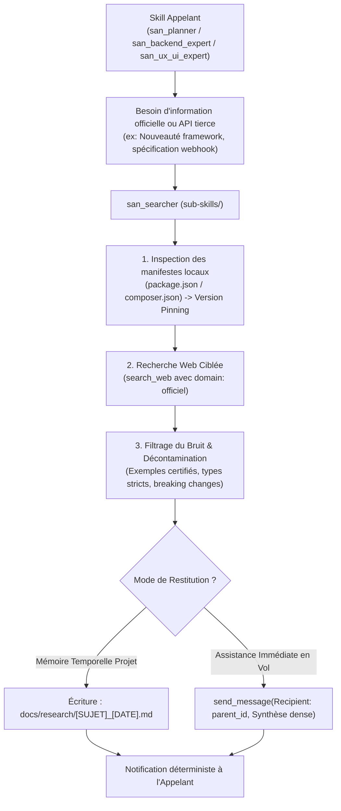
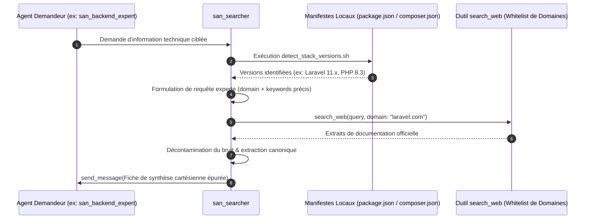
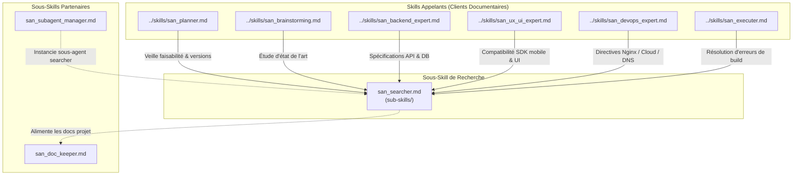

# `san_searcher` — Documentaliste de Haute Précision, Veilleur Technique et Extracteur de Savoir

> **Note d'implantation architecturale :**  
> Au sein du dépôt source `san_agy_framework`, ce sous-skill réside dans `sub-skills/` afin de formaliser la frontière entre les rôles de direction maîtres (points d'entrée dans `skills/`) et l'outillage transversal. Lors de l'installation dans une codebase cliente par le script d'initialisation, il est déployé dans `.agents/skills/san_searcher/` pour être reconnu nativement par le moteur d'exécution Antigravity CLI.

---

## 1. RÔLE, POUR QUI, POUR QUOI

### Rôle Fondamental
`san_searcher` est le **documentaliste de haute précision, le sas de décontamination documentaire et le veilleur technologique autonome** du framework **Antigravity (`san_*`)**. Il opère comme un **Éclaireur Technique & Sas Étanche Anti-Pollution de Contexte** : sa mission est de chercher, filtrer, inspecter, vérifier et synthétiser les documentations officielles des technologies du projet, les changelogs de dépendances, les RFC, les spécifications d'APIs tierces (passerelles Mobile Money, webhooks, services cloud, SDKs) et les benchmarks d'architecture. Il intervient pour lever toute ambiguïté technique en amont ou en cours de développement, tout en garantissant une étanchéité absolue vis-à-vis du contexte de travail principal de l'orchestrateur.

### Pour Qui ?
- **Pour les planificateurs et architectes ([san_planner](../skills/san_planner.md), [san_brainstorming](../skills/san_brainstorming.md)) :** qui doivent calibrer des choix technologiques modernes, s'assurer de la viabilité d'une stack et éviter d'embarquer des dépendances abandonnées ou non pérennes.
- **Pour les experts d'implémentation ([san_backend_expert](../skills/san_backend_expert.md), [san_ux_ui_expert](../skills/san_ux_ui_expert.md), [san_devops_expert](../skills/san_devops_expert.md)) :** qui ont besoin de signatures de fonctions exactes, de schémas de typage TypeScript stricts ou de configurations Nginx/Docker officielles conformes à la version exacte installée sur le projet.
- **Pour le chef d'orchestre ([san_executer](../skills/san_executer.md)) :** en cas d'erreur de compilation inexpliquée, de breaking change lors d'un bump de version ou d'interfaçage complexe avec un service tiers.

### Pour Quoi ?
- **Protéger le contexte principal (*Context Shielding & Decontamination*) :** la navigation web brute déverse des milliers de tokens de balisage HTML, de bannières et de bruit verbeux. `san_searcher` agit comme un sas de décontamination : il absorbe le bruit externe et ne délivre à l'orchestrateur qu'un concentré d'information technique pure.
- **Éradiquer les hallucinations d'APIs (*Anti-Hallucination Guardrail*) :** les modèles de langage ont des coupures de connaissances et ont tendance à extrapoler des paramètres ou méthodes qui n'existent pas dans les versions récentes de frameworks modernes (React 19, Expo SDK 52+, Laravel 11+, Tailwind CSS v4+). `san_searcher` garantit la conformité stricte avec la documentation en ligne faisant autorité.
- **Garantir le Pinning de Versions Stricte :** interdire l'application de solutions conçues pour des versions obsolètes ou divergentes de celles installées localement.

---

## 2. FRONTIÈRES STRICTES : CE QU'IL FAIT / CE QU'IL NE FAIT PAS

| CE QU'IL FAIT STRICTEMENT | CE QU'IL NE FAIT ABSOLUMENT PAS |
| :--- | :--- |
| **Détection Déterministe de la Stack Locale :** Analyse les manifestes (`package.json`, `composer.json`, `go.mod`, `pom.xml`, `Cargo.toml`) pour verrouiller les versions majeures et mineures en service avant toute recherche. | Ne code JAMAIS dans la codebase applicative $\rightarrow$ il ne modifie aucun fichier source métier (`.ts`, `.php`, `.tsx`, `.vue`, `.sql`). Sa production est strictement documentaire. |
| **Recherche Ciblée par Whitelist de Domaines :** Priorise impérativement les domaines officiels reconnus (`laravel.com`, `react.dev`, `docs.expo.dev`, `tailwindcss.com`, `owasp.org`, `developer.mozilla.org`, `php.net`). | N'effectue JAMAIS de recherche web vague ou non versionnée (interdiction de requêtes sans mention de la version exacte du projet). |
| **Extraction Chirurgicale d'Extraits Canoniques :** Extrait les snippets de code officiels, schémas Zod, FormRequests, structures JSON et signatures TypeScript sans balisage HTML résiduel. | Ne pollue JAMAIS l'orchestrateur avec des dumps HTML bruts ou des pages non épurées de trackers et bandeaux. |
| **Benchmark & Veille d'APIs Tierces :** Analyse les passerelles de paiement (Mobile Money MTN, Airtel, Orange, Wave), les webhooks et les SDKs push (idempotence, HMAC, statuts HTTP). | Ne se substitue JAMAIS au code source local déjà présent dans `vendor/` ou `node_modules/` (il inspecte en priorité les fichiers locaux avant de solliciter le web). |
| **Rédaction de Fiches de Synthèse Standardisées :** Stocke ses analyses dans `docs/research/` ou les renvoie directement au parent via `send_message`. | Ne prend JAMAIS de décision architecturale unilatérale $\rightarrow$ il expose les faits techniques et compromis officiels, l'arbitrage revenant à l'orchestrateur. |

---

## 3. COMMENT IL EST MOBILISÉ PAR LES SKILLS PRINCIPAUX



### Invocations Concrètes

#### 1. Mobilisation par [`san_planner`](../skills/san_planner.md)
* Requête : *"san_searcher : inspecte la compatibilité d'Expo SDK 52 avec React Native Reanimated v3 et extrait les breaking changes officiels."*
* Rôle : Vérifier la faisabilité et anticiper les incompatibilités avant la rédaction de la feuille de route.

#### 2. Mobilisation par [`san_backend_expert`](../skills/san_backend_expert.md)
* Requête : *"san_searcher : extrais la documentation officielle de Laravel 11 concernant `Cache::lock` atomique sur Redis et le modèle de signature HMAC des webhooks MTN MoMo."*
* Rôle : Fournir les signatures de méthodes et contrats d'idempotence exacts.

#### 3. Mobilisation par [`san_ux_ui_expert`](../skills/san_ux_ui_expert.md)
* Requête : *"san_searcher : vérifie la syntaxe officielle de Tailwind CSS v4 pour la déclaration des variables de thèmes et les contraintes de nesting."*
* Rôle : Empêcher l'utilisation de configurations dépréciées issues de Tailwind v3.

---

## 4. STRUCTURE INTERNE DU SOUS-SKILL

Lors du déploiement au sein d'une codebase sous Antigravity CLI, le sous-skill présente l'arborescence normative suivante :

```txt
.agents/skills/san_searcher/
├── SKILL.md                                 # Manifeste de gouvernance, méthodologie de veille et formats
├── references/
│   ├── official_authorities.md              # Whitelist des domaines officiels fiables et documentations de référence
│   ├── payment_apis_cheatsheet.md           # Spécifications comparées des passerelles Mobile Money et webhooks
│   └── version_matrix_guidelines.md         # Règles de corrélation entre versions de frameworks et compatibilité SDK
├── templates/
│   └── RESEARCH_NOTE_TEMPLATE.md            # Gabarit officiel d'investigation avec tableau comparatif multi-options
└── scripts/
    ├── detect_stack_versions.sh             # Script d'inspection rapide extrayant les versions exactes du projet
    └── doc_scraper.sh                       # Script de scraping et décontamination de documentation officielle
```

---

## 5. LIVRABLES EXACTS & GABARIT CANONIQUE

`san_searcher` produit des synthèses techniques à haute valeur ajoutée, archivées sous `docs/research/` :

```txt
Livrables Documentaires :
docs/research/
├── TECH_INVESTIGATION_[DOMAINE]_[JJMMAAAA].md  # Fiche d'investigation technique canonique
├── API_SPEC_[FOURNISSEUR]_[JJMMAAAA].md         # Fiche d'intégration d'API tierce avec contrat et erreurs
└── BENCHMARK_[COMPOSANT]_[JJMMAAAA].md         # Analyse comparative multicritères de librairies
```

### Modèle Canonique d'une Fiche de Recherche (`docs/research/TECH_INVESTIGATION_*.md`)

```markdown
# FICHE DE RECHERCHE TECHNIQUE : [Sujet / Technologie]
- **Date d'Investigation :** JJ/MM/AAAA
- **Version Détectée du Projet :** [ex: Laravel 11.28, React 19.0, Expo SDK 52.0, Tailwind CSS 4.0]
- **Domaine Officiel Consulté :** [ex: laravel.com, react.dev, docs.expo.dev]
- **Sources Officielles :**
  - [Documentation Officielle](https://...)
  - [Release Notes / Changelog](https://...)

## 1. Contexte & Problématique Résolue
[Description concise du verrou technique, de la méthode recherchée ou du choix d'architecture à clarifier.]

## 2. Pattern Canonique Officiel (Recommandé)
[Explication du design pattern actuel préconisé par la documentation officielle de l'éditeur.]

## 3. Snippet de Référence Typé (Zéro Hallucination)
```typescript
// Exemple officiel vérifié et prêt pour l'implémentation
export async function handleWebhook(payload: WebhookPayload, signature: string): Promise<boolean> {
  // Implémentation certifiée conforme à la version active
}
```

## 4. Tableau Comparatif : Déprécié vs Canonique
| Ancien Pattern (Déprécié / À Proscrire) | Pattern Canonique Actuel | Risque / Impact |
| :--- | :--- | :--- |
| `ancien_parametre` | `nouveau_parametre` | Déprécié en vN, levée d'exception en vN+1 |
| Configuration manuelle `tailwind.config.js` | Directives CSS `@theme` (Tailwind v4) | Rupture de build au rechargement à chaud |

## 5. Pièges Connus & Réalités Terrain (3G/EDGE & Idempotence)
- **Gestion des Coupures Réseau :** [Comportement en cas de timeout socket, politique de retry recommandée]
- **Idempotence & Verrous :** [Spécification de la clé d'idempotence et durée de rétention en cache]
- **Sécurité :** [Validation cryptographique des signatures HMAC-SHA256, assainissement des entrées]
```

---

## 6. PROCÉDURE D'EXÉCUTION DÉTAILLÉE (PIPELINE EN 6 ÉTAPES)



### Étape 1 : Algorithme de Pinning de Versions Locales
Avant d'effectuer la moindre requête web, `san_searcher` cartographie l'environnement :
1. Exécuter `scripts/detect_stack_versions.sh` pour inspecter :
   - `package.json` $\rightarrow$ Versions de React, Vue, Next.js, Tailwind, TypeScript, Expo.
   - `composer.json` $\rightarrow$ Versions de PHP, Laravel, Pest, Sanctum.
   - `Dockerfile` / `docker-compose.yml` $\rightarrow$ Versions de Redis, PostgreSQL, Nginx.
2. Épingler formellement la version cible. Si le projet est sous Laravel 11, toute solution conçue pour Laravel 8 ou 9 est immédiatement disqualifiée.

### Étape 2 : Formulation de Requêtes Expertes avec Whitelist de Domaines
1. Exploiter obligatoirement le paramètre `domain` de l'outil `search_web` en puisant dans la whitelist officielle :
   - **Frameworks Web & JS :** `domain: "react.dev"`, `domain: "nextjs.org"`, `domain: "nodejs.org"`
   - **Frameworks Backend :** `domain: "laravel.com"`, `domain: "php.net"`, `domain: "adonisjs.com"`
   - **Mobile :** `domain: "docs.expo.dev"`, `domain: "reactnative.dev"`
   - **Styling :** `domain: "tailwindcss.com"`
   - **Standards & Sécurité :** `domain: "developer.mozilla.org"`, `domain: "owasp.org"`
2. Formuler des requêtes denses associant le framework, le composant, l'action et le numéro de version :
   - *Exemple non conforme :* `"comment faire des verrous de cache"`
   - *Exemple conforme :* `"laravel 11 cache lock atomic redis official documentation"`

### Étape 3 : Sas de Décontamination et Épuration du Bruit
1. Réceptionner les données retournées par `search_web` ou scrapées via `scripts/doc_scraper.sh`.
2. Éliminer immédiatement les en-têtes de navigation, bannières publicitaires, mentions de cookies et discussions de forums non corroborées.
3. Isoler les signatures de fonctions exactes, les types d'arguments et les codes d'exceptions.

### Étape 4 : Détection des Breaking Changes et Cas Limites
1. Consulter les sections *« Upgrade Guide »* et *« Breaking Changes »* de l'éditeur.
2. Vérifier les contraintes opérationnelles : idempotence obligatoire, gestion des timeouts sur réseau 3G dégradé, consommation mémoire.

### Étape 5 : Rédaction de la Synthèse Cartésienne
1. Structurer la fiche selon le gabarit canonique (`RESEARCH_SYNTHESIS_TEMPLATE.md`).
2. Consigner systématiquement les URLs exactes consultées.
3. Si le sujet constitue un choix structurant pour le projet, écrire la fiche dans `docs/research/TECH_INVESTIGATION_[DOMAINE]_[JJMMAAAA].md` avec `write_file`.

### Étape 6 : Restitution à l'Agent Appelant
1. Renvoyer la synthèse immédiatement via `send_message` ou dans la réponse directe.
2. Signaler clairement toute dérive potentielle par rapport au code existant du projet.

---

## 7. SCRIPTS ET OUTILS DÉTERMINISTES EMBARQUÉS

### 1. Script d'Inspection et de Pinning de Versions (`scripts/detect_stack_versions.sh`)

```bash
#!/usr/bin/env bash
# scripts/detect_stack_versions.sh
# Extraction déterministe des versions de frameworks et runtimes du projet.
# Usage: bash scripts/detect_stack_versions.sh [PROJECT_ROOT]

set -euo pipefail

ROOT_DIR="${1:-.}"
echo "🔍 [san_searcher] Analyse des manifestes dans : ${ROOT_DIR}"

VERSIONS_FOUND=0

echo "=== STACK TECHNIQUE IDENTIFIÉE ==="

# 1. Écosystème Node / JavaScript / TypeScript
if [[ -f "${ROOT_DIR}/package.json" ]]; then
  echo "📦 Fichier détecté : package.json"
  node -e "
    const pkg = JSON.parse(require('fs').readFileSync('${ROOT_DIR}/package.json', 'utf-8'));
    const deps = Object.assign({}, pkg.dependencies || {}, pkg.devDependencies || {});
    const targets = ['react', 'react-native', 'expo', 'next', 'tailwindcss', 'typescript', 'vue', 'adonisjs'];
    targets.forEach(t => {
      if (deps[t]) console.log('  - ' + t + ' : ' + deps[t]);
    });
  " || true
  VERSIONS_FOUND=$((VERSIONS_FOUND + 1))
fi

# 2. Écosystème PHP / Laravel
if [[ -f "${ROOT_DIR}/composer.json" ]]; then
  echo "🐘 Fichier détecté : composer.json"
  php -r "
    \$json = json_decode(file_get_contents('${ROOT_DIR}/composer.json'), true);
    \$req = array_merge(\$json['require'] ?? [], \$json['require-dev'] ?? []);
    \$targets = ['php', 'laravel/framework', 'pestphp/pest', 'laravel/sanctum', 'livewire/livewire'];
    foreach (\$targets as \$t) {
      if (isset(\$req[\$t])) echo '  - ' . \$t . ' : ' . \$req[\$t] . PHP_EOL;
    }
  " || true
  VERSIONS_FOUND=$((VERSIONS_FOUND + 1))
fi

# 3. Écosystème Docker / Infrastructure
if [[ -f "${ROOT_DIR}/Dockerfile" ]]; then
  echo "🐳 Fichier détecté : Dockerfile"
  grep -E "^FROM " "${ROOT_DIR}/Dockerfile" | sed 's/^/  - /' || true
  VERSIONS_FOUND=$((VERSIONS_FOUND + 1))
fi

if [[ -f "${ROOT_DIR}/docker-compose.yml" ]]; then
  echo "🐙 Fichier détecté : docker-compose.yml"
  grep -E "image:" "${ROOT_DIR}/docker-compose.yml" | sed 's/^/  - /' || true
  VERSIONS_FOUND=$((VERSIONS_FOUND + 1))
fi

if [[ ${VERSIONS_FOUND} -eq 0 ]]; then
  echo "⚠️ Aucun manifeste standard (package.json, composer.json, Dockerfile) détecté."
  exit 1
else
  echo "=================================="
  echo "✅ [san_searcher] Pinning de versions achevé. Utilisez ces repères pour vos requêtes."
  exit 0
fi
```

### 2. Script de Décontamination et Scraping Documentaire (`scripts/doc_scraper.sh`)

Ce script télécharge une page de documentation officielle, en extrait le contenu technique textuel pur, élimine l'intégralité du balisage superflu (scripts, bannières, styles) et produit une note épurée prête pour `docs/research/`.

```bash
#!/usr/bin/env bash
# scripts/doc_scraper.sh
# Téléchargement épuré et décontamination d'une page de documentation officielle.
# Usage: bash scripts/doc_scraper.sh <URL> <NOM_SUJET>

set -euo pipefail

TARGET_URL="${1:-}"
SUBJECT_NAME="${2:-tech_doc}"
OUTPUT_DIR="docs/research"
DATE_STAMP=$(date +%d%m%Y)
TARGET_FILE="${OUTPUT_DIR}/TECH_INVESTIGATION_${SUBJECT_NAME^^}_${DATE_STAMP}.md"

if [[ -z "${TARGET_URL}" ]]; then
  echo "❌ Erreur : URL cible manquante."
  echo "Usage: $0 <URL> <NOM_SUJET>"
  exit 1
fi

# Whitelist de sécurité pour prévenir le scraping sauvage de domaines suspects
WHITELIST_REGEX="^(https?://)?([a-zA-Z0-9-]+\.)*(laravel\.com|react\.dev|docs\.expo\.dev|tailwindcss\.com|owasp\.org|developer\.mozilla\.org|php\.net|nodejs\.org|stripe\.com)"

if ! echo "${TARGET_URL}" | grep -qE "${WHITELIST_REGEX}"; then
  echo "⚠️ ALERTE : L'URL demandée (${TARGET_URL}) ne fait pas partie de la whitelist officielle."
  echo "Domaines autorisés : laravel.com, react.dev, docs.expo.dev, tailwindcss.com, owasp.org, developer.mozilla.org, php.net, nodejs.org, stripe.com"
  read -p "Souhaitez-vous tout de même continuer ? (y/N) : " CONFIRM
  if [[ "${CONFIRM}" != "y" && "${CONFIRM}" != "Y" ]]; then
    echo "Opération annulée par sécurité."
    exit 1
  fi
fi

mkdir -p "${OUTPUT_DIR}"
echo "🌐 [san_searcher] Extraction épurée depuis : ${TARGET_URL}"

# Téléchargement avec curl et décontamination HTML via node
TEMP_HTML=$(mktemp)
curl -sSL -A "Mozilla/5.0 (compatible; SanSearcherBot/1.0; +https://alexsan.pro)" "${TARGET_URL}" -o "${TEMP_HTML}"

node -e "
const fs = require('fs');
let html = fs.readFileSync('${TEMP_HTML}', 'utf-8');

// 1. Suppression des scripts, styles, iframes, nav, footer, aside
html = html.replace(/<script\b[^<]*(?:(?!<\/script>)<[^<]*)*<\/script>/gi, '');
html = html.replace(/<style\b[^<]*(?:(?!<\/style>)<[^<]*)*<\/style>/gi, '');
html = html.replace(/<nav\b[^<]*(?:(?!<\/nav>)<[^<]*)*<\/nav>/gi, '');
html = html.replace(/<footer\b[^<]*(?:(?!<\/footer>)<[^<]*)*<\/footer>/gi, '');
html = html.replace(/<header\b[^<]*(?:(?!<\/header>)<[^<]*)*<\/header>/gi, '');

// 2. Conversion basique balises HTML vers Markdown
let md = html
  .replace(/<h1[^>]*>(.*?)<\/h1>/gi, '\n# $1\n')
  .replace(/<h2[^>]*>(.*?)<\/h2>/gi, '\n## $1\n')
  .replace(/<h3[^>]*>(.*?)<\/h3>/gi, '\n### $1\n')
  .replace(/<pre[^>]*><code[^>]*>([\s\S]*?)<\/code><\/pre>/gi, '\n\`\`\`\n$1\n\`\`\`\n')
  .replace(/<code[^>]*>(.*?)<\/code>/gi, '\`$1\`')
  .replace(/<li[^>]*>(.*?)<\/li>/gi, '- $1\n')
  .replace(/<p[^>]*>(.*?)<\/p>/gi, '\n$1\n')
  .replace(/<[^>]+>/g, '');

// Décodage entités HTML courantes
md = md
  .replace(/&amp;/g, '&')
  .replace(/&lt;/g, '<')
  .replace(/&gt;/g, '>')
  .replace(/&quot;/g, '\"')
  .replace(/&#39;/g, '\'')
  .replace(/\n{3,}/g, '\n\n');

const header = \`# FICHE DE RECHERCHE TECHNIQUE : ${SUBJECT_NAME^^}
- **Source Officielle :** ${TARGET_URL}
- **Date d'Extraction :** \${new Date().toISOString()}
- **Statut :** Décontaminé et épuré

---

\`;

fs.writeFileSync('${TARGET_FILE}', header + md.trim() + '\n', 'utf-8');
console.log('✅ Synthèse documentaire épurée générée dans : ${TARGET_FILE}');
"

rm -f "${TEMP_HTML}"
echo "🎯 [san_searcher] Sas de décontamination complété avec succès."
exit 0
```

---

## 8. PRINCIPES DIRECTEURS ET INVARIANTS

### 1. Invariant de Primauté de la Documentation Officielle (*Official Authority First*)
La parole officielle de l'éditeur d'un framework ou d'un service prime sur toute interprétation tierce. Les réponses trouvées sur des forums ou des blogs non officiels doivent être corroborées par la documentation officielle avant d'être validées.

### 2. Invariant de Conscience Temporelle et de Version (*Strict Version Pinning*)
Une solution technique n'est valide que pour la version exacte du framework utilisée sur le projet. Proposer une syntaxe dépréciée ou réservée à une version future non installée est une faute d'ingénierie majeure.

### 3. Invariant de Zéro Bruit dans le Contexte Orchestrateur (*Noise-Free Distillation*)
L'orchestrateur principal ne doit jamais recevoir des pages HTML brutes, des logs d'erreurs de scraping ou des listings verbeux non analysés. `san_searcher` délivre uniquement de l'information pré-digérée, vérifiée et immédiatement opérationnelle.

### 4. Invariant de Traçabilité et Citations Vérifiables (*Verifiable Source Citation*)
Chaque affirmation technique, signature d'API ou recommandation formulée par `san_searcher` doit être accompagnée de son URL source officielle, consultable directement par le développeur.

### 5. Invariant d'Économie de Requêtes et Mise en Cache Documentaire (*Research Caching*)
Toute recherche sur une problématique transverse structurante fait l'objet d'un fichier persistant dans `docs/research/`. Avant de lancer de nouvelles requêtes web, `san_searcher` consulte `docs/research/` pour réutiliser les synthèses déjà compilées.

---

## 9. MATRICE DE BRANCHEMENT ET RÉFÉRENCES CROISÉES



### Amont (Compétences maîtresses qui mobilisent ce sous-skill) :
- [`../skills/san_planner.md`](../skills/san_planner.md) : Sollicite `san_searcher` lors de la conception de la roadmap pour s'assurer que les patterns retenus sont conformes aux standards officiels actuels.
- [`../skills/san_brainstorming.md`](../skills/san_brainstorming.md) : Utilise `san_searcher` pour explorer l'état de l'art technologique et concurrentiel.
- [`../skills/san_backend_expert.md`](../skills/san_backend_expert.md) : Invoque `san_searcher` pour obtenir les spécifications d'APIs tierces et les drivers de base de données.
- [`../skills/san_ux_ui_expert.md`](../skills/san_ux_ui_expert.md) : Mobilise `san_searcher` pour vérifier la compatibilité des librairies React Native et des modules Expo.
- [`../skills/san_devops_expert.md`](../skills/san_devops_expert.md) : Déploie `san_searcher` pour valider les configurations serveur et les protocoles de messagerie.
- [`../skills/san_executer.md`](../skills/san_executer.md) : Déclenche `san_searcher` lorsqu'une erreur d'interfaçage bloque la validation de la livraison.

### Synergies avec les autres sous-skills :
- [`san_subagent_manager.md`](san_subagent_manager.md) : Instancie et calibre le sous-agent dédié à la recherche documentaire (`Model: 'inherit'`) avec outils web activés et outils de modification désactivés.
- [`san_doc_keeper.md`](san_doc_keeper.md) : Intègre les conclusions des fiches de recherche dans la documentation globale du projet (`README.md`, `docs/ARCHITECTURE.md`).
