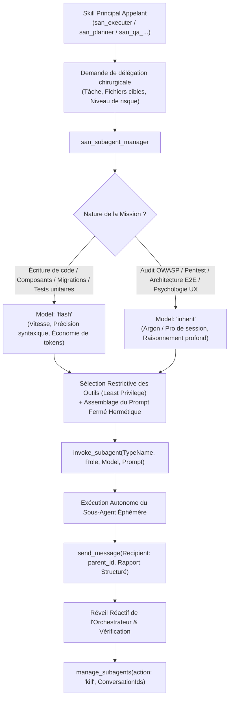
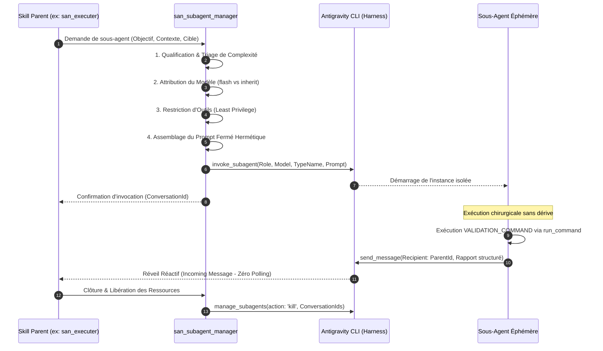
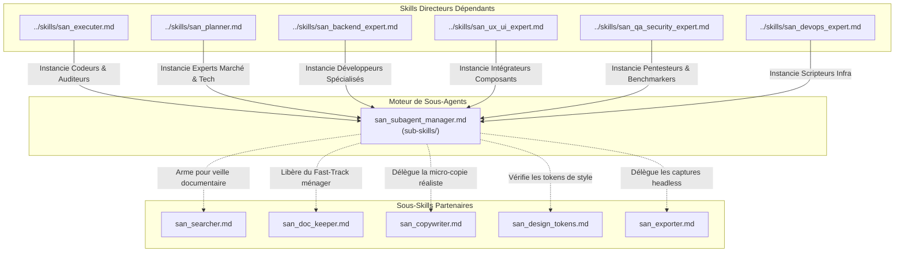

# `san_subagent_manager` — Usine de Conception, Calibrage et Supervision de Sous-Agents Chirurgicaux

> **Note d'implantation architecturale :**  
> Au sein du dépôt source `san_agy_framework`, ce sous-skill réside dans `sub-skills/` afin de formaliser la frontière entre les rôles de direction maîtres (points d'entrée dans `skills/`) et l'outillage transversal. Lors de l'installation dans une codebase cliente par le script d'initialisation, il est déployé dans `.agents/skills/san_subagent_manager/` pour être reconnu nativement par le moteur d'exécution Antigravity CLI.

---

## 1. RÔLE, POUR QUI, POUR QUOI

### Rôle Fondamental
`san_subagent_manager` est le **moteur cartésien de fabrication, de calibrage et d'orchestration des sous-agents autonomes éphémères** au sein du framework **Antigravity (`san_*`)**. Il agit comme l'**Armurier et Métrologue Agentique** des compétences maîtresses : son rôle est de transformer une intention de délégation formulée par un skill principal ([san_executer](../skills/san_executer.md), [san_planner](../skills/san_planner.md), [san_backend_expert](../skills/san_backend_expert.md), [san_ux_ui_expert](../skills/san_ux_ui_expert.md), [san_qa_security_expert](../skills/san_qa_security_expert.md), [san_devops_expert](../skills/san_devops_expert.md)) en une unité d'exécution chirurgicale, dotée du modèle de calcul optimal, d'un outillage restreint au strict minimum (principe de moindre privilège), d'un prompt système fermé hermétique et d'un protocole de reddition de comptes déterministe par `send_message`.

### Pour Qui ?
- **Pour les skills directeurs du framework :** qui doivent déléguer des tâches concrètes sans risquer la saturation de contexte (*Context Bloat*), la pollution de la session maîtresse ou la surconsommation de tokens.
- **Pour l'orchestrateur central :** garantissant que chaque sous-agent instancié dispose d'une mission univoque, bornée dans le temps, avec des critères de validation binaires (succès vérifié ou échec explicite).
- **Pour le développeur :** qui bénéficie d'une vitesse d'exécution accrue, d'une prédictibilité totale et de logs d'agents parfaitement structurés.

### Pour Quoi ?
- **Éradiquer le gaspillage de tokens (*Token Frugality*) :** en appliquant la stricte séparation entre le pôle de réflexion/audit (`Model: 'inherit'`) et le pôle d'exécution atomique (`Model: 'flash'`).
- **Supprimer le flou d'instruction (*Zero-Ambiguity Guardrail*) :** en injectant des prompts de sous-agents fermés contenant obligatoirement le contexte exact, les fichiers cibles, les règles non négociables et le format de retour attendu.
- **Appliquer le principe de moindre privilège (*Least Privilege Tooling*) :** en refusant d'accorder à un sous-agent des outils dont il n'a pas strictement besoin (ex: interdire les outils web à un sous-agent d'implémentation de contrôleur local, interdire les outils d'écriture à un sous-agent d'audit).
- **Bannir les boucles infinies et les hallucinations :** en contraignant chaque mission avec des bornes d'arrêt strictes et un rapport final obligatoire transmis au parent via `send_message`.

---

## 2. FRONTIÈRES STRICTES : CE QU'IL FAIT / CE QU'IL NE FAIT PAS

| CE QU'IL FAIT STRICTEMENT | CE QU'IL NE FAIT ABSOLUMENT PAS |
| :--- | :--- |
| **Calibrage Sémantique de Mission :** Formalise la demande selon le standard normatif : Rôle précis (2 à 5 mots), Objectif unique, Entrées et sorties formelles, Contraintes strictes. | N'exécute JAMAIS de code métier lui-même $\rightarrow$ il conçoit et arme les agents ; il ne code ni contrôleurs, ni écrans, ni requêtes SQL. |
| **Attribution Algorithmique du Modèle (`routing`) :** Affecte strictement `Model: 'flash'` pour l'implémentation atomique / code et `Model: 'inherit'` pour les audits, la sécurité et la réflexion architecturale. | N'autorise JAMAIS l'utilisation de `Model: 'inherit'` pour de l'écriture de code applicatif ou du boilerplate $\rightarrow$ considéré comme une faute d'ingénierie majeure. |
| **Sélection Restrictive des Outils (*Tool Sandboxing*) :** Ouvre uniquement les capacités indispensables (interdiction formelle des outils récursifs `invoke_subagent`, `define_subagent` et de la navigation web inutile). | N'instancie JAMAIS un sous-agent avec un prompt flou ou incomplet (chemins relatifs vagues, absence de commande de test, format de restitution libre). |
| **Injection de Garde-Fous Anti-Hallucination :** Verrouille dans le prompt l'obligation de se baser sur du code vérifié, l'interdiction d'inventer des packages tiers et l'usage exclusif de `send_message`. | N'autorise JAMAIS la récursion sauvage : `EnableSubagentTools` est désactivé par défaut pour éliminer toute arborescence d'agents incontrôlée. |
| **Supervision Événementielle Réactive :** Invoque le sous-agent en mode non-bloquant (zéro polling) et libère les ressources via `manage_subagents(action: 'kill')` dès clôture. | Ne se substitue JAMAIS au Fast-Track de l'orchestrateur pour les tâches ménagères immédiates (cochage d'une case, déplacement d'un fichier). |

---

## 3. COMMENT IL EST MOBILISÉ PAR LES SKILLS PRINCIPAUX



### Invocations Concrètes par les Rôles Directeurs

#### 1. Mobilisation par [`san_executer`](../skills/san_executer.md)
`san_executer` est le premier consommateur de sous-agents pour dérouler les paliers de roadmap :
- **Artisan Backend (`flash`) :** Migrations, modèles, services métier, FormRequests, tests Pest/PHPUnit, requêtes Bruno.
- **Artisan Frontend (`flash`) :** Composants React/React Native, gestion des 5 états UI, animations 60 fps, intégration des contrats d'API.
- **Auditeur d'Intégration E2E (`inherit`) :** Vérification croisée des contrats, simulation de coupures réseau 3G, idempotence des requêtes, conformité des statuts HTTP.

#### 2. Mobilisation par [`san_planner`](../skills/san_planner.md)
- **`psychologist_market_expert` (`inherit`) :** Analyse cognitive de l'UX, réduction des frictions de parcours, modèles économiques adaptés aux contextes locaux.
- **`technical_market_expert` (`inherit`) :** Cartographie des dépendances, analyse de robustesse SOLID/DRY, dimensionnement des goulets d'étranglement.

#### 3. Mobilisation par [`san_qa_security_expert`](../skills/san_qa_security_expert.md)
- **Auditeur Pentest OWASP (`inherit`) :** Détection des vulnérabilités BOLA/IDOR, injections SQL/NoSQL, sécurité du stockage local, fuites de tokens d'authentification.

---

## 4. STRUCTURE INTERNE DU SOUS-SKILL

Lors du déploiement au sein d'une codebase sous Antigravity CLI, le sous-skill présente l'arborescence normative suivante :

```txt
.agents/skills/san_subagent_manager/
├── SKILL.md                                 # Manifeste de gouvernance, règles de calibrage et prompts types
├── references/
│   ├── subagent_archetypes.md               # Catalogue exhaustif des 8 archétypes de sous-agents
│   ├── prompt_engineering_standards.md      # Directives de rédaction hermétique et techniques anti-hallucination
│   └── least_privilege_matrix.md            # Matrice d'attribution des outils Antigravity selon la mission
├── templates/
│   ├── UNIVERSAL_SYSTEM_PROMPT_TEMPLATE.md  # Gabarit universel fermé (Role, Mission, Inputs, Outputs, Constraints)
│   ├── ATOMIC_CODER_PROMPT.md               # Gabarit d'instruction pour sous-agent de code (flash)
│   └── AUDITOR_PROMPT.md                    # Gabarit d'instruction pour sous-agent d'audit (inherit)
└── scripts/
    └── validate_subagent_spec.sh            # Script de contrôle statique vérifiant la complétude du prompt avant invocation
```

---

## 5. LIVRABLES EXACTS & GABARITS CANONIQUES

### 1. Template Universel de Prompt Système Fermé
Tout prompt système calibré par `san_subagent_manager` doit impérativement respecter la structure fermée en 6 sections non négociables :

```markdown
### 1. ROLE
Tu es [Nom Exact du Rôle : 2 à 5 mots], artisan spécialisé rattaché au framework Antigravity (san_*).
Ton conversationId parent est : [PARENT_CONVERSATION_ID].

### 2. MISSION
[Description chirurgicale de l'objectif unique. Zéro ambiguïté, zéro digression.]

### 3. INPUTS (Contexte & Données autorisées)
- Fichiers à lire obligatoirement :
  - `file:///chemin/absolu/fichier_source_1.ext`
  - `file:///chemin/absolu/fichier_source_2.ext`
- Règles contextuelles applicables : `.agents/rules/PROJECT.md`, `.agents/rules/BRAND.md`, `.agents/rules/API.md`

### 4. OUTPUTS (Fichiers & Livrables attendus)
- Fichiers à créer / modifier exclusivement :
  - `file:///chemin/absolu/fichier_cible_1.ext`
  - `file:///chemin/absolu/fichier_cible_2.ext`

### 5. CONSTRAINTS (Garde-fous stricts & Anti-Hallucination)
- Interdiction formelle de créer ou modifier un fichier en dehors de la liste OUTPUTS.
- Interdiction d'inventer des packages tiers non déclarés dans les manifestes locaux.
- Interdiction formelle d'appeler des outils récursifs (invoke_subagent, define_subagent).
- Ne jamais polluer la console avec du texte verbeux : ton unique canal de communication final est l'outil `send_message`.

### 6. VALIDATION_COMMAND (Preuve déterministe)
Avant de conclure, exécute la commande de test suivante via `run_command` :
`[COMMANDE_EXACTE_DE_VALIDATION]` (ex: npm test path/to/test.spec.ts || php artisan test --filter=PaymentTest)
Le résultat doit afficher 0 erreur et 100% de succès.

### 7. PROTOCOLE DE REDDITION
Appelle immédiatement l'outil `send_message` avec :
- `Recipient` : "[PARENT_CONVERSATION_ID]"
- `Message` : [Rapport structuré conforme au schéma standard]
```

### 2. Schéma Standard du Rapport de Reddition (`send_message`)
Le message de restitution transmis à l'orchestrateur doit obligatoirement adopter ce format Markdown :

```markdown
### RAPPORT DE MISSION : [Nom du Rôle]
- **Statut :** [SUCCÈS_TOTAL | ÉCHEC_PARTIEL | BLOCAGE]
- **Fichiers Créés / Modifiés :**
  - [nom_fichier.ext](file:///chemin/absolu/fichier1.ext) — Brève description du contenu
  - [nom_fichier.ext](file:///chemin/absolu/fichier2.ext) — Brève description du contenu
- **Preuves Déterministes d'Exécution :**
  - Commande exécutée : `[COMMANDE_EXACTE]`
  - Résultat : [X tests passés, 0 échec, typage statique 100% valide]
- **Alertes / Points d'Attention pour le Parent :**
  - [Détail des arbitrages ou remarques architecturales]
```

---

## 6. PROCÉDURE D'EXÉCUTION DÉTAILLÉE (PIPELINE EN 6 ÉTAPES)



### Étape 1 : Qualification du Besoin et Triage de Granularité
1. **Validation du Principe de Responsabilité Unique (SRP) :** S'assurer que la mission confiée correspond à une action délimitée. Si la demande combine backend, UI et configuration réseau, `san_subagent_manager` la découpe en 3 missions distinctes exécutées séquentiellement.
2. **Identification des Dépendances :** Référencer exhaustivement les chemins absolus des fichiers d'entrée (`INPUTS`) et de sortie (`OUTPUTS`).

### Étape 2 : Routage Strict du Modèle de Calcul
Appliquer sans exception la règle d'attribution des ressources :
- **`Model: 'flash'` :**
  - Implémentation de classes de service, contrôleurs, composants d'UI, hooks.
  - Écriture de migrations de base de données, seeders et fixtures.
  - Rédaction de suites de tests unitaires ou de collections de requêtes d'API (Bruno).
  - Formatage de documentation, correction syntaxique de linters.
- **`Model: 'inherit'` :**
  - Analyse d'architecture amont, arbitrage de structures de données critiques.
  - Audit de sécurité OWASP, analyse de vulnérabilités et pentesting.
  - Évaluation de performance globale et intégration croisée Frontend/Backend.
  - Audits cognitifs UX et psychologie produit.

### Étape 3 : Application du Principe de Moindre Privilège (*Tool Sandboxing*)
Restreindre la surface d'attaque et les risques de digression en n'ouvrant que les capacités strictement indispensables :
```yaml
# Profil d'Exécution Code (flash)
EnabledTools:
  - read_file
  - write_file
  - edit_file
  - run_command
DisabledTools:
  - search_web         # Pas de navigation sauvage pour coder du métier local
  - invoke_subagent    # Zéro sous-agent récursif
  - define_subagent

# Profil d'Audit de Sécurité / Architecture (inherit)
EnabledTools:
  - read_file
  - run_command        # Uniquement pour lancer des suites de tests et linters
DisabledTools:
  - write_file         # Un auditeur ne modifie pas le code en direct
  - edit_file
  - search_web
```

### Étape 4 : Assemblage du Prompt Système Hermétique
Construire le prompt selon le gabarit universel fermé (Role, Mission, Inputs, Outputs, Constraints, Validation Command, Reddition). Vérifier sa conformité statique via `scripts/validate_subagent_spec.sh`.

### Étape 5 : Invocation Non-Bloquante et Attente Réactive
1. Lancer l'instance via l'outil natif :
   ```json
   {
     "Role": "Backend Service Implementer",
     "Model": "flash",
     "TypeName": "self",
     "Prompt": "[PROMPT_HERMETIQUE_COMPILE]"
   }
   ```
2. **Principe de Réveil Événementiel :** L'agent appelant ne fait AUCUN appel en boucle (`sleep`, boucle de consultation de statut). Dès que l'appel d'outil est émis, l'exécution s'interrompt proprement ; le système Antigravity CLI réveillera automatiquement l'orchestrateur dès que le message de fin de mission sera réceptionné.

### Étape 6 : Réception du Rapport, Contrôle Qualité et Nettoyage
1. À la reprise d'exécution, lire le contenu du rapport transmis par `send_message`.
2. Vérifier la présence des preuves d'exécution (tests au vert, typage 100% valide).
3. Si la tâche est déclarée réussie, appeler `manage_subagents` avec l'action `'kill'` sur le `conversationId` du sous-agent pour libérer l'espace mémoire et clore la session de travail.
4. Si la tâche a échoué, réinjecter l'erreur spécifique dans un nouveau sous-agent de correction ou transmettre un diagnostic net au développeur (après 5 échecs consécutifs maximum).

---

## 7. SCRIPTS ET OUTILS DÉTERMINISTES EMBARQUÉS

### Script de Validation Statique de Spécification de Sous-Agent (`scripts/validate_subagent_spec.sh`)

Ce script analyse le texte d'un prompt système avant son injection dans `invoke_subagent` afin de certifier qu'aucune règle du framework n'est transgressée.

```bash
#!/usr/bin/env bash
# scripts/validate_subagent_spec.sh
# Validation déterministe de la structure d'un prompt système de sous-agent Antigravity.
# Usage: bash scripts/validate_subagent_spec.sh path/to/prompt.md [flash|inherit]

set -euo pipefail

PROMPT_FILE="${1:-}"
MODEL_TARGET="${2:-flash}"

if [[ -z "${PROMPT_FILE}" || ! -f "${PROMPT_FILE}" ]]; then
  echo "❌ Erreur : Fichier de prompt introuvable ou non spécifié."
  echo "Usage: $0 path/to/prompt.md [flash|inherit]"
  exit 1
fi

echo "🔍 [san_subagent_manager] Audit cartésien du prompt : ${PROMPT_FILE} (Modèle visé: ${MODEL_TARGET})"
ERRORS=0

# 1. Vérification des sections obligatoires
REQUIRED_SECTIONS=(
  "### 1. ROLE"
  "### 2. MISSION"
  "### 3. INPUTS"
  "### 4. OUTPUTS"
  "### 5. CONSTRAINTS"
  "### 6. VALIDATION_COMMAND"
  "### 7. PROTOCOLE DE REDDITION"
)

for section in "${REQUIRED_SECTIONS[@]}"; do
  if ! grep -qF "${section}" "${PROMPT_FILE}"; then
    echo "❌ Section obligatoire manquante : '${section}'"
    ERRORS=$((ERRORS + 1))
  fi
done

# 2. Vérification des chemins absolus (Interdiction des chemins vagues relatifs)
if grep -qE "(INPUTS|OUTPUTS)" "${PROMPT_FILE}"; then
  if grep -E '`\./|\.\./' "${PROMPT_FILE}" | grep -qv "file://"; then
    echo "⚠️ Avertissement : Détection de chemins relatifs suspects. Privilégiez des chemins absolus ou file:///."
  fi
fi

# 3. Interdiction formelle des outils récursifs dans les contraintes
if ! grep -q "invoke_subagent" "${PROMPT_FILE}"; then
  echo "❌ Garde-fou manquant : L'interdiction formelle de 'invoke_subagent' doit figurer dans les contraintes."
  ERRORS=$((ERRORS + 1))
fi

# 4. Vérification de l'attribution du modèle
if [[ "${MODEL_TARGET}" == "inherit" ]]; then
  # Si inherit, vérifier que la mission est bien de l'audit/sécurité/architecture
  if grep -qiE "(code|implémente|écris le composant|crée la migration)" "${PROMPT_FILE}"; then
    echo "❌ Violation de routing : Un sous-agent de code pur NE DOIT JAMAIS tourner sous 'Model: inherit'."
    ERRORS=$((ERRORS + 1))
  fi
elif [[ "${MODEL_TARGET}" == "flash" ]]; then
  # Si flash, vérifier qu'on ne lui demande pas un audit d'architecture critique E2E
  if grep -qiE "(audit de sécurité owasp|pentest complet|arbitrage architectural majeur)" "${PROMPT_FILE}"; then
    echo "⚠️ Avertissement de routing : Une mission d'audit critique devrait être assignée à 'Model: inherit'."
  fi
else
  echo "❌ Modèle cible non reconnu : '${MODEL_TARGET}'. Choisissez 'flash' ou 'inherit'."
  ERRORS=$((ERRORS + 1))
fi

# 5. Vérification du protocole de reddition (send_message obligatoire)
if ! grep -q "send_message" "${PROMPT_FILE}"; then
  echo "❌ Protocole de reddition incomplet : L'instruction explicite d'utiliser 'send_message' est absente."
  ERRORS=$((ERRORS + 1))
fi

# Résultat final
if [[ ${ERRORS} -gt 0 ]]; then
  echo "🚨 [san_subagent_manager] Validation ÉCHOUÉE : ${ERRORS} violation(s) détectée(s)."
  exit 1
else
  echo "✅ [san_subagent_manager] Spécification 100% conforme. Prêt pour invoke_subagent."
  exit 0
fi
```

---

## 8. PRINCIPES DIRECTEURS ET INVARIANTS

### 1. Invariant de Moindre Privilège d'Outils (*Least Privilege*)
Aucun sous-agent ne doit recevoir un outil qui n'est pas strictement nécessaire à la réalisation immédiate de sa mission. Moins un agent a d'outils ouverts, plus son exécution est déterministe, rapide et exempte de digressions.

### 2. Invariant de Routage Cartésien des Modèles (*Model Routing Rigor*)
L'intelligence de haut vol et l'écriture de code sont deux fonctions distinctes :
- Le raisonnement critique, la planification et la sécurité exigent un modèle hautement capacitaire (`Model: 'inherit'`).
- L'application mécanique des patrons de conception, l'écriture de boilerplate et les tests unitaires exigent un modèle rapide, économique et rigoureux (`Model: 'flash'`).
Tout manquement à cette règle constitue une régression d'efficacité.

### 3. Invariant d'Étanchéité du Contexte (*Context Hygiene*)
Un sous-agent est un travailleur jetable dans une bulle isolée. Les lectures verbeuses de dizaines de fichiers, les stacktraces de compilation et les itérations intermédiaires doivent rester confinées dans son contexte éphémère. Seule la synthèse finale structurée est transmise à l'orchestrateur.

### 4. Invariant de Communication Asynchrone Native (*Reactive Wakeup*)
Les agents Antigravity CLI opèrent sur un bus événementiel. Tout mécanisme d'attente active, d'interrogation répétée de statut en boucle (*polling loop*) ou d'endormissement artificiel (`sleep`) est strictement proscrit.

### 5. Invariant de Preuve Déterministe de Clôture (*Proof-Backed Delivery*)
Un sous-agent ne peut déclarer sa mission accomplie sur une simple affirmation verbale. Le rapport de reddition doit impérativement fournir la commande de validation exécutée et son résultat positif (0 erreur, tests au vert).

---

## 9. MATRICE DE BRANCHEMENT ET RÉFÉRENCES CROISÉES



### Amont (Compétences maîtresses qui mobilisent ce sous-skill) :
- [`../skills/san_executer.md`](../skills/san_executer.md) : Mobilise continuellement le manager pour créer et piloter les sous-agents d'implémentation (`flash`) et les auditeurs d'intégration (`inherit`).
- [`../skills/san_planner.md`](../skills/san_planner.md) : Mobilise le manager pour orchestrer la double analyse amont (psychologique marché et technique codebase).
- [`../skills/san_backend_expert.md`](../skills/san_backend_expert.md) : Sollicite le manager pour déléguer l'écriture de migrations ou de fixtures volumineuses.
- [`../skills/san_ux_ui_expert.md`](../skills/san_ux_ui_expert.md) : Sollicite le manager pour scinder l'implémentation d'une suite complexe de 5 états UI en tâches atomiques indépendantes.
- [`../skills/san_qa_security_expert.md`](../skills/san_qa_security_expert.md) : Délègue l'exécution des tests de charge et des scans statiques à des sous-agents isolés.
- [`../skills/san_devops_expert.md`](../skills/san_devops_expert.md) : Instancie des scripteurs isolés pour générer les Dockerfiles et playbooks Ansible.

### Aval & Synergies avec les autres sous-skills :
- [`san_searcher.md`](san_searcher.md) : Utilisé pour enrichir les prompts de sous-agents en extrayant en amont les signatures officielles exactes de bibliothèques tierces.
- [`san_doc_keeper.md`](san_doc_keeper.md) : Prend le relais une fois les missions de sous-agents achevées pour garantir la consignation dans `CHANGELOG.md` et l'archivage dans `/roadmaps/archives/`.
- [`san_copywriter.md`](san_copywriter.md) : Fournit les textes vivants et réalistes injectés dans les prompts d'implémentation frontend.
- [`san_design_tokens.md`](san_design_tokens.md) : Fournit les configurations compilées de Tailwind et thèmes TypeScript consommés par les sous-agents de composants.
- [`san_exporter.md`](san_exporter.md) : Reçoit les requêtes d'exportation d'images headless déclenchées lors des phases de validation.
