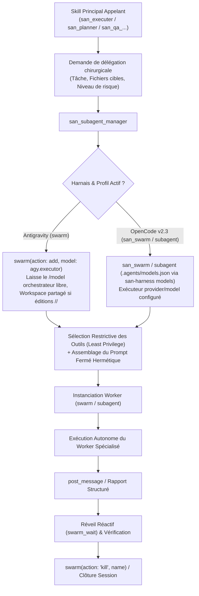
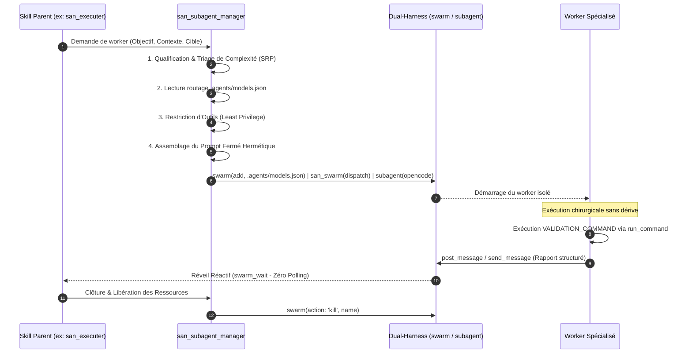
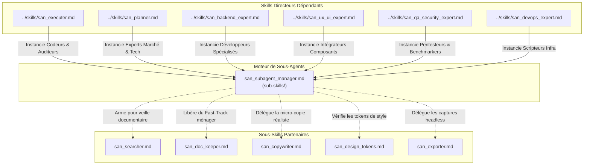

# `san_subagent_manager` — Usine de Conception, Calibrage et Supervision de Sous-Agents Chirurgicaux

> **Note d'implantation architecturale :**  
> Au sein du dépôt source `san_ai_harness`, ce sous-skill réside dans `sub-skills/` afin de formaliser la frontière entre les rôles de direction maîtres (points d'entrée dans `skills/`) et l'outillage transversal. Lors de l'installation dans une codebase cliente par le script d'initialisation, il est déployé dans `.agents/skills/san_subagent_manager/` pour être reconnu nativement par les harnesses Antigravity & OpenCode.

---

## 1. RÔLE, POUR QUI, POUR QUOI

### Rôle Fondamental
`san_subagent_manager` est le **moteur cartésien de fabrication, de calibrage et d'orchestration des sous-agents autonomes éphémères** au sein du framework **Antigravity (`san_*`)**. Il agit comme l'**Armurier et Métrologue Agentique** des compétences maîtresses : son rôle est de transformer une intention de délégation formulée par un skill principal ([san_executer](../skills/san_executer.md), [san_planner](../skills/san_planner.md), [san_backend_expert](../skills/san_backend_expert.md), [san_ux_ui_expert](../skills/san_ux_ui_expert.md), [san_qa_security_expert](../skills/san_qa_security_expert.md), [san_devops_expert](../skills/san_devops_expert.md)) en une unité d'exécution chirurgicale, dotée du modèle de calcul optimal, d'un outillage restreint au strict minimum (principe de moindre privilège), d'un prompt système fermé hermétique et d'un protocole de reddition de comptes déterministe par `send_message`.

### Pour Qui ?
- **Pour les skills directeurs du framework :** qui doivent déléguer des tâches concrètes sans risquer la saturation de contexte (*Context Bloat*), la pollution de la session maîtresse ou la surconsommation de tokens.
- **Pour l'orchestrateur central :** garantissant que chaque sous-agent instancié dispose d'une mission univoque, bornée dans le temps, avec des critères de validation binaires (succès vérifié ou échec explicite).
- **Pour le développeur :** qui bénéficie d'une vitesse d'exécution accrue, d'une prédictibilité totale et de logs d'agents parfaitement structurés.

### Pour Quoi ?
- **Unifier le routage Dual-Harness :** en orientant les workers Antigravity vers **`swarm`** (modèle configuré dans `.agents/models.json#agy.executor`) et les workers OpenCode v2.3 vers **`san_swarm` / `subagent`** via `.agents/models.json` (`san-harness models`), tout en laissant l'orchestrateur hériter librement du `/model` utilisateur (`inherit-user-model`).
- **Supprimer le flou d'instruction (*Zero-Ambiguity Guardrail*) :** en injectant des prompts de sous-agents fermés contenant obligatoirement le contexte exact, les fichiers cibles, les règles non négociables et le format de retour attendu.
- **Appliquer le principe de moindre privilège (*Least Privilege Tooling*) :** en refusant d'accorder à un sous-agent des outils dont il n'a pas strictement besoin (ex: interdire les outils web à un sous-agent d'implémentation de contrôleur local, interdire les outils d'écriture à un sous-agent d'audit).
- **Bannir les boucles infinies et les hallucinations :** en contraignant chaque mission avec des bornes d'arrêt strictes et un rapport final obligatoire transmis au parent via `send_message`.

---

## 2. FRONTIÈRES STRICTES : CE QU'IL FAIT / CE QU'IL NE FAIT PAS

| CE QU'IL FAIT STRICTEMENT | CE QU'IL NE FAIT ABSOLUMENT PAS |
| :--- | :--- |
| **Calibrage Sémantique de Mission :** Formalise la demande selon le standard normatif : Rôle précis (2 à 5 mots), Objectif unique, Entrées et sorties formelles, Contraintes strictes. | N'exécute JAMAIS de code métier lui-même $\rightarrow$ il conçoit et arme les agents ; il ne code ni contrôleurs, ni écrans, ni requêtes SQL. |
| **Routage Dual-Harness (`.agents/models.json`) :** Affecte l'exécuteur configuré dans `.agents/models.json#agy.executor` via `swarm` (Antigravity) ou `.agents/models.json#opencode.executor` via `san_swarm` / `subagent` (OpenCode v2.3, via `san-harness models`). | N'impose jamais de nom de modèle orchestrateur en dur ; évite les sous-agents récursifs non contrôlés. |
| **Sélection Restrictive des Outils (*Tool Sandboxing*) :** Ouvre uniquement les capacités indispensables (interdiction des appels récursifs non encadrés et de la navigation web inutile pour les codeurs). | N'instancie JAMAIS un worker avec un prompt flou ou incomplet (chemins relatifs vagues, absence de commande de test, format de restitution libre). |
| **Injection de Garde-Fous Anti-Hallucination :** Verrouille dans le prompt l'obligation de se baser sur du code vérifié, l'interdiction d'inventer des packages tiers et l'usage exclusif de `send_message`. | N'autorise JAMAIS la récursion sauvage : `EnableSubagentTools` est désactivé par défaut pour éliminer toute arborescence d'agents incontrôlée. |
| **Supervision Événementielle Réactive :** Invoque le sous-agent en mode non-bloquant (zéro polling) et libère les ressources via `manage_subagents(action: 'kill')` dès clôture. | Ne se substitue JAMAIS au Fast-Track de l'orchestrateur pour les tâches ménagères immédiates (cochage d'une case, déplacement d'un fichier). |

---

## 3. COMMENT IL EST MOBILISÉ PAR LES SKILLS PRINCIPAUX



### Invocations Concrètes par les Rôles Directeurs

#### 1. Mobilisation par [`san_executer`](../skills/san_executer.md)
`san_executer` est le premier consommateur de workers pour dérouler les paliers de roadmap :
- **Artisan Backend (`san-coder-back`) :** Migrations, modèles, services métier, FormRequests, tests Pest/PHPUnit, requêtes Bruno.
- **Artisan Frontend (`san-coder-front`) :** Composants React/React Native, gestion des 5 états UI, animations 60 fps, intégration des contrats d'API.
- **Auditeur d'Intégration E2E (`san-qa-auditor`, lecture seule) :** Vérification croisée des contrats, simulation de coupures réseau 3G, idempotence des requêtes, audit DOM géométrique.

#### 2. Mobilisation par [`san_planner`](../skills/san_planner.md)
- **`san-researcher` (`swarm` / `subagent`, lecture) :** Cartographie Map-First, benchmarks concurrentiels et état réel des tests.
- **`san-architect` (`swarm` / `subagent`, lecture) :** Mini-ADR 2 approches, contrat OpenAPI/Zod gelé, Pre-Mortem et Fitness Functions.

#### 3. Mobilisation par [`san_qa_security_expert`](../skills/san_qa_security_expert.md)
- **Auditeur Pentest OWASP (`san-qa-auditor`, lecture seule) :** Détection des vulnérabilités BOLA/IDOR, injections SQL/NoSQL, stockage sécurisé et conformité Fitness.

---

## 4. STRUCTURE INTERNE DU SOUS-SKILL

Lors du déploiement au sein d'une codebase sous SAN AI Harness, le sous-skill présente l'arborescence normative suivante :

```txt
.agents/skills/san_subagent_manager/
├── SKILL.md                                 # Manifeste de gouvernance, règles de calibrage et prompts types
├── references/
│   ├── subagent_archetypes.md               # Catalogue exhaustif des 8 archétypes de sous-agents
│   ├── prompt_engineering_standards.md      # Directives de rédaction hermétique et techniques anti-hallucination
│   └── least_privilege_matrix.md            # Matrice d'attribution des outils Antigravity selon la mission
├── templates/
│   ├── SUBAGENT_PROMPT_TEMPLATE.md          # Gabarit universel fermé (Role, Mission, Inputs, Outputs, Constraints)
│   ├── ATOMIC_CODER_PROMPT.md               # Gabarit d'instruction pour worker de code (Dual-Harness)
│   └── AUDITOR_PROMPT.md                    # Gabarit d'instruction pour auditeur sceptique (lecture seule)
└── scripts/
    └── validate_subagent_spec.sh            # Script de contrôle statique vérifiant la complétude du prompt avant invocation
```

---

## 5. LIVRABLES EXACTS & GABARITS CANONIQUES

### 1. Template Universel de Prompt Système Fermé
Tout prompt système calibré par `san_subagent_manager` doit impérativement respecter la structure fermée en 6 sections non négociables :

```markdown
### 1. ROLE
Tu es [Nom Exact du Rôle : 2 à 5 mots], artisan spécialisé rattaché au framework Antigravity (san_*).
Ton conversationId parent est : [PARENT_CONVERSATION_ID].

### 2. MISSION
[Description chirurgicale de l'objectif unique. Zéro ambiguïté, zéro digression.]

### 3. INPUTS (Contexte & Données autorisées)
- Fichiers à lire obligatoirement :
  - `file:///chemin/absolu/fichier_source_1.ext`
  - `file:///chemin/absolu/fichier_source_2.ext`
- Règles contextuelles applicables : `.agents/rules/PROJECT.md`, `.agents/rules/BRAND.md`, `.agents/rules/API.md`

### 4. OUTPUTS (Fichiers & Livrables attendus)
- Fichiers à créer / modifier exclusivement :
  - `file:///chemin/absolu/fichier_cible_1.ext`
  - `file:///chemin/absolu/fichier_cible_2.ext`

### 5. CONSTRAINTS (Garde-fous stricts & Anti-Hallucination)
- Interdiction formelle de créer ou modifier un fichier en dehors de la liste OUTPUTS.
- Interdiction d'inventer des packages tiers non déclarés dans les manifestes locaux.
- Interdiction formelle de lancer des sous-agents récursifs non autorisés (`invoke_subagent` dans un worker).
- Ne jamais polluer la console avec du texte verbeux : canal final via `post_message` / `send_message`.

### 6. VALIDATION_COMMAND (Preuve déterministe)
Avant de conclure, exécute la commande de test suivante via `run_command` :
`[COMMANDE_EXACTE_DE_VALIDATION]` (ex: npm test path/to/test.spec.ts || php artisan test --filter=PaymentTest)
Le résultat doit afficher 0 erreur et 100% de succès.

### 7. PROTOCOLE DE REDDITION
Appelle immédiatement l'outil `send_message` avec :
- `Recipient` : "[PARENT_CONVERSATION_ID]"
- `Message` : [Rapport structuré conforme au schéma standard]
```

### 2. Schéma Standard du Rapport de Reddition (`send_message`)
Le message de restitution transmis à l'orchestrateur doit obligatoirement adopter ce format Markdown :

```markdown
### RAPPORT DE MISSION : [Nom du Rôle]
- **Statut :** [SUCCÈS_TOTAL | ÉCHEC_PARTIEL | BLOCAGE]
- **Fichiers Créés / Modifiés :**
  - [nom_fichier.ext](file:///chemin/absolu/fichier1.ext) — Brève description du contenu
  - [nom_fichier.ext](file:///chemin/absolu/fichier2.ext) — Brève description du contenu
- **Preuves Déterministes d'Exécution :**
  - Commande exécutée : `[COMMANDE_EXACTE]`
  - Résultat : [X tests passés, 0 échec, typage statique 100% valide]
- **Alertes / Points d'Attention pour le Parent :**
  - [Détail des arbitrages ou remarques architecturales]
```

---

## 6. PROCÉDURE D'EXÉCUTION DÉTAILLÉE (PIPELINE DUAL-HARNESS EN 6 ÉTAPES)



### Étape 1 : Qualification du Besoin et Triage de Granularité
1. **Validation du Principe de Responsabilité Unique (SRP) :** S'assurer que la mission confiée correspond à une action délimitée. Si la demande combine backend, UI et configuration réseau, `san_subagent_manager` la découpe en missions distinctes exécutées en parallèle sur périmètres disjoints (`workspace: "share"` si éditions simultanées).
2. **Identification des Dépendances :** Inspecter directement les manifestes, schémas et fichiers ciblés (zéro `.agents/cache`), et référencer exhaustivement les chemins exacts des fichiers d'entrée (`INPUTS`) et de sortie (`OUTPUTS`).

### Étape 2 : Routage Dual-Harness (`.agents/models.json` & `san-harness models`)
Appliquer la doctrine v3.0 Dual-Harness (tâche simple en `Plan → Execute` natif ; chantiers multi-couches/Duel/QA en Swarm) :
- **Antigravity (`swarm`) :**
  - Workers d'exécution (`san-coder-back`, `san-coder-front`, `san-designer-worker`, `san-researcher`) et d'audit (`san-qa-auditor`, `san-architect`) lancés via `swarm` avec le modèle exécuteur configuré dans `.agents/models.json#agy.executor` (avec `model: "pro"` maintenu dans le frontmatter `src/agents/*.md` pour compatibilité du parser CLI).
- **OpenCode v2.3 (`san_swarm` / `subagent`) :**
  - Orchestration multi-workers via l'outil **`san_swarm`** (plugin `.agents/opencode/san-harness-plugin.mjs`, Swarm Board Markdown) ou `subagent` natif vers les profils configurés dans `.agents/models.json#opencode.executor` (`san-harness models`).

### Étape 3 : Application du Principe de Moindre Privilège (*Tool Sandboxing*)
Restreindre la surface d'action selon le rôle :
```yaml
# Profil Bâtisseur (san-coder-back / san-coder-front)
EnabledTools: [read_file, write_file, edit_file, run_command]
DisabledTools: [invoke_subagent]  # Pas de récursion sauvage ; Dialectique 2 Approches obligatoire

# Profil Auditeur Sceptique (san-qa-auditor / san-architect)
EnabledTools: [read_file, run_command]  # Tests & linters uniquement
DisabledTools: [write_file, edit_file, invoke_subagent]  # Lecture seule, Présomption de Défaut
```

### Étape 4 : Assemblage du Prompt Système Hermétique
Construire le prompt selon le gabarit fermé (`SUBAGENT_PROMPT_TEMPLATE.md`, `ATOMIC_CODER_PROMPT.md` ou `AUDITOR_PROMPT.md`). Vérifier sa conformité statique via `scripts/validate_subagent_spec.sh`.

### Étape 5 : Instanciation Non-Bloquante et Attente Réactive (`swarm_wait` / `san_swarm`)
1. **Sous Antigravity :** Spawner via `swarm({ "action": "add", "name": "...", "model": "<agy.executor depuis .agents/models.json>", "workspace": "share", "brief": "..." })`, puis appeler `swarm_wait` (zéro polling).
2. **Sous OpenCode v2.3 :** Orchestrer en parallèle via `san_swarm(action: "dispatch", ...)` (qui gère les sessions et rend le Swarm Board) ou déléguer via `subagent` avec le profil `.agents/models.json`.

### Étape 6 : Réception du Rapport, Contrôle Qualité et Nettoyage
1. À la reprise d'exécution, vérifier le contenu du rapport et les preuves d'exécution réelles (tests au vert `exit 0`, typage valide, captures si UI).
2. Si la tâche est intégrée, libérer le worker `swarm({"action": "kill", "name": "<name>"})`.
3. En cas de `RETOUR_ATELIER`, relancer une passe corrective ciblée avec les coordonnées exactes (`fichier:ligne`).

---

## 7. SCRIPT DE VALIDATION STATIQUE (`scripts/validate_subagent_spec.sh` v3.0)

Le script déterministe [validate_subagent_spec.sh](../src/skills/san_subagent_manager/scripts/validate_subagent_spec.sh) contrôle les agents natifs (`src/agents/*.md`) et les prompts fermés avant exécution :

```bash
# Validation défaut Antigravity / Dual-Harness (unified-executor)
bash .agents/skills/san_subagent_manager/scripts/validate_subagent_spec.sh src/agents/san-architect.md

# Validation profil OpenCode v2.3 (<provider>/<model>)
bash .agents/skills/san_subagent_manager/scripts/validate_subagent_spec.sh src/agents/san-coder-back.md opencode-go/deepseek-v4-pro
```

**Contrôles exécutés (`fail-closed`) :**
- Rejet immédiat des cibles obsolètes ou codées en dur (`inherit`, `flash`, `gemini-3.1-pro-high`, `gemini-3.8-flash-high`, `gemini-4-argon`, `gemini-4-hydrogen-xhigh`).
- Acceptation Dual-Harness : `pro` (compat YAML `src/agents/*.md`), `unified-executor` et `<provider>/<model>` OpenCode v2.3.
- Vérification des champs YAML obligatoires (`name`, `description`, `mainAgent`, `subagent`, `model`, `commandExecutionPolicy`, `tools`, `skills`), des sections `RÔLE/MISSION`, `GARDE-FOUS/PÉRIMÈTRE`, `PROTOCOLE DE REDDITION DÉTERMINISTE`, et de la règle anti-récursion.

---

## 8. PRINCIPES DIRECTEURS ET INVARIANTS

### 1. Invariant de Moindre Privilège d'Outils (*Least Privilege*)
Aucun worker ne doit recevoir un outil qui n'est pas strictement nécessaire à la réalisation immédiate de sa mission.

### 2. Invariant de Routage Dual-Harness (`swarm` | `san_swarm` / `subagent`)
- Le thread principal (Antigravity ou OpenCode orchestrateur) reste souverain et hérite librement du `/model` choisi par l'utilisateur (`inherit-user-model`).
- Les workers de chantiers multi-couches/Duel/QA tournent sur l'exécuteur configuré dans `.agents/models.json` (`agy.executor` en `swarm` sous Antigravity ; `opencode.executor` en `san_swarm` / `subagent` sous OpenCode v2.3). L'exécution native `Plan → Execute` reste autorisée pour les tâches simples.

### 3. Invariant d'Étanchéité du Contexte (*Context Hygiene*)
Un sous-agent est un travailleur jetable dans une bulle isolée. Les lectures verbeuses de dizaines de fichiers, les stacktraces de compilation et les itérations intermédiaires doivent rester confinées dans son contexte éphémère. Seule la synthèse finale structurée est transmise à l'orchestrateur.

### 4. Invariant de Communication Asynchrone Native (*Reactive Wakeup*)
Les agents SAN AI Harness opèrent sur un bus événementiel. Tout mécanisme d'attente active, d'interrogation répétée de statut en boucle (*polling loop*) ou d'endormissement artificiel (`sleep`) est strictement proscrit.

### 5. Invariant de Preuve Déterministe de Clôture (*Proof-Backed Delivery*)
Un sous-agent ne peut déclarer sa mission accomplie sur une simple affirmation verbale. Le rapport de reddition doit impérativement fournir la commande de validation exécutée et son résultat positif (0 erreur, tests au vert).

---

## 9. MATRICE DE BRANCHEMENT ET RÉFÉRENCES CROISÉES



### Amont (Compétences maîtresses qui mobilisent ce sous-skill) :
- [`../skills/san_executer.md`](../skills/san_executer.md) : Mobilise continuellement le manager pour créer et piloter les sous-agents d'implémentation (`flash`) et les auditeurs d'intégration (`inherit`).
- [`../skills/san_planner.md`](../skills/san_planner.md) : Mobilise le manager pour orchestrer la double analyse amont (psychologique marché et technique codebase).
- [`../skills/san_backend_expert.md`](../skills/san_backend_expert.md) : Sollicite le manager pour déléguer l'écriture de migrations ou de fixtures volumineuses.
- [`../skills/san_ux_ui_expert.md`](../skills/san_ux_ui_expert.md) : Sollicite le manager pour scinder l'implémentation d'une suite complexe de 5 états UI en tâches atomiques indépendantes.
- [`../skills/san_qa_security_expert.md`](../skills/san_qa_security_expert.md) : Délègue l'exécution des tests de charge et des scans statiques à des sous-agents isolés.
- [`../skills/san_devops_expert.md`](../skills/san_devops_expert.md) : Instancie des scripteurs isolés pour générer les Dockerfiles et playbooks Ansible.

### Aval & Synergies avec les autres sous-skills :
- [`san_searcher.md`](san_searcher.md) : Utilisé pour enrichir les prompts de sous-agents en extrayant en amont les signatures officielles exactes de bibliothèques tierces.
- [`san_doc_keeper.md`](san_doc_keeper.md) : Prend le relais une fois les missions de sous-agents achevées pour garantir la consignation dans `CHANGELOG.md` et l'archivage dans `/roadmaps/archives/`.
- [`san_copywriter.md`](san_copywriter.md) : Fournit les textes vivants et réalistes injectés dans les prompts d'implémentation frontend.
- [`san_design_tokens.md`](san_design_tokens.md) : Fournit les configurations compilées de Tailwind et thèmes TypeScript consommés par les sous-agents de composants.
- [`san_exporter.md`](san_exporter.md) : Reçoit les requêtes d'exportation d'images headless déclenchées lors des phases de validation.
