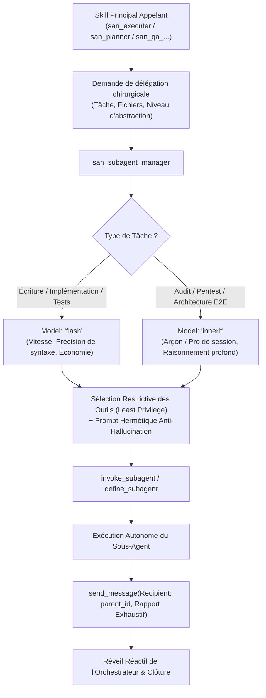
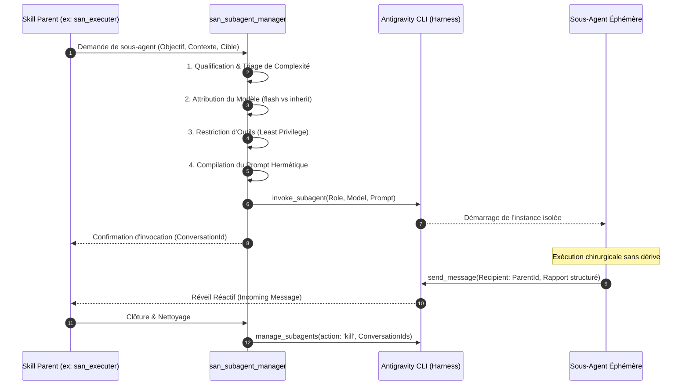
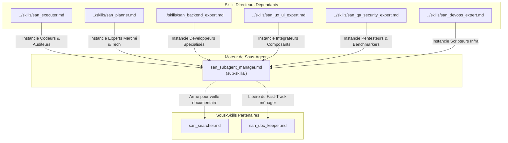

# `san_subagent_manager` — Usine de Conception, Calibrage et Supervision de Sous-Agents Chirurgicaux

> **Note d'implantation architecturale :**  
> Au sein du dépôt source `san_agy_framework`, ce sous-skill réside dans `sub-skills/` afin de distinguer structurellement les rôles directeurs (entry points dans `skills/`) de l'outillage transversal. Lors de l'installation au sein d'une codebase cliente par le script d'initialisation, il est déployé dans `.agents/skills/san_subagent_manager/` pour être reconnu nativement par le moteur d'exécution Antigravity CLI.

---

## 1. RÔLE, POUR QUI, POUR QUOI

### Rôle Fondamental
`san_subagent_manager` est le **moteur cartésien de fabrication, de calibrage et d'orchestration des sous-agents autonomes éphémères** au sein du framework **Antigravity (`san_*`)**. Il agit comme l'**Armurier et Métrologue Agentique** des compétences maîtresses : son rôle est de transformer une intention de délégation formulée par un skill principal ([san_executer](../skills/san_executer.md), [san_planner](../skills/san_planner.md), [san_backend_expert](../skills/san_backend_expert.md), [san_ux_ui_expert](../skills/san_ux_ui_expert.md), [san_qa_security_expert](../skills/san_qa_security_expert.md)) en une unité d'exécution chirurgicale, dotée du modèle de calcul optimal, d'un outillage restreint au strict nécessaire, d'un prompt système hermétique et d'un protocole de reddition de comptes déterministe.

### Pour Qui ?
- **Pour les skills directeurs du framework :** qui doivent déléguer des tâches concrètes sans risquer la dérive de contexte (*Context Bloat*), la pollution de la session maîtresse ou la surconsommation de tokens.
- **Pour l'orchestrateur central :** garantissant que chaque sous-agent instancié dispose d'une mission univoque, bornée dans le temps, avec des critères de validation binaires (succès ou échec).
- **Pour le développeur :** qui bénéficie d'une vitesse d'exécution accrue, d'une prédictibilité totale et de logs d'agents parfaitement structurés.

### Pour Quoi ?
- **Éradiquer le gaspillage de tokens (*Token Frugality*) :** en appliquant la stricte séparation entre le pôle d'intelligence/audit (`Model: 'inherit'`) et le pôle d'exécution atomique (`Model: 'flash'`).
- **Supprimer le flou d'instruction (*Zero-Ambiguity Guardrail*) :** en injectant des prompts de sous-agents contenant obligatoirement le contexte exact, les fichiers cibles, les règles non négociables et le format de retour attendu.
- **Appliquer le principe de moindre privilège (*Least Privilege Tooling*) :** en refusant d'accorder à un sous-agent des outils dont il n'a pas strictement besoin (ex: interdire les outils web à un sous-agent d'implémentation de contrôleur local, interdire les outils d'écriture à un sous-agent d'audit).
- **Bannir les boucles infinies et les hallucinations :** en contraignant chaque mission avec des bornes d'arrêt strictes et un rapport final obligatoire transmis au parent via `send_message`.

---

## 2. CE QU'IL FAIT / CE QU'IL NE FAIT PAS

### Ce qu'il FAIT :
1. **Calibrage Sémantique de Mission :** Analyse la demande du skill parent et la formalise selon le standard normatif : Rôle précis (2 à 5 mots), Objectif unique, Fichiers autorisés en lecture/écriture, Critères d'arrêt formels.
2. **Attribution Algorithmique du Modèle (`routing`) :**
   - **`Model: 'flash'` (`gemini-3.8-flash-high`) :** Assigné impérativement à toute tâche d'exécution atomique, écriture de code source, création de migrations, implémentation de composants d'UI, refactoring de syntaxe, ou génération de tests unitaires.
   - **`Model: 'inherit'` (héritage d'Argon ou Pro de la session maîtresse) :** Assigné exclusivement aux missions requérant une haute abstraction cognitive : audits de sécurité OWASP, revues d'architecture croisée E2E, diagnostic de blocages complexes, arbitrage de design patterns ou analyse d'impact réglementaire.
3. **Sélection Restrictive des Outils (*Tool Sandboxing*) :** Configure le profil de sous-agent via `define_subagent` ou `invoke_subagent` en n'ouvrant que les capacités nécessaires :
   - *Agent de Code :* Outils de lecture/écriture de fichiers, exécution de commandes locales (`run_command`), exclusion formelle des sous-agents récursifs et de la recherche web inutile.
   - *Agent d'Audit :* Outils de lecture seule et exécution de scripts de vérification en lecture (`read_file`, `run_command` sous scripts déterministes), interdiction d'écriture de code applicatif.
   - *Agent de Recherche :* Outils de navigation web et lecture de fichiers, exclusion des outils de modification de code.
4. **Injection de Garde-Fous Anti-Hallucination :** Verrouille dans le prompt système du sous-agent l'obligation de baser chaque affirmation sur du code vérifié, l'interdiction d'inventer des packages tiers ou des signatures d'APIs non documentées, et l'exigence d'une communication exclusive vers le parent via `send_message`.
5. **Gestion du Cycle de Vie et Attente Réactive :** Invoque le sous-agent en mode non-bloquant conformément à la réactivité événementielle d'Antigravity CLI (réveil automatique à réception du message, zéro boucle active de polling), et libère les ressources via `manage_subagents` (`action: 'kill'`) une fois la mission achevée.

### Ce qu'il NE FAIT PAS :
- **Il n'exécute JAMAIS de code métier lui-même :** Il conçoit, paramètre, arme et instancie les sous-agents ; il ne code pas de controllers, d'écrans ou de requêtes SQL.
- **Il n'autorise JAMAIS l'utilisation de `Model: 'inherit'` pour de l'écriture de code :** Coder un composant React ou un service PHP avec un modèle lourd est considéré comme une faute d'ingénierie majeure dans le framework.
- **Il n'instancie JAMAIS un sous-agent avec un prompt flou :** Tout prompt ne comportant pas explicitement le chemin absolu des fichiers cibles, la commande de test de validation et le schéma de restitution est rejeté.
- **Il n'autorise JAMAIS les sous-agents récursifs sauvages :** L'option `EnableSubagentTools` est désactivée par défaut pour éviter toute arborescence d'agents incontrôlée.
- **Il ne se substitue JAMAIS au Fast-Track de l'orchestrateur :** Les tâches immédiates de maintenance (cocher une case `[x]` dans une roadmap, déplacer un fichier achevé vers `/roadmaps/archives/`, insérer une entrée dans `CHANGELOG.md`) sont exécutées directement par l'orchestrateur sans instanciation de sous-agent.

---

## 3. COMMENT IL EST MOBILISÉ PAR LES SKILLS PRINCIPAUX



### 1. Mobilisation par [san_executer](../skills/san_executer.md)
`san_executer` est le premier consommateur de `san_subagent_manager`. Pour chaque palier de roadmap :
- **Génération de l'Artisan Backend :**
  - Rôle : `Backend Logic Implementer`
  - Modèle : `Model: 'flash'`
  - Outils : `read_file`, `write_file`, `edit_file`, `run_command`
  - Mission : Migrations, models, services, FormRequests, tests unitaires/fonctionnels, fichiers Bruno.
- **Génération de l'Artisan Frontend :**
  - Rôle : `UI Component Implementer`
  - Modèle : `Model: 'flash'`
  - Outils : `read_file`, `write_file`, `edit_file`, `run_command`
  - Mission : Composants React/React Native, gestion des 5 états UI, animations 60 fps, intégration contrat d'API.
- **Génération de l'Auditeur d'Intégration E2E :**
  - Rôle : `E2E Integration Auditor`
  - Modèle : `Model: 'inherit'`
  - Outils : `read_file`, `run_command`
  - Mission : Vérification croisée des contrats, simulation de coupures réseau 3G, idempotence des requêtes, conformité des statuts HTTP.

### 2. Mobilisation par [san_planner](../skills/san_planner.md)
- **Génération du `psychologist_market_expert` :**
  - Modèle : `Model: 'inherit'`
  - Mission : Analyse cognitive de l'UX, réduction des frictions de parcours, modèles économiques adaptés aux cibles.
- **Génération du `technical_market_expert` :**
  - Modèle : `Model: 'inherit'`
  - Mission : Cartographie des dépendances, analyse de robustesse SOLID/DRY, dimensionnement des goulets de performance.

### 3. Mobilisation par [san_qa_security_expert](../skills/san_qa_security_expert.md)
- **Génération de l'Auditeur Pentest OWASP :**
  - Modèle : `Model: 'inherit'`
  - Mission : Détection des vulnérabilités BOLA/IDOR, injections, sécurité du stockage local, fuites de tokens.

---

## 4. STRUCTURE INTERNE DU SOUS-SKILL

Lors du déploiement au sein d'une codebase sous Antigravity CLI, le sous-skill présente l'arborescence normative suivante :

```txt
.agents/skills/san_subagent_manager/
├── SKILL.md                                 # Manifeste de gouvernance, règles de calibrage et prompts types
├── references/
│   ├── subagent_archetypes.md               # Catalogue exhaustif des archétypes de sous-agents (rôles, outils, modèles)
│   ├── prompt_engineering_standards.md      # Directives de rédaction hermétique et techniques anti-hallucination
│   └── least_privilege_matrix.md            # Matrice d'attribution des outils Antigravity selon la mission
├── templates/
│   ├── SYSTEM_PROMPT_TEMPLATE.md            # Structure squelette d'un prompt système de sous-agent
│   ├── ATOMIC_CODER_PROMPT.md               # Gabarit d'instruction pour sous-agent de code (flash)
│   └── AUDITOR_PROMPT.md                    # Gabarit d'instruction pour sous-agent d'audit (inherit)
└── scripts/
    └── validate_subagent_spec.sh            # Script de contrôle statique vérifiant la complétude du prompt avant invocation
```

---

## 5. LIVRABLES EXACTS

À chaque sollicitation, `san_subagent_manager` garantit la production des artefacts techniques et opérationnels suivants :

```txt
Sorties Opérationnelles :
├── Spécification Validée d'Invocation       # Payload conforme invoke_subagent (Role, Model, TypeName, Prompt)
├── En-tête de Mission Hermétique            # Contexte, chemins absolus, invariants et critères d'arrêt
├── Canal de Communication Paramétré         # Recipient configuré sur le conversationId parent
└── Rapport Consolidé de Reddition           # Message reçu via send_message avec diffs, preuves et métriques
```

### Spécification Standard du Payload de Reddition (`send_message`) :
Tout sous-agent généré par `san_subagent_manager` doit obligatoirement conclure sa mission en transmettant au parent un message respectant le schéma suivant :
```markdown
### RAPPORT DE MISSION : [Nom du Rôle]
- **Statut :** [SUCCÈS_TOTAL | ÉCHEC_PARTIEL | BLOCAGE]
- **Fichiers Créés / Modifiés :**
  - `file:///chemin/absolu/fichier1.ext` (Description synthétique)
  - `file:///chemin/absolu/fichier2.ext`
- **Preuves Déterministes d'Exécution :**
  - Commande exécutée : `[commande de test ou build]`
  - Résultat : [X tests passés, 0 échec, typage 100 % valide]
- **Alertes / Points d'Attention pour le Parent :**
  - [Détail des arbitrages ou remarques architecturales]
```

---

## 6. PROCÉDURE D'EXÉCUTION DÉTAILLÉE (PIPELINE EN 6 ÉTAPES)



### Étape 1 : Qualification du Besoin et Triage de Granularité
1. **Validation de l'Unicité de Tâche :** Vérifier que la mission confiée correspond à une responsabilité unique (Single Responsibility Principle). Si la tâche contient à la fois du code backend, du code frontend et de la configuration de déploiement, `san_subagent_manager` la découpe en 3 missions distinctes exécutées séquentiellement ou en parallèle.
2. **Identification des Dépendances :** Lister exhaustivement les fichiers requis en lecture (contrats d'interfaces, modèles, schémas de base de données) et les fichiers autorisés en écriture.

### Étape 2 : Routage Strict du Modèle de Calcul
Appliquer sans exception la règle d'attribution des ressources :
- **`Model: 'flash'` :**
  - Implémentation de classes de service, contrôleurs, composants d'UI, hooks.
  - Écriture de migrations de base de données et seeders.
  - Rédaction de suites de tests unitaires ou de collections de requêtes d'API (Bruno).
  - Formatage de documentation, correction syntaxique de linters.
- **`Model: 'inherit'` :**
  - Analyse d'architecture amont, arbitrage de structures de données critiques.
  - Audit de sécurité OWASP, analyse de vulnérabilités et pentesting.
  - Évaluation de performance globale et intégration croisée Frontend/Backend.
  - Audits cognitifs UX et psychologie produit.

### Étape 3 : Application du Principe de Moindre Privilège (*Tool Sandboxing*)
Restreindre la surface d'attaque et les risques de digression en n'autorisant que les outils indispensables :
```yaml
# Profil d'Exécution Code (flash)
EnabledTools:
  - read_file
  - write_file
  - edit_file
  - run_command
DisabledTools:
  - search_web         # Pas de navigation sauvage pour coder du métier local
  - invoke_subagent    # Zéro sous-agent récursif
  - define_subagent

# Profil d'Audit de Sécurité / Architecture (inherit)
EnabledTools:
  - read_file
  - run_command        # Uniquement pour lancer des suites de tests et linters
DisabledTools:
  - write_file         # Un auditeur ne modifie pas le code en direct
  - edit_file
  - search_web
```

### Étape 4 : Assemblage du Prompt Système Hermétique
Construire le prompt de mission selon la structure cartésienne inviolable :
1. **Identité & Rôle :** *"Tu es l'artisan spécialisé [Rôle Exact] pour la codebase..."*
2. **Contexte Projet :** Rappel des règles techniques pertinentes lues dans `.agents/rules/` (`PROJECT.md`, `BRAND.md`, `API.md`).
3. **Mission Spécifique :** Description chirurgicale de ce qui doit être accompli.
4. **Périmètre Fichiers Stricte :** Chemins absolus explicites des fichiers à créer ou modifier.
5. **Critères de Validation Autonome :** Commande bash exacte que le sous-agent doit exécuter pour prouver que son travail fonctionne (`npm test`, `php artisan test`, `npx tsc --noEmit`).
6. **Directive de Reddition Obligatoire :** Rappel formel d'utiliser l'outil `send_message` avec l'identifiant du parent comme `Recipient`, en fournissant le rapport structuré avec liens absolus `file:///`.

### Étape 5 : Invocation Non-Bloquante et Attente Réactive
1. Lancer l'instance via l'outil natif :
   ```json
   {
     "Role": "Backend Service Implementer",
     "Model": "flash",
     "TypeName": "self",
     "Prompt": "[PROMPT_HERMETIQUE_COMPILE]"
   }
   ```
2. **Principe de Réveil Événementiel :** L'agent appelant ne fait AUCUN appel en boucle (`sleep`, boucle de consultation de statut). Dès que l'appel d'outil est émis, l'exécution s'interrompt proprement ; le système Antigravity CLI réveillera automatiquement l'orchestrateur dès que le message de fin de mission sera réceptionné.

### Étape 6 : Réception du Rapport, Contrôle Qualité et Nettoyage
1. À la reprise d'exécution, lire le contenu du rapport transmis par `send_message`.
2. Vérifier la présence des preuves d'exécution (tests au vert, absence d'erreurs statiques).
3. Si la tâche est déclarée réussie, appeler `manage_subagents` avec l'action `'kill'` sur le `conversationId` du sous-agent pour libérer l'espace mémoire et clore la session de travail.
4. Si la tâche a échoué, réinjecter l'erreur spécifique dans un nouveau sous-agent de correction ou transmettre un diagnostic net au développeur (après 5 échecs consécutifs maximum).

---

## 7. PRINCIPES DIRECTEURS ET INVARIANTS

### 1. Invariant de Moindre Privilège d'Outils (*Least Privilege*)
Aucun sous-agent ne doit recevoir un outil qui n'est pas strictement nécessaire à la réalisation immédiate de sa mission. Moins un agent a d'outils ouverts, plus son exécution est déterministe, rapide et exempte de digressions.

### 2. Invariant de Routage Cartésien des Modèles (*Model Routing Rigor*)
L'intelligence de haut vol et l'écriture de code sont deux fonctions distinctes :
- Le raisonnement critique, la planification et la sécurité exigent un modèle hautement capacitaire (`inherit` / `pro`).
- L'application mécanique des patrons de conception, l'écriture de boilerplate et les tests unitaires exigent un modèle rapide, économique et rigoureux (`flash`).
Tout manquement à cette règle constitue une régression d'efficacité.

### 3. Invariant d'Étanchéité du Contexte (*Context Hygiene*)
Un sous-agent est un travailleur jetable dans une bulle isolée. Les lectures verbeuses de dizaines de fichiers, les stacktraces de compilation et les itérations intermédiaires doivent rester confinées dans son contexte éphémère. Seule la synthèse finale structurée est transmise à l'orchestrateur.

### 4. Invariant de Communication Asynchrone Native (*Reactive Wakeup*)
Les agents Antigravity CLI opèrent sur un bus événementiel. Tout mécanisme d'attente active, d'interrogation répétée de statut en boucle (*polling loop*) ou d'endormissement artificiel est strictement proscrit.

### 5. Invariant de Preuve Déterministe de Clôture (*Proof-Backed Delivery*)
Un sous-agent ne peut déclarer sa mission accomplie sur une simple affirmation verbale. Le rapport de reddition doit impérativement fournir la commande de validation exécutée et son résultat positif.

---

## 8. MATRICE DE BRANCHEMENT ET RÉFÉRENCES CROISÉES



### Amont (Compétences maîtresses qui mobilisent ce sous-skill) :
- [san_executer](../skills/san_executer.md) : Mobilise continuellement le manager pour créer et piloter les sous-agents d'implémentation (`flash`) et les auditeurs d'intégration (`inherit`).
- [san_planner](../skills/san_planner.md) : Mobilise le manager pour orchestrer la double analyse amont (psychologique marché et technique codebase).
- [san_backend_expert](../skills/san_backend_expert.md) : Sollicite le manager pour déléguer l'écriture de migrations ou de fixtures volumineuses.
- [san_ux_ui_expert](../skills/san_ux_ui_expert.md) : Sollicite le manager pour scinder l'implémentation d'une suite complexe de 5 états UI en tâches atomiques indépendantes.
- [san_qa_security_expert](../skills/san_qa_security_expert.md) : Délègue l'exécution des tests de charge et des scans statiques à des sous-agents isolés.

### Aval & Synergies avec les autres sous-skills :
- [san_searcher](san_searcher.md) : Utilisé pour enrichir les prompts de sous-agents en extrayant en amont les signatures officielles exactes de bibliothèques tierces.
- [san_doc_keeper](san_doc_keeper.md) : Prend le relais une fois les missions de sous-agents achevées pour garantir la consignation dans `CHANGELOG.md` et l'archivage dans `/roadmaps/archives/`.
